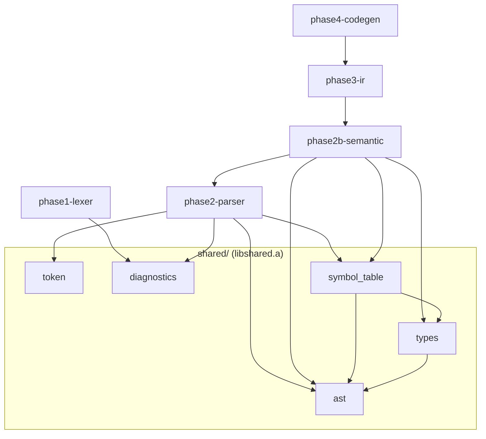

# Compiler Feature Map

Where every feature lives in the source, for navigating the code during revision. Paths are relative to the repository root. Status: ✅ implemented, 🟡 partial, ⚪ present but not on the pipeline, ❌ absent.

Companion file: [COMPILER_IMPLEMENTATION_QUESTION_BANK.md](COMPILER_IMPLEMENTATION_QUESTION_BANK.md) (detailed answers). Up to date with decision D50 (2026-11-24).

---

## 1. Feature table

### 1.1 Front end

| Feature | Status | Source files | Classes / functions | Data structures | Phase |
|---|---|---|---|---|---|
| Source reader (no preprocessor) | ✅ | `shared/diagnostics/diagnostics.cpp` | `openSource` | — | Lexical; a `#` line is a lexical error (D34) |
| Standalone tokenizer | ✅ | `phase1-lexer/src/lexer.l`, `src/logger.cpp` | Flex rules, `reportError` | — | Lexical |
| Parser's scanner | ✅ | `phase2-parser/src/scanner.l`, `src/scanner_support.cpp` | `identifierOrKeyword`, `emit` | `g_tokens` | Lexical |
| Lexer hack (typedef names) | ✅ | `scanner.l`, `shared/symbol_table/symbol_table.cpp` | `isTypeName`, `addTypeName`, `hideTypeName` | `g_typeNameScopes` | Lexical / parse |
| Token classification (Token_Type) | ✅ | `shared/token/token_type.cpp`, `phase2-parser/src/token_converter.cpp` | `lookupSymbol`, `categoryForTypeName` | parse-time table | Parse |
| Grammar | ✅ | `phase2-parser/src/parser.y` | `yyparse` (generated `build/parser.tab.cpp`) | LALR tables | Syntax |
| Precedence / associativity | ✅ | `parser.y` lines 107–136 | `%left`, `%right`, `%nonassoc`, `%precedence` | — | Syntax |
| Dangling else | ✅ | `parser.y` | `%nonassoc IFX`, `ELSE` | — | Syntax |
| Declarators (`int (*p)[3]`, references) | ✅ | `phase2-parser/src/declarators.cpp`, `include/declarators.h` | `makeTypeExpr` | `ASTTypeExpr` | Syntax |
| AST construction | ✅ | `parser.y`, `shared/ast/ast.cpp` | `mkNode`, `atToken`, `atNode` | `ASTNode`, `ASTKind` | Syntax |
| Syntax error recovery | ✅ | `parser.y` | `error ';'`, `error '}'`, `lastErrorLabel` | `ErrorNode` | Syntax |
| Parse-time symbol table | ✅ | `shared/symbol_table/symbol_table.cpp` part 1 | `pushScope`, `popScope`, `declareSymbol`, `lookupSymbol`, `lookupOverload`, `recordUsage` | `g_scopes` (vector of `unordered_map`), `g_symbolTable` (flat) | Syntax |
| Forward references | ✅ | `symbol_table.cpp`; `phase2b-semantic/src/declarations.cpp` | `queuePendingReference`, `resolvePendingReferences`; `prescan`, `hoistFunction` | pending list | Syntax / semantic |
| Name mangling | ✅ | `symbol_table.cpp` | `mangle`, `parseTimeType` | substitution table | Syntax / semantic |

### 1.2 Semantic analysis

| Feature | Status | Source files | Classes / functions | Data structures | Phase |
|---|---|---|---|---|---|
| Analyzer driver | ✅ | `phase2b-semantic/include/semantic.h`, `src/main.cpp` | `SemanticAnalyzer::analyze` | `FunctionCtx` stack | Semantic |
| Semantic symbol table | ✅ | `shared/symbol_table/symbol_table.{hpp,cpp}` part 2 | `SymbolTable::enterScope`, `exitScope`, `reenterScope`, `declare`, `lookup`, `lookupLocal`, `lookupTag` | `Scope`, `Symbol`, `scopes_`, `stack_`, `all_` | Semantic |
| Type system | ✅ | `shared/types/types.{hpp,cpp}` | `pointerTo`, `arrayOf`, `functionType`, `sameType`, `usualArithmetic`, `sizeOf`, `alignOf` | `Type`, `RecordInfo` | Semantic |
| Type resolution of declarations | ✅ | `declarations.cpp` | `resolveType`, `resolveSpecifiers`, `resolveTag`, `resolveParams` | — | Semantic |
| Variables, duplicates | ✅ | `declarations.cpp` | `variable`, `declaration` | — | Semantic |
| Functions, signatures | ✅ | `declarations.cpp` | `functionSignature`, `functionDefinition`, `functionBody`, `checkMainSignature` | `Symbol::params`, `locals` | Semantic |
| Initializers, brace elision | ✅ | `declarations.cpp` | `checkInitializer`, `elideBraces`, `takeElided`, `designatorIndex` | — | Semantic |
| Expression typing | ✅ | `expressions.cpp` | `expr`, `value`, `identifier`, `binary`, `unary`, `assignment`, `ternary`, `index`, `cast`, `sizeofExpr`, `member` | `semType` on nodes | Semantic |
| Conversions | ✅ | `expressions.cpp` | `convertible`, `argumentConversion`, `checkConstantConversion` | `ConvRank`, `Conversion` | Semantic |
| Constant folding | ✅ | `expressions.cpp` | `foldBinary` | `constValue` | Semantic |
| Calls, argument checks | ✅ | `expressions.cpp` | `call`, `checkCallArgs`, `callResult`, `builtinCall`, `varargBuiltin` | — | Semantic |
| printf/scanf format check | ✅ | `expressions.cpp` | `checkFormat` | — | Semantic |
| Statements | ✅ | `statements.cpp` | `statement`, `subStatement`, `blockItems`, `condition`, `returnStatement` | `SwitchCtx`, `breakables` | Semantic |
| Flow checks | ✅ | `statements.cpp` | `flowChecks`, `completes`, `jumpScopes`, `collectLabels` | `JumpWalk` | Semantic |
| Sequence points | ✅ | `sequencing.cpp` | `checkSequencing` | read/write sets | Semantic |
| Classes, members | ✅ | `cxx.cpp`, `declarations.cpp` | `recordDefinition`, `outOfClassDefinition`, `member`, `scopeMember` | `RecordInfo::fields`, `members` | Semantic |
| Access control, friends | ✅ | `expressions.cpp`, `cxx.cpp` | `checkAccess`, `friendFunction` | `Access`, `friendFunctions`, `friendClasses` | Semantic |
| Default constructors (D35) | ✅ | `cxx.cpp` | `construct`, `defaultConstruct`, `constructorInit`, `constructExpr`, `outOfClassSpecial` | `RecordInfo::constructors` | Semantic |
| Overloading | ✅ | `expressions.cpp` | `resolveOverload`, `anyViable`, `objectCandidates` | `Scope::names` vectors | Semantic |
| Operator overloading | ✅ | `expressions.cpp`, `cxx.cpp` | `overloadedOperator`, `checkOperatorDeclaration` | — | Semantic |
| Enums, C++ rules (D42) | ✅ | `declarations.cpp`, `expressions.cpp`, `shared/types/types.cpp` | `enumDefinition`, `enumType`, `isEnum`, `implicitConversion` (int → enum only with a cast) | `EnumInfo`, `Type::enumInfo` | Semantic |
| Removed features (D35, D47, D50) | ❌ (diagnosed) | `phase2-parser/src/scanner.l`, `declarations.cpp`, `cxx.cpp`, `expressions.cpp` | `identifierOrKeyword` (`virtual`, `explicit`, `union` → lexical error), `recordDefinition` (second base, nested classes), `construct` (parameters), slicing check in `expressions.cpp` | — | Lexical / semantic |
| Assignment-as-condition warning | ✅ | `statements.cpp` | `condition` (silenced by extra parentheses: `ASTNode::parenthesized`) | — | Semantic (D37) |
| Record layout | ✅ | `shared/types/types.cpp` | `layoutRecord` | `BaseClass::offset`, `Symbol::offset`, `RecordInfo::size` | Semantic |
| Diagnostics | ✅ | `shared/diagnostics/diagnostics.cpp`, `phase2b-semantic/src/report.cpp` | `reportDiagnostic`, `printDiagnostic`, `hasErrors` | `g_diagnostics` | All |

### 1.3 Intermediate code

| Feature | Status | Source files | Classes / functions | Data structures | Phase |
|---|---|---|---|---|---|
| TAC data model | ✅ | `phase3-ir/include/tac.h` | — | `Quad`, `Operand`, `Op`, `Cls`, `Function`, `FrameEntry`, `Global`, `Program` | IR |
| Generator driver | ✅ | `phase3-ir/include/irgen.h`, `src/gen_stmt.cpp` | `Generator::generate`, `collect`, `function`, `globals`, `globalInit` | `Program prog` | IR |
| Emit, temporaries | ✅ | `src/gen_expr.cpp` | `emit`, `newTemp`, `emitBinary`, `emitAssign`, `icon`, `fcon` | `fn->quads`, `fn->temps` | IR |
| Backpatching | ✅ | `irgen.h`, `gen_expr.cpp` | `makelist`, `merge`, `backpatch`, `nextQuad`, `emitGoto` | `List = std::vector<int>` | IR |
| Boolean expressions | ✅ | `gen_expr.cpp` | `cond`, `relJump`, `boolValue` | true/false lists | IR |
| Arithmetic expressions | ✅ | `gen_expr.cpp` | `rvalue`, `binary`, `unary`, `incDec`, `assignment`, `ternary` | — | IR |
| Conversions | ✅ | `gen_expr.cpp` | `convert`, `converted`, `convertInto`, `promoteVariadic` | `Op::Conv` | IR |
| Lvalues, arrays, pointers | ✅ | `gen_expr.cpp` | `lvalue`, `indexLValue`, `scaled`, `addOffset`, `member`, `pointerAdd`, `load`, `store`, `address` | `LValue {Direct, Indexed, Deref}` | IR |
| Statements | ✅ | `gen_stmt.cpp` | `stmt`, `block`, `innermostLoop` | `Breakable` stack, `labels`, `pendingGotos` | IR |
| Calls | ✅ | `gen_expr.cpp` | `callExpr`, `call`, `builtin`, `argumentFor`, `referenceTo` | — | IR |
| Frame table | ✅ | `gen_stmt.cpp` | `buildFrame` | `Function::frame`, `frameWidth` | IR |
| Objects: construction | ✅ | `gen_expr.cpp` | `construct`, `constructInto`, `constructSubobjects` | — | IR (no destructors, D35) |
| Base offsets | ✅ | `gen_expr.cpp` | `baseOffset` (0 with single inheritance) | — | IR |
| TAC printing | ✅ | `src/tac.cpp` | `printProgram`, `printFunction`, `quadText`, `floatText`, `signatureOf`, `classOf` | label map | IR |
| TAC interpreter | ✅ | `include/interp.h`, `src/interp.cpp` | `run`, `evalArithmetic`, `evalConvert`, `evalCompare`, `evalWrap`, `heapAlloc` | `RunResult`, `Val`, byte memory, `blocks`, `freed` (free list, D45), `DEPTH_LIMIT` (10,000 calls) | IR (testing) |
| Uninitialized warning | ✅ | `src/opt_uninitialized.cpp`, `src/main.cpp` | `uninitializedReads`, class `ReachingDefinitions` (`readsBeforeAssignment`, `solve`, `applyDefinition`), `flowGraph`, `assignedName` (`va_start` counts as a definition, D48) | `FlowBlock`, `Definition`, reaching-definition sets | IR (D38) |
| Log of the run | ✅ | `src/main.cpp` | `writeLog`, `appendRunToLog` (`--run`: program output, exit code, instruction count at the end of `logs/<file>.tac` / `.O1.tac`) | — | IR (D49) |

### 1.4 Optimizer (`phase3-ir/src/opt*.cpp`, one level: `-O1`, D49)

The optimizer is split by job, one file each, with no comments (each step is a small named function). Shared declarations: `phase3-ir/include/opt_internal.h` (namespace `tac::opt`).

| Feature | Status | File | Functions | Data structures |
|---|---|---|---|---|
| Driver, pass order | ✅ | `opt.cpp` | `optimize`, `optimizeEachFunction`, `optimizeOnce`, `renumberQuads`, `printStats` | `OptStats`, `MAX_ROUNDS` (10) |
| Operands, names, memory model | ✅ | `opt_common.cpp` | `isName`, `nameOf`, `sameName`, `constant`, `becomeCopy`, `MemoryModel::inMemory`, `addressTaken` | `Name`, `MemoryModel` (address-taken set) |
| Basic blocks | ✅ | `opt_common.cpp` | `blockLeaders`, `basicBlocks` | `BasicBlock {begin, end}` |
| Value numbering (DAG) | ✅ | `opt_numbering.cpp` | class `BlockNumbering`: `valueOfOperand`, `cheapestForm`, `reuseOrRecord`, `assignValue`, `forgetMemory`, one `number…` method per kind of quad | `Value`, `valueHeldBy`, `expressions`, `intConstants`, `floatConstants`, `memoryVersion` |
| Constant folding | ✅ | `opt_numbering.cpp` | `foldTo`, `numberArithmetic`, `numberConversion`, `branchOutcome` (use `evalArithmetic`, `evalConvert`, `evalCompare`) | — |
| Local common subexpressions, store-to-load forwarding | ✅ | `opt_numbering.cpp` | `reuseOrRecord`, `numberStore`, `numberIndexStore`, `indexedLoadKey`, `loadKey` | `ExpressionKey` |
| Copy and constant propagation (in a block) | ✅ | `opt_numbering.cpp` | `cheapestForm`, `currentHolder` | — |
| Algebraic simplification, `x * 2^k` → shift | ✅ | `opt_algebra.cpp` | `simplifyAlgebra`, `simplifyIntegerOnlyIdentity`, `simplifyAdditiveIdentity`, `simplifyMultiplication` … | — |
| Temporary merging (coalescing) | ✅ | `opt_cleanup.cpp` | `mergeTemporaries`, `isTemporaryCopiedOnward` | read/write counts |
| Dead temporaries | ✅ | `opt_cleanup.cpp` | `removeUnusedTemporaries`, `countReads`, `removeIfUnread` | `removed` flags |
| Jump clean-up, unreachable code | ✅ | `opt_cleanup.cpp` | class `JumpCleaner`: `threadJumpChains`, `invertBranchesOverJumps`, `dropJumpsToNext`, `dropUnreachable`; `dropRemoved` | worklist |
| Function inlining | ✅ | `opt_inline.cpp` | `inlineCalls`, `isInlinable` (≤ 16 quads, not recursive, not variadic), class `CallerRewriter` (`argumentsAreReady`, `expandCall`, `bindArguments`, `copyBody`) | copy of the original functions |
| Reaching definitions | ✅ (analysis only) | `opt_uninitialized.cpp` | see §1.3 | — |
| Global propagation, liveness/dead assignments, global CSE, dominators, loop unrolling, tail recursion, dead function removal | ❌ | — | removed with `-O2`/`-O3` (D49) | — |
| Loop-invariant code motion | ❌ | — | removed (D36) | — |
| Induction variables, SSA, PRE, next-use | ❌ | — | — (strength reduction of `i * 4` would gain nothing: it is already a shift) | — |

### 1.5 Back end (`phase4-codegen/`)

| Feature | Status | Source files | Functions (struct `Emitter`) | Data structures |
|---|---|---|---|---|
| Driver (also the combined driver, D40) | ✅ | `src/main.cpp`, `include/mips.h` | `mips::generate`, `Emitter::run`; `--tokens`, `--ast`, `--symbols`, `--tac`, `--run` | — |
| Static data | ✅ | `src/mips.cpp` | `globals` | `globalLabel`, start-up stream |
| Frame layout, prologue, epilogue | ✅ | `src/mips.cpp` | `function` (one slot per local and per used temporary; stack-overflow check; leaf functions skip saving `$ra` at -O1) | `varOff`, `tempOff`, `frameSize`, `STACK_FLOOR` |
| Arithmetic | ✅ | `src/mips.cpp` | `binary` (with the division-by-zero check; small constants as immediates at -O1), `unary`, `fixUnsigned` | — |
| Conversions | ✅ | `src/mips.cpp` | `convert` | constant pool `pool` |
| Branches | ✅ | `src/mips.cpp` | `branch`, `target` | — |
| Loads, stores, arrays | ✅ | `src/mips.cpp` | `use` (`$zero` for 0 at -O1), `floatUse`, `wideUse`, `loadInt`, `storeInt`, `loadFloat`, `storeFloat`, `loadWide`, `storeWide`, `element`, `mem`, `address`, `copyBytes` | — |
| Calls, `$a0`–`$a3` (MIPS convention, every level, D49) | ✅ | `src/mips.cpp` | `call`, `slot`, `loadArgumentRegisters` (caller), `saveArgumentRegisters` (callee), `isWordInteger` | `params` (pending `param` quads), `ARGUMENT_REGISTER_BYTES` (16) |
| Variadic support | ✅ | `src/mips.cpp` | `quad` (VaStart, VaArg) | `varargStart` |
| Register allocation, peephole, branch-free comparisons | ❌ | — | removed (D49): every value lives in the frame | — |
| Runtime library | ✅ | `runtime/runtime.s` | `__printf`, `__scanf`, `__malloc`, `__calloc`, `__realloc`, `__free` (free list, first fit, D45), `__memcpy`, `__div_by_zero`, `__stack_overflow`, `__divll`, `__modll`, `__udivll`, `__umodll`, `__shlll`, `__shrll`, `__sarll`, `__dtoll` | `__pf_buf`, `__sc_line`, `__sc_peek`, `__stack_limit`, `__heap_free` |
| Register descriptors / getReg / graph coloring | ❌ | — | — | — |

---

## 2. Module dependency map



Each later phase compiles the earlier phases' sources into its own binary (the `build/` folders hold copies of the generated parser), so `phase4-codegen/mips_generator` contains the whole pipeline.

---

## 3. Important call relationships

### 3.1 Driver chain (`phase3-ir/src/main.cpp`, `phase4-codegen/src/main.cpp`)

```
main
├── openSource(path)                        shared/diagnostics (no preprocessor)
├── pushScope("global"); yyparse()          phase2-parser (builds g_astRoot)
├── resolvePendingReferences()
├── SemanticAnalyzer(table).analyze(g_astRoot)
│   ├── prescan(root)
│   ├── declaration / functionDefinition / recordDefinition ...
│   └── checkSequencing(root)
├── Generator(table).generate(g_astRoot)
│   ├── collect(...) → function(n) → buildFrame(), block(body) → stmt(...) → cond/rvalue/...
│   └── globals()
├── uninitializedReads(program)             warnings
├── optimize(program)                       -O1 only
├── run(program, args, input)               --run, both versions → OPTIMIZER BUG check; appendRunToLog
└── mips::generate(program, runtime, opt)   phase 4 only
    ├── globals(startup)
    └── function(f, i) → prologue, saveArgumentRegisters, quad(q) per quad, epilogue
```

### 3.2 Expression translation

```
Generator::rvalue(n)
├── Identifier        → var(symbol) / load(lvalue)
├── BinaryExpr        → binary(n)
│                        ├── &&, ||, relational → boolValue(n) → cond(n, T, F) → relJump(n)
│                        ├── pointer ± int      → scaled(), pointerAdd()
│                        └── arithmetic         → convert(rvalue(L)), convert(rvalue(R)), emitBinary()
├── UnaryExpr         → unary(n) / incDec()
├── AssignExpr        → assignment(n) → lvalue(), store()
├── IndexExpr         → load(indexLValue(n))
├── CallExpr          → callExpr(n) → call(callee, this, args, extraArgs, wantResult)
├── TernaryExpr       → ternary(n) → cond()
└── ConstructExpr     → construct(n) → constructInto()
```

### 3.3 Statement translation

```
Generator::block(n)           backpatch(next, nextQuad()) before each statement
└── stmt(s) returns S.nextlist
    ├── IfStmt        cond → backpatch(true) → stmt(S1) → [emitGoto, backpatch(false), stmt(S2)]
    ├── While/Until   begin = nextQuad → cond → stmt(body) → backpatch(body.next ∪ continues, begin) → emitGoto(begin)
    ├── DoWhile       body → cond → backpatch(true, begin)
    ├── For           init → begin → cond → body → step → emitGoto(begin)
    ├── Switch        t = E → goto test → body → tests from Breakable::cases
    ├── Break/Continue append emitGoto() to Breakable lists
    ├── Return        value → Op::Return
    └── Goto/Label    labels map, pendingGotos patched at function end
```

### 3.4 Optimizer pass order

```
optimize(program)                                  opt.cpp
├── optimizeEachFunction                           per function, up to 10 rounds of optimizeOnce:
│     basicBlocks → numberBlock per block          opt_numbering.cpp (folding, CSE, copies, algebra)
│     → mergeTemporaries → removeUnusedTemporaries opt_cleanup.cpp
│     → cleanJumps → dropRemoved
├── inlineCalls(program)                           opt_inline.cpp (one level)
├── optimizeEachFunction                           again, on the larger bodies
└── renumberQuads
```

---

## 4. Data flow between phases

| From → To | What is passed | Type / variable | Defined in |
|---|---|---|---|
| Source file → scanner | The file as written | `FILE *` from `openSource()` assigned to `yyin` | `diagnostics.hpp` |
| Scanner → parser | Tokens with values | `int` token code + `ParserValue` | `parser_value.h` |
| Parser → semantic | AST | `ASTNodePtr g_astRoot` | `ast.hpp` |
| Parser → scanner (feedback) | Type names in scope | `isTypeName()` | `symbol_table.hpp` part 1 |
| Semantic → TAC | Annotated AST + symbol table | `semType`, `symbol`, `isLValue`, `constValue`; `sem::SymbolTable &` | `ast.hpp`, `symbol_table.hpp` part 2 |
| TAC → optimizer | Program | `tac::Program &` | `tac.h` |
| TAC → interpreter | Program, args, stdin | `run(program, args, input)` → `RunResult` | `interp.h` |
| TAC → MIPS | Program + runtime text | `mips::generate(program, runtime, optimize)` | `mips.h` |
| Optimizer ↔ interpreter | Exact machine arithmetic | `evalArithmetic`, `evalConvert`, `evalCompare`, `evalWrap` | `interp.h` |
| All → user | Diagnostics | `g_diagnostics`, `reportDiagnostic` | `diagnostics.hpp` |

---

## 5. Features implemented across multiple files

| Feature | Files involved, in pipeline order |
|---|---|
| Typedef names (lexer hack) | `symbol_table.cpp` (`addTypeName`) → `scanner.l` (`identifierOrKeyword`) → `parser.y` (`TYPE_NAME` rules) |
| Overloading | `symbol_table.cpp` (`mangle`, storage as vectors) → `expressions.cpp` (`resolveOverload`) → `gen_expr.cpp` (`call` uses `node->symbol`) → `mips.cpp` (`functionLabel` = mangled name) |
| Removed features (D35, D47, D50) | `scanner.l` (`virtual`, `explicit`, `union` → lexical error) → `parser.y` (no rules for `~T()`, `const` methods, initializer lists, `= 0`) → `declarations.cpp` / `cxx.cpp` / `expressions.cpp` (second base, constructor parameters, nested/local classes, slicing) |
| Default constructors | `parser.y` (`constructor_head`, `out_of_class_special`) → `cxx.cpp` (`construct`, `defaultConstruct`) → `gen_expr.cpp` (`constructInto`, `constructSubobjects`) → `mips.cpp` (start-up code constructs global objects) |
| Type conversions | `types.cpp` (`usualArithmetic`) → `expressions.cpp` (`convertible`) → `gen_expr.cpp` (`convert`) → `mips.cpp` (`convert`) |
| Activation records | `symbol_table.cpp` (`Symbol::params`, `locals`) → `gen_stmt.cpp` (`buildFrame`) → `mips.cpp` (`function`: `varOff`, `tempOff`, prologue/epilogue) |
| Reaching definitions | `opt_common.cpp` (`basicBlocks`) → `opt_uninitialized.cpp` (`flowGraph`, `ReachingDefinitions`) → `main.cpp` (prints `[uninitialized]`) |
| Run-time checks | `interp.cpp` (`DEPTH_LIMIT`, division) → `mips.cpp` (`bnez` before `div`, `__stack_limit` compare in prologues) → `runtime.s` (`__div_by_zero`, `__stack_overflow`) |
| Register arguments | `mips.cpp` `call` → `loadArgumentRegisters` (caller fills `$a0–$a3`) → `function` → `saveArgumentRegisters` (callee stores them into their slots) |
| printf/scanf | `scanner.l` (`PRINTF`, `SCANF` tokens) → `expressions.cpp` (`checkFormat`) → `gen_expr.cpp` (`builtin`, `promoteVariadic`) → `interp.cpp` (host C library) / `mips.cpp` (`jal __printf`) → `runtime.s` |
| Variadic functions | `parser.y` (`ELLIPSIS`, `VA_*`) → `expressions.cpp` (`varargBuiltin`) → `gen_expr.cpp` (`VaStart/VaArg/VaEnd`) → `mips.cpp` (`varargStart`) |
| Heap (free list, D45) | `interp.cpp` (`heapAlloc`, `freed`) and `runtime.s` (`__malloc`, `__free`, `__heap_free`): freed blocks are reused first fit; `calloc` clears; `realloc` keeps the block if it fits |
| Error reporting | `diagnostics.cpp` used by `lexer.l`, `scanner.l`, `parser.y`, all semantic files; `[uninitialized]` warnings from `opt_uninitialized.cpp` |

---

## 6. Incomplete or disconnected implementations

| Item | Situation |
|---|---|
| Inlining | One level only; recursion checks cover only direct self-calls; a function inlined everywhere still stays in the output (no dead function removal since D49) |
| Nested class name from outside (`Box::Lid`) | Syntax error (nested classes are rejected anyway, D35) |
| Runtime size | All 1,327 lines appended to every program, used or not |
| Heap | `free` reuses blocks (D45) but neighbouring free blocks are not merged, and the heap never shrinks |
| Parse-time `lookupOverload` | Best-effort overload hint for the Token_Type report only; real resolution is `resolveOverload` |

No source file was found that is compiled but never called from a pipeline (⚪).

---

## 7. Entry points for reading the code

Read in this order to understand the compiler in about two hours:

| # | File | What to look at | Why |
|---|---|---|---|
| 1 | `phase3-ir/src/main.cpp` | `main` | The whole pipeline in about 200 lines |
| 2 | `phase2-parser/src/parser.y` | lines 75–133, then `selection_stmt`, `binary_expr` | Tokens, precedence, how nodes are built |
| 3 | `shared/ast/ast.hpp` | `ASTKind`, `ASTNode` | What every later phase walks |
| 4 | `shared/symbol_table/symbol_table.hpp` | part 2: `Symbol`, `Scope`, `SymbolTable` | The semantic table |
| 5 | `shared/types/types.hpp` | `Type`, `RecordInfo`, `ConvRank` | Types and classes |
| 6 | `phase2b-semantic/include/semantic.h` | the class declaration | Map of every semantic check |
| 7 | `phase3-ir/include/tac.h` | `Quad`, `Operand`, `Op` | The IR |
| 8 | `phase3-ir/include/irgen.h` | helpers and attribute mapping | SDT ↔ code |
| 9 | `phase3-ir/src/gen_expr.cpp` | `binary`, `relJump`, `cond`, `boolValue`, `call`, `indexLValue` | Expressions and backpatching |
| 10 | `phase3-ir/src/gen_stmt.cpp` | `block`, `stmt`, `buildFrame` | Statements, frames |
| 11 | `phase3-ir/include/opt_internal.h`, then `src/opt.cpp`, `opt_numbering.cpp`, `opt_cleanup.cpp`, `opt_inline.cpp` | `optimize`, `BlockNumbering`, `JumpCleaner`, `CallerRewriter` | Optimizer |
| 12 | `phase4-codegen/include/mips.h` then `src/mips.cpp` | `function`, `call`, `loadArgumentRegisters`, `saveArgumentRegisters`, `binary` | Back end |
| 13 | `phase4-codegen/runtime/runtime.s` | `__printf`, `__scanf` | Runtime |
| 14 | `docs/DESIGN_LOG.md` | D10, D25, D31, D35, D42, D45, D49, D50 | Why things are the way they are |
