# C-Like Compiler

A **multi-pass compiler** for a C-like language with a small C++
subset, written in C++17 with Flex and Bison. It translates a source
file into Three Address Code, optimizes it, and generates MIPS assembly
that runs on SPIM / QtSpim.

| | |
|---|---|
| Source language | A C core plus a small C++ subset: classes with single inheritance, virtual functions (run-time overriding, abstract classes) and default constructors, access control, `friend`, references, function and operator overloading, `enum` (C++ rules) and plain unions — see the [feature audit](docs/FEATURES.md) |
| Intermediate representation | Three Address Code as quadruples, with an interpreter and a three-level optimizer ([`phase3-ir`](phase3-ir/README.md)) |
| Target | MIPS32 assembly for SPIM / QtSpim, with a hand-written run-time library ([`phase4-codegen`](phase4-codegen/README.md)) |
| Implementation | C++17, Flex 2.6.4, Bison 3.8.2 (LALR(1), 0 conflicts), g++ 13 |
| Specification | [`docs/project_description.md`](docs/project_description.md) |
| Status | Every phase is implemented and tested end to end; every test program's output is checked against gcc / g++ |

## Contents

1. [A multi-pass compiler](#a-multi-pass-compiler)
2. [The passes in detail](#the-passes-in-detail)
3. [Executables](#executables)
4. [The language](#the-language)
5. [Building](#building)
6. [Running](#running)
7. [Testing](#testing)
8. [Documentation](#documentation)
9. [Known limitations](#known-limitations)
10. [Future work](#future-work)

---

## A multi-pass compiler

A *pass* is one complete trip over the whole program, or over one
complete representation of it. This compiler makes a pass per phase,
and each pass reads the finished result of the one before it:



*(Interactive source: [`docs/diagrams/compiler-architecture.html`](docs/diagrams/compiler-architecture.html).)*

| Pass | Reads | Produces | Code |
|---|---|---|---|
| 1. Scan + parse | the source file (read as written: there is no preprocessor) | the syntax tree (`g_astRoot`), a parse-time symbol table, the Token / Token_Type table | `phase2-parser/src/scanner.l`, `parser.y` |
| 2. Semantic analysis | the whole syntax tree | the same tree annotated with types, lvalue-ness, constant values and the symbol each name means; the persistent symbol table; record layouts | `phase2b-semantic/src/*.cpp` |
| 3. TAC generation | the annotated tree | quadruples, one array per function, with frame tables | `phase3-ir/src/gen_*.cpp` |
| 4. Flow analysis | the unoptimized TAC | uninitialized-variable warnings (reaching definitions) | `phase3-ir/src/opt.cpp` |
| 5. Optimization (`-O1`…`-O3`) | the TAC | shorter TAC that behaves the same | `phase3-ir/src/opt.cpp` |
| 6. Code generation | the (optimized) TAC | MIPS assembly plus the run-time library | `phase4-codegen/src/mips.cpp`, `runtime/runtime.s` |

The passes communicate only through these data structures:

```
source.c
  │  pass 1   yylex() ⇄ yyparse()                         scanner.l + parser.y
  ▼
syntax tree (g_astRoot)  +  parse-time symbol table
  │  pass 2   SemanticAnalyzer::analyze()                 phase2b-semantic
  ▼
annotated syntax tree  +  sem::SymbolTable  +  record layouts
  │  pass 3   Generator::generate()                       phase3-ir
  ▼
tac::Program (quadruples per function, globals, strings) ──► TAC interpreter (--run)
  │  pass 4   uninitializedReads()      pass 5   optimize(-O1/-O2/-O3)
  ▼
optimized tac::Program
  │  pass 6   mips::generate()                            phase4-codegen
  ▼
file.s  ──►  spim -file file.s
```

### Why multi-pass and not one pass

The lecture slides generate TAC inside the parser's actions, while each
rule is reduced. That only works if every fact a rule needs is known at
that moment, and in this language it is not (decision D10 in
[`docs/DESIGN_LOG.md`](docs/DESIGN_LOG.md)):

- **Forward references.** A function may be called before it is
  declared, so its parameter types, and which overload a call picks,
  are known only after the rest of the file has been seen.
- **Classes.** A method body may use members declared below it, so
  bodies can only be checked once the class is complete.
- **Types drive the code.** TAC needs each expression's type (`int+` or
  `double+`, which conversions to insert) and every field's offset;
  those come from the semantic pass.
- **Optimization needs whole functions.** Basic blocks, the flow graph
  and every data-flow analysis need a function's complete code.
- **Testability.** Each pass has its own output and its own test suite,
  so a failing test points at the pass that broke.

### What is still done in a single walk

- **Scanning and parsing are one pass.** The parser calls `yylex()`
  whenever it needs the next token; there is no separate token stream.
- **TAC generation is one walk per function.** Jumps to code that does
  not exist yet are filled in by **backpatching** (truelist, falselist,
  nextlist), so no second pass over the code is needed to fix targets.

How the syntax-directed translation of Lectures 25–27 maps onto these
passes, construct by construct, with flowcharts and real TAC, is in
[`docs/TRANSLATION.md`](docs/TRANSLATION.md).

---

## The passes in detail

Some passes are made of smaller passes of their own:

| Pass | Inside it |
|---|---|
| 1. Scan + parse | The scanner classifies each identifier as a variable or a type name from the parse-time symbol table (the "lexer hack"), so the grammar stays LALR(1). Syntax errors are recovered with `error` productions, so every error in the file is reported. |
| 2. Semantic analysis | **(a)** `prescan()` records every top-level function and variable, so calls before a declaration resolve. **(b)** One walk in source order declares, type-checks and annotates (an L-attributed definition: declarations push types down, expressions synthesize them up); class member bodies are checked after their class. **(c)** `checkSequencing()` walks the tree again for unsequenced side effects (`i = i++`). |
| 3. TAC generation | `collect()` gathers every function (including methods and out-of-class definitions), then each function is translated in one walk with backpatching, and its frame table is laid out (`buildFrame()`). A polymorphic class gets a vtable (`_ZTV<class>`), and a virtual call becomes an indirect `call *t`. |
| 4. Flow analysis | Basic blocks, the flow graph and reaching definitions over the unoptimized code; a read reached by the "not assigned yet" definition is warned about. |
| 5. Optimization | `-O1`: value numbering per basic block (constant folding, algebraic identities, common subexpressions, copies, dead temporaries, jump clean-up), repeated until nothing changes. `-O2`: adds global constant/copy propagation and dead-assignment elimination (liveness). `-O3`: adds inlining, tail recursion, global common subexpressions (available expressions), loop unrolling by two (dominators), then removes functions no call reaches. |
| 6. Code generation | Per function: lay out the frame, allocate registers (use counts and live intervals; `-O1` and above), lay out the frame again for what stays in memory, emit one fixed sequence per TAC instruction, run the peephole pass. Then the start-up code and the run-time library are added. |

The **TAC interpreter** (`--run`) executes the output of pass 3 or 5
with the MIPS32 data model. With an `-O` flag it runs the program both
unoptimized and optimized and reports `OPTIMIZER BUG` if they differ.

---

## Executables

Each phase is its own executable, and each one runs all the passes
before its own, so every tool takes a source file directly. They share
one static library, `shared/build/libshared.a` (vocabulary,
diagnostics, syntax tree, type system, symbol tables).

| Executable | Runs passes | Prints on success | On failure |
|---|---|---|---|
| `phase1-lexer/lexer` | a standalone lexer | the Lexeme / Token table | every lexical error with line and column |
| `phase2-parser/syntax_analyzer` | 1 | Token / Token_Type table, syntax tree, parse-time symbol table | every syntax error (gcc style, with a caret) and a partial tree |
| `phase2b-semantic/semantic_analyzer` | 1–2 | annotated tree, semantic symbol table, record and enum layouts | every semantic error and warning |
| `phase3-ir/tac_generator` | 1–5 | the TAC of every function with its frame table; `--run` executes it | the errors of the earlier passes; no code |
| `phase4-codegen/mips_generator` | 1–6 | MIPS assembly; with `--tokens`, `--ast`, `--symbols`, `--tac` or `--run` it stops at that pass instead (the combined driver) | the errors of the earlier passes; no code |

Every tool also writes its report to `logs/` in the current directory.

### Repository layout



```
.
├── README.md                 this file
├── docs/
│   ├── project_description.md    the project specification
│   ├── TRANSLATION.md            the passes, the SDT rules, flowcharts and real TAC
│   ├── FEATURES.md               feature audit: matrix with test evidence
│   ├── FEATURE_CONNECTIVITY.md   how the features depend on each other; change impact
│   ├── DESIGN_LOG.md             every design decision (D1–D45) with its reason
│   ├── SYMBOL_TABLE.md           both symbol tables in detail
│   ├── ADVANCED_COMPILER_FEATURE_ANALYSIS.md   historical analysis (before D34)
│   ├── examples/                 example programs used in the docs
│   └── diagrams/                 architecture diagrams (HTML + SVG)
├── shared/                   libshared.a
├── phase1-lexer/             standalone flex lexer
├── phase2-parser/            pass 1: flex scanner + bison LALR(1) parser
├── phase2b-semantic/         pass 2: semantic analyzer
├── phase3-ir/                passes 3–5: TAC generator, flow analysis, optimizer, interpreter
└── phase4-codegen/           pass 6: MIPS generator, run-time library
```

---

## The language

### Features

Everything below is implemented and tested in every phase, down to MIPS.
The full matrix with the test that covers each row is in
[`docs/FEATURES.md`](docs/FEATURES.md).

| Area | Features |
|---|---|
| Operators | arithmetic, logical (short-circuit), relational, bitwise, assignment and compound assignment, unary, `?:`, comma, `sizeof`, C-style and functional casts |
| Control flow | if / else, for, while, do-while, `until`, switch / case / default, goto and labels, break, continue |
| Types | `int`, `char`, `short`, `long`, `long long`, `float`, `double`, `bool`, `void`, signed / unsigned; arrays of any dimension; pointers and pointer arithmetic; structures (named, unnamed, anonymous members); plain unions; `enum` with C++ rules; `typedef`; references; `const`; `auto` |
| Functions | recursion, prototypes, calls before the declaration, variable arguments (`...`, `va_*`), `main(argc, argv)` |
| Built-ins | `printf`, `scanf` (format strings checked like gcc), `malloc`, `calloc`, `realloc`, `free` (freed memory is reused through a free list) |
| Storage | locals, globals, `static` locals and members |
| C++ subset | classes, objects and `this`; single inheritance with access control; **virtual functions** (run-time overriding through a vtable, pure virtual functions, abstract classes); `public` / `protected` / `private`; `friend`; default constructors; static members; function and operator overloading with Itanium name mangling |
| Checks | gcc-style errors and warnings: types, scopes, overload ambiguity, missing returns, unreachable code, jumps over initializations, unsequenced side effects, constant overflow, format mismatches, assignment used as a condition, possibly uninitialized variables |
| Run time | division by zero and too-deep recursion stop with a message (exit code 2) on SPIM and in the interpreter |

All the specification's basic features (operators, if-else, loops,
switch, int and char arrays, pointers, structures, printf / scanf,
calls with arguments, goto / break / continue, `static`) and advanced
features (variable arguments, dynamic memory, command-line input,
typedef, references, `until`, multi-level pointers, multi-dimensional
arrays) are covered.

### Virtual functions (run-time overriding)

Calls to a virtual function through a pointer or a reference are bound
**at run time**, from the object's real class (decision D44):

```cpp
class Shape {
public:
    virtual int area() = 0;              /* pure virtual: Shape is abstract */
    virtual int sides() { return 0; }
};
class Rect : public Shape {
public:
    int w, h;
    Rect() { w = 2; h = 3; }
    int area() { return w * h; }         /* overrides, with or without `virtual` */
    int sides() { return 4; }
};
class Square : public Rect {
public:
    Square() { w = 4; h = 4; }
    int area() { return w * w; }         /* overrides again; sides() is inherited */
};
int describe(Shape *s) { return s->area() * 10 + s->sides(); }
int main() {
    Rect r;
    Square q;
    Shape *all[2];
    all[0] = &r;
    all[1] = &q;
    printf("%d %d %d\n", describe(all[0]), describe(all[1]), q.Rect::area());
    return 0;
}
```

Output, the same from g++, the TAC interpreter and SPIM at every `-O`
level: `64 164 16`. The same `describe()` call runs `Rect::area` for `r`
and `Square::area` for `q`; `q.Rect::area()` names a class, so it is an
ordinary direct call.

**The rules** (C++):

| Rule | What happens |
|---|---|
| Overriding | Mark a function `virtual` once in a base class. A function in a derived class with the same name and parameters overrides it, with or without `virtual`, and must return the same type |
| Pure virtual, abstract | `virtual int area() = 0;` is pure. A class with a pure function not overridden is **abstract**: no variables, members, arrays, by-value parameters or results, or `T()` of it; pointers and references are fine |
| Which calls dispatch | A call through a pointer (`p->f()`), a reference (`r.f()`), `*p` or the implicit `this` inside a method is dispatched at run time; a call on a named object (`obj.f()`) or with a class name (`p->Base::f()`) is direct |
| During construction | A virtual call made while a base constructor runs reaches the base's version |
| Copies | A copy that creates an object (`Rect c = *p;`, a by-value parameter, a returned value) is exactly its declared class; an assignment (`*p = other;`) copies the members and keeps the object's own class |
| Operators | A virtual `operator` called on `*p` or a reference dispatches too |
| Not supported | `override` / `final`, covariant return types, RTTI, multiple and virtual inheritance |

**How each pass handles it:**

| Pass | What it does | Code |
|---|---|---|
| 1. Parse | `virtual` is a declaration specifier; `= 0` after a virtual function makes it pure | `parser.y`, `declarators.cpp` |
| 2. Semantic | When a class is complete, `virtualFunctions()` copies the base's table, lets matching functions take over their slots, appends new virtual functions, and marks the class abstract if a pure slot is left. `layoutRecord()` puts the **vtable pointer** right after the base part of the first class with virtual functions (here at `+0` of `Shape`), so a base still starts at offset 0 of a derived object | `declarations.cpp`, `types.cpp` |
| 3. TAC | One global table per class (`_ZTV<class>`), each slot a function address. Constructors store the table's address after building the base. A virtual call loads the table pointer, then the slot, and calls through it: `call *t` | `gen_expr.cpp` |
| 5. Optimizer | Functions named in a table count as used, so `-O3` never removes them; only direct calls are inlined | `opt.cpp` |
| 6. MIPS | `jalr` on the loaded address; the start-up code fills each table with the function labels | `mips.cpp` |

The semantic analyzer prints each class's slots:

```
class Shape: size 4, align 4
    +0  vtable pointer
    slot 0: Shape::area  (pure)
    slot 1: Shape::sides
    (abstract)
class Square: size 12, align 4
    (base Rect, public)
    slot 0: Square::area
    slot 1: Rect::sides
```

The tables and the dispatch in TAC:

```
   _ZTV4Rect        unsigned int[2]                 8  { +0: &Rect::area(), +4: &Rect::sides() }
   _ZTV6Square      unsigned int[2]                 8  { +0: &Square::area(), +4: &Rect::sides() }

 FUNCTION Rect::Rect()
    101     t1 = &_ZTV5Shape           <- the base part is a Shape first
    102     *this = t1
    103     t2 = &_ZTV4Rect            <- then a Rect
    104     *this = t2

 FUNCTION describe(class Shape *)
    132     t1 = *s                    <- the table pointer
    133     t2 = *t1                   <- slot 0: area
    134     param s                             (this)
    135     t3 = call *t2, 1                    (virtual Shape::area())
```

and in MIPS (`-O1`):

```asm
        lw    $s1, 0($s0)       # t1 = *s: the table pointer
        lw    $s2, 0($s1)       # t2 = *t1: slot 0
        addiu $sp, $sp, -16
        move  $a0, $s0          # this
        jalr  $s2               # call through the address
```

The full test is `phase3-ir/test/t37_virtual.c` (run on the interpreter
and SPIM at every level); the design is decision D44 in
[`docs/DESIGN_LOG.md`](docs/DESIGN_LOG.md).

### Not supported

| Rejected | Examples | Why |
|---|---|---|
| Removed on purpose | the preprocessor (`#include`, `#define`), `extern`, file I/O (`FILE`, `fopen` …), lambdas, function pointers, `new` / `delete`, `register`, `volatile`, `long double`; from C++: destructors, constructors with parameters, initializer lists, copy and converting constructors, `const` member functions, multiple inheritance, object slicing, nested and local classes, anonymous unions, `enum class`; loop-invariant code motion | decisions D1–D6, D31, D34–D36, D43 in [`docs/DESIGN_LOG.md`](docs/DESIGN_LOG.md) |
| Never implemented | bit-fields, default arguments, templates, namespaces, `using`, exceptions, `inline`, `override` / `final`, compound literals, nested functions, wide characters | out of scope |

`printf`, `scanf`, `malloc` and the other built-ins are part of the
language, so programs need no `#include`; any line starting with `#` is
a lexical error. `explicit` is still a reserved word, only so that its
error message can name it.

### Language history

| Date | Decisions | Change |
|---|---|---|
| 2026-10-07 | D1–D6 | `enum`, `union`, file I/O, lambdas and function pointers removed before the back end was written |
| 2026-10-10 | D31 | `new` / `delete`, `register`, `volatile`, `long double` removed |
| 2026-10-15 | D32 | the last partial features finished |
| 2026-11-21 | D34–D36 | preprocessor removed; the C++ subset reduced to default constructors and single inheritance; loop-invariant code motion removed |
| 2026-11-21 | D37–D41 | run-time checks and the assignment warning; more algebraic rules, loop unrolling, dead function removal, reaching definitions; register arguments and frame slot reclamation; the combined driver; an audit |
| 2026-11-23 | D42 | `enum` (C++ rules: its own type, converts to `int`, an `int` needs a cast to become one) and plain unions brought back |
| 2026-11-23 | D43 | `extern` removed |
| 2026-11-24 | D44 | virtual functions brought back: run-time overriding (C++ rule: a matching function in a derived class overrides), pure virtual functions, abstract classes |
| 2026-11-24 | D45 | a free list: `free` hands blocks back and `malloc` reuses them |

---

## Building

Requirements: `g++` with C++17, `flex`, `bison`, `make` (verified with
g++ 13.3, flex 2.6.4, bison 3.8.2 on Ubuntu 24.04). Running the
generated MIPS needs `spim` (`sudo apt install spim`) or QtSpim.

```bash
for p in phase1-lexer phase2-parser phase2b-semantic phase3-ir phase4-codegen; do make -C $p; done
```

Each phase's `makefile` builds `shared/build/libshared.a` first if
needed. `make clean` in a phase removes its own build; `make -C shared clean`
removes the library.

---

## Running

The example program [`docs/examples/add.c`](docs/examples/add.c) is used
throughout.

Front end (passes 1 and 2):

```bash
./phase2-parser/syntax_analyzer docs/examples/add.c
```

```bash
./phase2b-semantic/semantic_analyzer docs/examples/add.c
```

`semantic_analyzer -q file.c` prints only the verdict and the
diagnostics. The exit status is 0 on success (warnings allowed) and 1 on
any error.

Three Address Code (passes 3–5): print it, or execute it in the
interpreter:

```bash
./phase3-ir/tac_generator docs/examples/add.c
```

```bash
./phase3-ir/tac_generator -O2 --run -q docs/examples/add.c
```

```
[exit code 9, 8 instructions executed; 11 without -O2: 27% fewer]
```

MIPS (all six passes): generate the assembly and run it in SPIM:

```bash
./phase4-codegen/mips_generator -O2 docs/examples/add.c > add.s
```

```bash
spim -file add.s
```

Any pass from one command (the combined driver):

```bash
./phase4-codegen/mips_generator --tac docs/examples/add.c
```

```bash
./phase4-codegen/mips_generator -O2 --run docs/examples/add.c
```

| Flag | Tool | Meaning |
|---|---|---|
| `-O1` | both | value numbering in each basic block |
| `-O2` | both | `-O1` plus constants and copies across blocks and dead assignments |
| `-O3` | both | `-O2` plus inlining, tail recursion, global common subexpressions, loop unrolling by two, dead function removal |
| `--run`, `-q` | `tac_generator` | execute the code; `-q` prints only what the program prints |
| `--stack-only` | `mips_generator` | with an `-O` flag, still keep every value in the frame and every argument on the stack |
| `--tokens`, `--ast`, `--symbols`, `--tac`, `--run` | `mips_generator` | stop after that pass and print its result instead of the assembly |

Without an `-O` flag the MIPS code is a direct translation: every value
lives in the stack frame and every argument is passed on the stack. With
one, the most used names live in `$s0`–`$s7` / `$f20`–`$f30`, the first
16 bytes of arguments to user functions travel in `$a0`–`$a3`, small
constants go into the instructions, and a peephole pass runs.

A program with errors stops at the pass that finds them:

```c
int main() {
    int x = 1;
    int x = 2;
    return y;
}
```

```
Semantic analysis failed: 2 error(s), 0 warning(s) in 'bad.c'.

bad.c:3:9: semantic error: duplicate declaration of 'x' in the same scope (previous declaration at line 2) [redeclaration]
 3 |     int x = 2;
   |         ^

bad.c:4:12: semantic error: undeclared identifier 'y' [undeclared]
 4 |     return y;
   |            ^
```

---

## Testing

One suite per pass:

| Suite | Command | Contents |
|---|---|---|
| Lexer | `cd phase1-lexer && ./run.sh` | 8 programs; `test6_lexical_errors.c` must report 11 errors and 1 warning, each with its line and column |
| Pass 1 (parser) | `cd phase2-parser && ./run.sh` | 37 programs: 24 valid, 13 with deliberate syntax errors |
| Pass 2 (semantic, self-checking) | `cd phase2b-semantic && ./run_tests.sh` | 28 valid + 25 invalid programs with the expected diagnostics written inline (`// error: …`, `// warning: …`, `// mangled: …`), plus the 37 parser programs end to end — **90 checks, all passing** |
| Passes 3–5 (TAC, self-checking) | `cd phase3-ir && ./run_tests.sh` | 35 programs executed by the TAC interpreter, raw and at `-O1`, `-O2`, `-O3`; output and exit code must equal `test/expected/*.out` (verified against gcc / g++); plus the uninitialized-variable warnings — **36 checks, all passing** |
| Pass 6 (MIPS on SPIM, self-checking) | `cd phase4-codegen && ./run_tests.sh` | the same 35 programs compiled to MIPS at every level and run in SPIM against the same outputs — **35 checks, all passing** |

The `run.sh` scripts print each program's output for inspection; the
`run_tests.sh` scripts check results automatically, and any missing
**or** unexpected diagnostic, or any difference in output or exit code,
fails the test.

---

## Documentation

| Topic | Document |
|---|---|
| The passes and the syntax-directed translation | [`docs/TRANSLATION.md`](docs/TRANSLATION.md) |
| Shared library (vocabulary, diagnostics, syntax tree, types, symbol tables) | [`shared/README.md`](shared/README.md) |
| Standalone lexer | [`phase1-lexer/README.md`](phase1-lexer/README.md) |
| Pass 1: scanner and parser | [`phase2-parser/README.md`](phase2-parser/README.md) · grammar walkthrough [`phase2-parser/docs/GRAMMAR_DESIGN.md`](phase2-parser/docs/GRAMMAR_DESIGN.md) |
| Pass 2: semantic analysis | [`phase2b-semantic/README.md`](phase2b-semantic/README.md) |
| Passes 3–5: TAC, flow analysis, optimizer, interpreter | [`phase3-ir/README.md`](phase3-ir/README.md) |
| Pass 6: MIPS generation and the run-time library | [`phase4-codegen/README.md`](phase4-codegen/README.md) |
| Symbol tables | [`docs/SYMBOL_TABLE.md`](docs/SYMBOL_TABLE.md) |
| Feature matrix and test evidence | [`docs/FEATURES.md`](docs/FEATURES.md) |
| Feature connectivity and change impact | [`docs/FEATURE_CONNECTIVITY.md`](docs/FEATURE_CONNECTIVITY.md) |
| Design decisions D1–D45 | [`docs/DESIGN_LOG.md`](docs/DESIGN_LOG.md) |

Each phase folder also keeps its development history in
`docs/DEVELOPMENT_NOTES.md` (not maintained; may be outdated).

---

## Known limitations

- Recursion depth: SPIM's default stack (256 KB in practice) holds about
  8,000 frames of 32 bytes; the TAC interpreter stops at 10,000 calls.
  Both report `stack overflow (recursion too deep)`.
- Calls into the run-time library (`printf`, `scanf`, `malloc` …)
  always pass their arguments on the stack.
- An object made with `malloc` runs no constructor, so a class with
  virtual functions gets no vtable pointer that way: use it only for
  plain data, or construct objects as variables.
- The heap reuses freed blocks whole (first fit, no splitting or
  merging of neighbours), so many small blocks freed cannot serve one
  large request; and the whole run-time library is appended to every
  program.
- One source file per compilation: there is no linker for SPIM.

## Future work

What a next version could add, in order of value:

1. **Induction-variable strength reduction** (`i * 4` in a loop becomes
   an addition), and unrolling by more than two when the trip count is
   known.
2. **Register arguments for the run-time library**, so `printf` and
   `scanf` calls also skip the stack.
3. **Splitting and coalescing heap blocks**, so a freed large block can
   serve several small requests and neighbouring free blocks merge.
