# Advanced Compiler Feature Analysis

A feature-selection blueprint for this compiler, based on an audit of the code at commit `4d17807` on `main` (2026-10-31). It lists what truly works, what could be added, what each addition involves, and which pieces belong together. **This document changes nothing:** no compiler, grammar or test file was modified to write it.

> **How to use it.** Find a feature in [section 5](#-5-detailed-internal-feature-decomposition), read its graph in [section 7](#-7-mermaid-connectivity-graphs), then mark your choices in the [final checklist](#-14-final-feature-selection-checklist). Each feature has the same three-letter prefix everywhere (`CLS`, `INH`, `FPT` and so on), so you can delete one by removing its blocks without touching the rest.

**Status marks:** ✓ implemented · ◐ partially implemented · ○ not implemented

**How status was decided:** by running code, not by reading the README. A feature counts as implemented only if it reaches working TAC and MIPS, or if it is a front-end-only feature that demonstrably works. The probes are listed in [Appendix A](#-appendix-a-probe-evidence).

---

## 📋 1. Executive summary

- **The compiler is further along than a typical course project.** All of the specification's features work from source to MIPS, plus classes, multiple inheritance, virtual functions, overloading, an optimizer at three levels and register allocation.
- **Verified baseline.** A clean export of the commit passes all suites: semantic 87/87, TAC 35/35, SPIM 34/34 at four optimization levels.
- **Inventory.** 15 advanced features split into 163 internal features: 77 implemented, 13 partial, 73 not implemented.
- **The audit found three bugs that need fixing whichever features you choose:**
  1. A virtual `operator+` called through a reference runs the base version. We print 1; g++ prints 2 ([INH-14](#inh-14)).
  2. An ambiguous diamond member `d.x` is accepted; g++ rejects it ([INH-15](#inh-15)).
  3. Very deep recursion crashes the interpreter with a segmentation fault ([SAF-14](#saf-14)).
- **Some valid programs are rejected:** `void f() {};` inside a class ([CLS-18](#cls-18)) and `d = 4;` through a converting constructor ([OVL-07](#ovl-07)).
- **The two back ends disagree on one point.** On division by zero the interpreter stops with an error, while our SPIM run printed no diagnostic ([SAF-10](#saf-10)).
- **Best value next:** the small fixes above, then cheap warnings, interpreter memory checks, a real `free`, more `simplify()` rules, a call graph, and induction-variable strength reduction.
- **Not worth it here:** templates, exceptions, garbage collection, virtual inheritance, instruction scheduling. Each one needs infrastructure nothing else uses, or cannot show a benefit on SPIM.
- **Three features need your decision first:** enums, unions and function pointers were removed on purpose (D1–D6), and `new`/`delete` too (D31). Adding them reverses those decisions. Function pointers are now far cheaper than when they were dropped, because virtual calls built the back-end half.

Effort figures are **estimates** for one person who knows this code, not measurements.

---

## 🏗️ 2. Existing compiler architecture

A multi-pass compiler: each phase is its own executable, and all share `shared/build/libshared.a`. The full explanation of the translation is in [`TRANSLATION.md`](TRANSLATION.md).

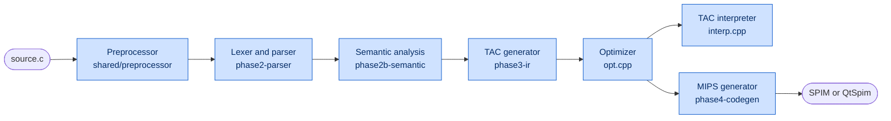

| Part | Main files | Lines | Data it produces |
|---|---|---:|---|
| Tokens | `shared/token/token_type.*` | 458 | 102 token types, shared by both scanners |
| Standalone lexer | `phase1-lexer/src/lexer.l` | — | token table, columns |
| Parser | `phase2-parser/src/parser.y`, `scanner.l` | 1,492 | AST; LALR(1), `%expect 0`, no conflicts |
| AST | `shared/ast/ast.hpp` | 255 | `ASTNode` with `typeExpr`, `semType`, `symbol`, `converter` |
| Symbol tables | `shared/symbol_table/*` | 1,345 | parse-time stack; semantic scope tree; mangling |
| Types | `shared/types/*` | 748 | structural `Type`, `RecordInfo`, layout, conversions |
| Semantic analysis | `phase2b-semantic/src/*.cpp` | 4,497 | annotated AST, diagnostics |
| TAC generator | `gen_expr.cpp`, `gen_stmt.cpp`, `tac.cpp` | 2,738 | `Program` of `Quad` arrays (27 opcodes) |
| Optimizer | `opt.cpp` | 1,225 | better TAC; statistics |
| Interpreter | `interp.cpp` | 730 | program behaviour, instruction counts |
| MIPS | `mips.cpp`, `runtime.s` | 2,254 | `.s` for SPIM |

**Design facts that decide what is easy here:**

- TAC is generated in a walk over the annotated AST, not in parser actions (D10). So a feature never has to fit into a single pass.
- `Quad` has spare generality: `Call` already supports an indirect target.
- Semantic results are stored on AST nodes. That is simple, but it means one tree cannot be analysed twice, which is why templates are hard.
- All analyses live in the private `FunctionPass` class in `opt.cpp`, so `phase4-codegen` cannot reuse them directly.
- Arguments always go on the stack (D25). This simplifies calls and varargs, but it makes general tail calls harder.
- Compilation covers one source file; `.s` output includes the run-time library.

---

## 🔍 3. Current implementation audit

Counts come from the [checklist](#-14-final-feature-selection-checklist) data.

| Advanced feature | Prefix | ✓ | ◐ | ○ | Verdict |
|---|---|---:|---:|---:|---|
| Classes and objects | `CLS` | 17 | 1 | 3 | Works, with gaps |
| Inheritance and polymorphism | `INH` | 11 | 4 | 4 | Works, with gaps |
| Overloading and user conversions | `OVL` | 6 | 0 | 3 | Works, with gaps |
| Enumerations | `ENM` | 0 | 0 | 5 | Not present |
| Unions | `UNI` | 0 | 0 | 6 | Not present |
| Function pointers | `FPT` | 0 | 0 | 5 | Not present |
| Generic types (templates) | `GEN` | 0 | 0 | 6 | Not present |
| Type system | `TYP` | 9 | 0 | 4 | Works, with gaps |
| Memory management | `MEM` | 3 | 0 | 4 | Works, with gaps |
| Memory-safety and static checks | `SAF` | 5 | 3 | 8 | Works, with gaps |
| Control flow | `CTL` | 5 | 0 | 1 | Works, with gaps |
| Exception handling | `EXC` | 0 | 0 | 6 | Not present |
| TAC optimizations | `OPT` | 9 | 1 | 6 | Works, with gaps |
| MIPS back end | `BCK` | 5 | 1 | 5 | Works, with gaps |
| Compiler infrastructure | `INF` | 7 | 3 | 7 | Works, with gaps |

### Tracing the whole pipeline

Having syntax is not the same as having a feature. These are the cases where a feature looks more finished than it is.

| Looks done | What is actually true | Evidence |
|---|---|---|
| `virtual ~T()` | Parsed and checked, never dispatched; no `delete` exists | INH-13 |
| Virtual functions | Correct for named calls, not for operators | probe `vop` |
| Interfaces | An idiom of pure virtual functions, no language feature | probe `ifaceonly` |
| `free` | A no-op in `runtime.s:88` and the interpreter | MEM-04 |
| Strength reduction | Only multiplication by a power of two; none for loops | OPT-09, OPT-11 |
| Inlining | One level, and recursion checks only cover direct self-calls | `inlineCalls()` |
| Reaching definitions | Constant and copy facts only | INF-04 |
| Peephole optimization | Three patterns on text lines | `peephole()` |
| Debug information | A line number on each quad, nothing emitted | INF-15 |
| Pass manager | Fixed loops | INF-11 |

### Documentation drift found

The audit also found statements that are now out of date. They were left alone, because this task may only create this file.

| File | Statement | Reality |
|---|---|---|
| `phase4-codegen/README.md:174` | `__printf` format list | Omits `%e %E %g %G`, added in D33 |
| `phase3-ir/README.md`, Limitations | A `goto` into a block past a constructor is not diagnosed | It is now an error (probe `gotoctor`) |
| `phase3-ir/README.md`, Limitations | Symbol table lists unused temporaries | Listings hide them; the frame slots remain (BCK-09) |

---

## 📚 4. Advanced feature catalog

Features considered and how each was filtered.

| Feature | In the document | Reason |
|---|---|---|
| [Classes and objects](#cls-classes-and-objects) | `CLS` | Exists; small gaps |
| [Inheritance and polymorphism](#inh-inheritance-and-polymorphism) | `INH` | Exists; two bugs and some extensions |
| [Overloading and user conversions](#ovl-overloading-and-user-conversions) | `OVL` | Exists; small gaps |
| [Enumerations](#enm-enumerations) | `ENM` | Cheap; reverses a decision |
| [Unions](#uni-unions) | `UNI` | Cheap to parse; optimizer risk |
| [Function pointers](#fpt-function-pointers) | `FPT` | Back-end half now exists |
| [Generic types (templates)](#gen-generic-types-templates) | `GEN` | Listed for completeness; advised against |
| [Type system](#typ-type-system) | `TYP` | Mostly exists |
| [Memory management](#mem-memory-management) | `MEM` | Allocator worth finishing; GC filtered out |
| [Memory-safety and static checks](#saf-memory-safety-and-static-checks) | `SAF` | Best value for effort |
| [Control flow](#ctl-control-flow) | `CTL` | Complete |
| [Exception handling](#exc-exception-handling) | `EXC` | Listed for completeness; advised against |
| [TAC optimizations](#opt-tac-optimizations) | `OPT` | Natural extension point |
| [MIPS back end](#bck-mips-back-end) | `BCK` | Some items cannot be measured on SPIM |
| [Compiler infrastructure](#inf-compiler-infrastructure) | `INF` | Unlocks other features |

The baseline language rows of the main README are mapped in [Appendix B](#-appendix-b-readme-feature-coverage); those without a section are finished, so they offer nothing to pick.

Three listed in your brief were kept only as entries marked **No**, with the reason: garbage collection (MEM-07), instruction scheduling (BCK-11) and multiple IR levels (INF-12).

---

## 🧩 5. Detailed internal feature decomposition

Each block has the same shape, so it can be deleted on its own. For implemented items, **Where** names the code. For the others, **Work** names only the stages that change. `Difficulty` for an implemented item describes what building it took.

### CLS: Classes and objects

User-defined types that bundle data and functions, with controlled access and a managed object lifetime. In this compiler a class is a record in `shared/types` plus member symbols; there is no separate object model at run time, because a method is an ordinary function with a hidden `this` parameter.

#### CLS-01 Class declaration and record type

✓ Implemented · **Moderate**

- **Provides:** Introduces a named record type with its own member scope.
- **Where:** Parser: `parser.y` class rules. Semantic: `recordDefinition()` `declarations.cpp:1362`. Types: `RecordInfo` `types.hpp`.

#### CLS-02 Object memory layout

✓ Implemented · **Moderate** · needs CLS-01

- **Provides:** Gives every member and base an offset, a size and an alignment for MIPS32.
- **Where:** Types: `layoutRecord()` `types.cpp:333`. Used by TAC offsets and `sizeof`.

#### CLS-03 Data member access

✓ Implemented · **Easy** · needs CLS-02

- **Provides:** `obj.x`, `p->x`, implicit `x` inside a method.
- **Where:** Semantic: `member()` `expressions.cpp`. TAC: `lvalue()` and `member()` in `gen_expr.cpp`.

#### CLS-04 Member function declaration and definition

✓ Implemented · **Moderate** · needs CLS-01

- **Provides:** Methods defined in the class or later as `T::f()`.
- **Where:** Parser: `function_definition`, `out_of_class_special`. Semantic: `functionSignature()`, `outOfClassDefinition()` `declarations.cpp:1236`.

#### CLS-05 Method invocation and this pointer

✓ Implemented · **Moderate** · needs CLS-04

- **Provides:** Passes the object address as a hidden first parameter.
- **Where:** Semantic: `call()`. TAC: `callExpr()` `gen_expr.cpp:1132`, `param this`. MIPS: an ordinary stack argument.

#### CLS-06 Access modifiers

✓ Implemented · **Easy** · needs CLS-01

- **Provides:** Public, protected and private checks, including inherited access.
- **Where:** Semantic: `checkAccess()` `expressions.cpp:225`. Nothing at run time.

#### CLS-07 Static data members

✓ Implemented · **Moderate** · needs CLS-01

- **Provides:** One shared object per class, defined out of class.
- **Where:** Semantic: `variable()`. TAC: `globals()` `gen_stmt.cpp:701` emits it as static data.

#### CLS-08 Static member functions

✓ Implemented · **Easy** · needs CLS-04

- **Provides:** Methods with no `this`.
- **Where:** Semantic: `isStatic` checks in `call()`. TAC: no `this` parameter.

#### CLS-09 Constructors (default, parameterized)

✓ Implemented · **Moderate** · needs CLS-05

- **Provides:** Runs initialization code when an object is created.
- **Where:** Parser: `constructor_head`. Semantic: `construct()` `cxx.cpp:45`. TAC: `constructInto()`, `defaultConstruct()`.

#### CLS-10 Member initializer lists

✓ Implemented · **Moderate** · needs CLS-09

- **Provides:** `Dog(int n) : Animal(4), legs(n) {}`, built in declaration order.
- **Where:** Parser: `mem_init_opt`. AST: `MemInit`. Semantic: `memberInitializers()` `cxx.cpp:313`. TAC: `constructSubobjects()` `gen_expr.cpp:1258`.

#### CLS-11 Copy construction

✓ Implemented · **Moderate** · needs CLS-09

- **Provides:** User copy constructors and the implicit block copy for arguments and results.
- **Where:** TAC: `copyOf()` `gen_expr.cpp:988`, copy elision for returned locals.

#### CLS-12 Destructors at scope exit

✓ Implemented · **Hard** · needs CLS-09

- **Provides:** Reverse-order destruction on block exit, `break`, `continue`, `goto`, `return`.
- **Where:** TAC: `destroyScopes()` `gen_stmt.cpp:58`, `scanLabels()`, `destroySubobjects()`.

#### CLS-13 Temporary object lifetime

✓ Implemented · **Hard** · needs CLS-12

- **Provides:** Unnamed objects die at the end of their full expression.
- **Where:** TAC: `temporary()`, `keep()`, `destroyTemporaries()` `gen_expr.cpp:960-972`. Ceiling: a temporary in a condition dies before that test's jump.

#### CLS-14 Const member functions

✓ Implemented · **Moderate** · needs CLS-04

- **Provides:** `f() const` overloads, `const T *this`, `_ZNK` mangling.
- **Where:** Parser: `method_cv_opt`. Semantic: `objectCandidates()` `cxx.cpp`, const function types.

#### CLS-15 Friend functions and classes

✓ Implemented · **Easy** · needs CLS-06

- **Provides:** Grants access to private members.
- **Where:** Parser: `FRIEND`, `FriendDecl`. Semantic: `friendFunction()`, friend sets in `RecordInfo`.

#### CLS-16 Explicit constructors

✓ Implemented · **Easy** · needs CLS-09

- **Provides:** Excludes a constructor from implicit conversion.
- **Where:** Parser: `EXPLICIT constructor_def`. Semantic: `isExplicit`, `userConvertible()`.

#### CLS-17 Nested and local classes

✓ Implemented · **Moderate** · needs CLS-01

- **Provides:** Classes inside classes and inside functions.
- **Where:** TAC: `localRecords` in `irgen.h` generates their methods. Confirmed by probe.

#### CLS-18 Stray semicolon after a member body

○ Not implemented · **Easy** · estimate 0.5 h · needs CLS-04

- **Provides:** Accepts the legal `void f() {};` inside a class. Rejected today (probe `semiend`).
- **Work:** Parser: one `member_item` alternative for `;`. No other stage.

#### CLS-19 Mutable data members

○ Not implemented · **Easy** · estimate 1-2 h · needs CLS-14

- **Provides:** A member writable from a const method.
- **Work:** Lexer and parser: `mutable` keyword. Symbol: a flag. Semantic: skip the const qualification in `member()` and `identifier()`.

#### CLS-20 Lazy construction of static local objects

◐ Partially implemented · **Moderate** · estimate 3-5 h · needs CLS-09

- **Provides:** Constructs a `static` local object on first use. Today it is built when the program starts.
- **Work:** TAC: a hidden guard variable and a test around the constructor call. MIPS: nothing new.

#### CLS-21 Pointers to members

○ Not implemented · **Hard** · estimate 10-16 h · needs CLS-05, FPT-04

- **Provides:** `int A::*p`, `(obj.*f)()`.
- **Work:** Parser: new declarators and `.*` / `->*`. Types: a new kind. TAC: offset or function-pointer arithmetic. Little teaching value for the cost.

---

### INH: Inheritance and polymorphism

Derived classes reuse a base's members and may replace its virtual functions, chosen at run time. This is implemented in every phase with vtables; two bugs and several extensions remain.

#### INH-01 Single and multilevel inheritance

✓ Implemented · **Moderate** · needs CLS-02

- **Provides:** Base sub-objects at the start of the object.
- **Where:** Semantic: base list in `recordDefinition()`. Types: `BaseClass.offset`. TAC: `baseOffset()`.

#### INH-02 Multiple inheritance

✓ Implemented · **Moderate** · needs INH-01

- **Provides:** Several bases, each at its own offset.
- **Where:** Types: `layoutRecord()`. TAC: pointer adjustment in `convert()`. Tested by `t08`, `t31`.

#### INH-03 Base member lookup and access capping

✓ Implemented · **Moderate** · needs INH-01

- **Provides:** Finds members in bases and applies inheritance access.
- **Where:** Types: `lookupMember()` `types.cpp:494`.

#### INH-04 Qualified member access

✓ Implemented · **Easy** · needs INH-03

- **Provides:** `obj.Base::f()` and `p->Base::x`.
- **Where:** Parser: two `postfix_expr` rules. Semantic: `member()`.

#### INH-05 Object slicing

✓ Implemented · **Moderate** · needs INH-02

- **Provides:** A derived object copied into a base object.
- **Where:** Semantic: `convertible()`, `argumentConversion()`. TAC: `sliced()` `gen_expr.cpp:944`.

#### INH-06 Override detection

✓ Implemented · **Moderate** · needs CLS-04

- **Provides:** Matches name, parameters and const-ness; a match is virtual even without the keyword.
- **Where:** Semantic: `virtualFunctions()` `cxx.cpp:252`.

#### INH-07 Vtable layout and generation

✓ Implemented · **Hard** · needs INH-06, CLS-02

- **Provides:** One table per class and polymorphic sub-object, of (address, this-adjustment) pairs.
- **Where:** TAC: `vtable()` `gen_expr.cpp:1311` emits globals named `_ZTV...`.

#### INH-08 Vptr installation

✓ Implemented · **Hard** · needs INH-07

- **Provides:** Stored after the bases in constructors, again in destructors, and after copies; kept by assignment.
- **Where:** TAC: `installVptrs()` `gen_expr.cpp:1383`, `saveVptrs()`, `restoreVptrs()`.

#### INH-09 Dynamic dispatch

✓ Implemented · **Hard** · needs INH-08

- **Provides:** `call *t, n` picks the function at run time.
- **Where:** TAC: `Op::Call` with no callee. Interpreter: `atAddress`. MIPS: `jalr` `mips.cpp:592`.

#### INH-10 This-adjustment for later bases

✓ Implemented · **Hard** · needs INH-09, INH-02

- **Provides:** Moves `this` from a second base back to the overriding class.
- **Where:** TAC: the second word of each table slot.

#### INH-11 Abstract classes and pure virtual functions

✓ Implemented · **Moderate** · needs INH-06

- **Provides:** `= 0`; abstract types cannot be instantiated.
- **Where:** Parser: `isPure` in `registerDeclarator()`. Semantic: `abstract`, `isAbstractType()`.

#### INH-12 Interfaces

◐ Partially implemented · **Easy** · estimate 1-2 h · needs INH-11

- **Provides:** Works today as a class of pure virtual functions (probe `ifaceonly`); no dedicated keyword.
- **Work:** Only if a keyword is wanted: lexer, parser, and one semantic check that no data or bodies appear.

#### INH-13 Virtual destructor dispatch

◐ Partially implemented · **Moderate** · estimate 4-6 h · needs MEM-05, INH-09

- **Provides:** `virtual ~T()` is accepted but never dispatched, because no `delete` exists.
- **Work:** Semantic: a destructor slot. TAC: table entry and a dispatching `delete`.

#### INH-14 Virtual operator dispatch

◐ Partially implemented · **Easy** · estimate 1 h · needs INH-09

- **Provides:** **Bug.** `r + 1` with a virtual `operator+` calls the base version: we print 1, g++ prints 2 (probe `vop`).
- **Work:** TAC: `overloaded()` `gen_expr.cpp:1164` must pass `dispatch` to `call()` the way `callExpr()` does.

#### INH-15 Diamond ambiguity diagnostic

◐ Partially implemented · **Easy** · estimate 1-2 h · needs INH-03

- **Provides:** **Bug.** `d.x` through two copies of a base is accepted; g++ rejects it (probe `dia`).
- **Work:** Types: `lookupMember()` compares only `declaringRecord`; it must compare sub-object paths or offsets.

#### INH-16 override and final

○ Not implemented · **Easy** · estimate 2-3 h · needs INH-06

- **Provides:** Checked intent: `override` must really override, `final` stops it.
- **Work:** Parser: contextual words after the parameter list, kept as identifiers elsewhere. Semantic: two checks in `virtualFunctions()`.

#### INH-17 Covariant return types

○ Not implemented · **Moderate** · estimate 3-5 h · needs INH-09

- **Provides:** An override may return a pointer to a derived class.
- **Work:** Semantic: relax the check in `virtualFunctions()`. TAC: adjust the returned pointer when bases are not at offset 0.

#### INH-18 Run-time type information

○ Not implemented · **Hard** · estimate 10-16 h · needs INH-07

- **Provides:** `dynamic_cast`, `typeid`.
- **Work:** Tables need a type descriptor and hierarchy data; run-time walk in `runtime.s`.

#### INH-19 Virtual inheritance

○ Not implemented · **Hard** · estimate 20-30 h · needs INH-02, INH-08

- **Provides:** One shared base in a diamond.
- **Work:** Types: layout redesign with virtual base offsets. TAC: every base access becomes indirect, plus construction order rules.

---

### OVL: Overloading and user conversions

Several functions may share a name, and classes may define operators and conversions. All of it rests on one overload-ranking routine.

#### OVL-01 Function overload resolution

✓ Implemented · **Moderate**

- **Provides:** C++ ranking with ambiguity errors.
- **Where:** Semantic: `resolveOverload()` `expressions.cpp:1110`, `argumentConversion()`.

#### OVL-02 Name mangling

✓ Implemented · **Moderate** · needs OVL-01

- **Provides:** Itanium link names, checked against g++.
- **Where:** Symbol table: `mangle()` `symbol_table.cpp:455`.

#### OVL-03 Constructor overloading

✓ Implemented · **Easy** · needs OVL-01, CLS-09

- **Provides:** Picks a constructor by its arguments.
- **Where:** Semantic: `construct()` calls `resolveOverload()`.

#### OVL-04 Operator overloading

✓ Implemented · **Moderate** · needs OVL-01

- **Provides:** Member and free operators, compiled as calls.
- **Where:** Parser: `operator_function_id`. Semantic: `overloadedOperator()`. TAC: `overloaded()`.

#### OVL-05 Overloading on const

✓ Implemented · **Easy** · needs OVL-01, CLS-14

- **Provides:** `get()` and `get() const`.
- **Where:** Semantic: `objectCandidates()`.

#### OVL-06 Converting constructors

✓ Implemented · **Moderate** · needs OVL-01

- **Provides:** Arguments, `const &` arguments, returns, copy-initialization.
- **Where:** Types: rank `UserDefined`. Semantic: `userConvertible()`, `markConversions()`. TAC: `converted()`.

#### OVL-07 Converting assignment

○ Not implemented · **Easy** · estimate 1-2 h · needs OVL-06

- **Provides:** `d = 4;` is rejected today but valid C++ (probe `asgconv`).
- **Work:** Semantic: try `userConvertible()` in `assignment()`. TAC: use `converted()` for the right-hand side.

#### OVL-08 Conversion operators

○ Not implemented · **Moderate** · estimate 4-6 h · needs OVL-06

- **Provides:** `operator int()` (rejected today, probe `convop`).
- **Work:** Parser: a new member declarator. Semantic: a second user-conversion source in ranking. TAC: emit the call.

#### OVL-09 Default arguments

○ Not implemented · **Moderate** · estimate 3-5 h · needs OVL-01

- **Provides:** `f(int a, int b = 2)` (rejected today, probe `defarg`).
- **Work:** Parser: `= expr` in `parameter_decl`. Semantic: arity rules in resolution and redeclaration. TAC: evaluate the default at the call in `call()`.

---

### ENM: Enumerations

Named integer constants. Implemented in the front end once and removed on purpose (decisions D1–D6). Adding them back reverses that decision; the TAC and MIPS phases need nothing because an enumerator is an integer constant.

#### ENM-01 Enum declaration syntax

○ Not implemented · **Easy** · estimate 1-2 h

- **Provides:** `enum Color { RED, GREEN = 5 };`
- **Work:** Lexer: `enum` keyword (shared token table). Parser: an enum specifier. AST: `EnumDecl`.

#### ENM-02 Enumerator constants

○ Not implemented · **Easy** · estimate 1-2 h · needs ENM-01

- **Provides:** Enumerators as compile-time integers.
- **Work:** Symbol table: constants with `isConstant`. Semantic: reuse constant folding.

#### ENM-03 Enum type and conversions

○ Not implemented · **Moderate** · estimate 2-4 h · needs ENM-02

- **Provides:** A distinct type converting to `int`, with overloads and mangling.
- **Work:** Types: a new kind. Semantic: ranking. Symbol table: mangling.

#### ENM-04 Switch coverage warning

○ Not implemented · **Easy** · estimate 1 h · needs ENM-03

- **Provides:** Warns when a `switch` misses an enumerator.
- **Work:** Semantic: one check in the `SwitchStmt` case of `statement()`.

#### ENM-05 Scoped enums

○ Not implemented · **Moderate** · estimate 3-4 h · needs ENM-03

- **Provides:** `enum class`, `Color::RED`.
- **Work:** Parser and semantic: scope lookup. Needs no back-end change.

---

### UNI: Unions

Members that share storage. Removed on purpose (D1–D6). Parsing is cheap because a union is a record with a different layout rule; the real risk is the optimizer.

#### UNI-01 Union declaration

○ Not implemented · **Easy** · estimate 1-2 h · needs CLS-01

- **Provides:** `union U { int i; float f; };`
- **Work:** Lexer: keyword. Parser: reuse the struct rules. Types: `RecordKind::Union`.

#### UNI-02 Overlapping layout

○ Not implemented · **Easy** · estimate 1 h · needs UNI-01

- **Provides:** All members at offset 0; size of the largest.
- **Work:** Types: one branch in `layoutRecord()`.

#### UNI-03 Member access and copy

○ Not implemented · **Easy** · estimate 1 h · needs UNI-02

- **Provides:** Reuses record access and block copy.
- **Work:** No new code expected in TAC or MIPS.

#### UNI-04 Optimizer aliasing safety

○ Not implemented · **Moderate** · estimate 4-8 h · needs UNI-03

- **Provides:** A write to one member changes the others.
- **Work:** Optimizer: the store-forwarding and load rules in `numberBlock()` assume distinct fields never overlap; memory facts must be invalidated. Needs dedicated tests.

#### UNI-05 Union initialization

○ Not implemented · **Easy** · estimate 1-2 h · needs UNI-02

- **Provides:** `= {1}` sets the first member; a designator picks another.
- **Work:** Semantic: `checkInitializer()`. TAC: `initItems()`.

#### UNI-06 Anonymous unions

○ Not implemented · **Moderate** · estimate 2-4 h · needs UNI-02

- **Provides:** Members promoted to the enclosing scope.
- **Work:** Semantic: reuse `promoted` from anonymous structs.

---

### FPT: Function pointers

Variables that hold a function's address. Removed on purpose (D1–D6). Since D32 the back end already has indirect calls for virtual functions, so most of the remaining work is in the front end.

#### FPT-01 Function-pointer declarators

○ Not implemented · **Moderate** · estimate 3-5 h

- **Provides:** `int (*p)(int)`, parameters, arrays, typedefs.
- **Work:** Parser: remove the deliberate rejection in `direct_declarator`. Check `%expect 0` still holds.

#### FPT-02 Pointer-to-function types

○ Not implemented · **Moderate** · estimate 2-4 h · needs FPT-01

- **Provides:** The type system allows `Pointer(Function)`.
- **Work:** Types: `decay()` and conversions. Semantic: `resolveType()` errors at `declarations.cpp` come out; `e19` tests must change.

#### FPT-03 Function-to-pointer decay

○ Not implemented · **Easy** · estimate 1-2 h · needs FPT-02

- **Provides:** `p = f;` and `p = &f;`.
- **Work:** Semantic: `identifier()`. TAC: load a function address. Interpreter: `codeAddress` already exists.

#### FPT-04 Calls through a pointer

○ Not implemented · **Easy** · estimate 1-2 h · needs FPT-03

- **Provides:** `p(3)` and `(*p)(3)`.
- **Work:** TAC: reuse `call *t, n`. MIPS: reuse `jalr`. Semantic: a new branch in `call()`.

#### FPT-05 Overloaded function as a pointer

○ Not implemented · **Moderate** · estimate 2-3 h · needs FPT-03, OVL-01

- **Provides:** Picks the overload from the target type.
- **Work:** Semantic: resolution by target type instead of arguments.

---

### GEN: Generic types (templates)

Code parameterized by type. Not implemented. Templates need work no existing pass does: re-analysing a syntax tree per instantiation. It is the largest single language feature on this list.

#### GEN-01 Template syntax

○ Not implemented · **Hard** · estimate 8-12 h

- **Provides:** `template<class T>`, and `f<int>(x)`.
- **Work:** Lexer and parser: the scanner's type-name hack cannot tell `<` from less-than without template names in the parse-time table. High risk to `%expect 0`.

#### GEN-02 AST cloning and substitution

○ Not implemented · **Hard** · estimate 8-12 h · needs GEN-01

- **Provides:** A private copy of the body per instantiation.
- **Work:** AST: a deep-clone routine. Semantic state stored on nodes (`semType`, `symbol`) forbids sharing a tree.

#### GEN-03 Function template instantiation

○ Not implemented · **Hard** · estimate 8-12 h · needs GEN-02

- **Provides:** Generates `id<int>`.
- **Work:** Semantic: instantiate on demand, then run normal checks. TAC: nothing new.

#### GEN-04 Template argument deduction

○ Not implemented · **Hard** · estimate 8-12 h · needs GEN-03, OVL-01

- **Provides:** `id(1)` deduces `T = int`.
- **Work:** Semantic: unification, joined with overload ranking.

#### GEN-05 Class templates

○ Not implemented · **Hard** · estimate 12-20 h · needs GEN-03

- **Provides:** `Box<int>`.
- **Work:** Parser: `Box<int>` as a type name. Semantic: record instantiation.

#### GEN-06 Template mangling

○ Not implemented · **Moderate** · estimate 3-5 h · needs GEN-03

- **Provides:** `_Z2idIiET_S0_`.
- **Work:** Symbol table: extend `Mangler`.

---

### TYP: Type system

The base type machinery. Almost everything here exists and is used by every other feature.

#### TYP-01 Structures and nested structures

✓ Implemented · **Easy**

- **Provides:** Named, unnamed and anonymous members.
- **Where:** Shares CLS-01 and CLS-02.

#### TYP-02 Typedef

✓ Implemented · **Easy**

- **Provides:** Aliases, with the scanner's type-name table.
- **Where:** Parser: `addTypeName()`. Semantic: `typedefDecl()`.

#### TYP-03 Implicit conversion

✓ Implemented · **Moderate**

- **Provides:** Usual arithmetic conversions; TAC shows `inttodouble`.
- **Where:** Types: `implicitConversion()`. TAC: `convert()`.

#### TYP-04 Explicit casts

✓ Implemented · **Easy** · needs TYP-03

- **Provides:** C-style `(T)e` and functional `T(e)`.
- **Where:** Semantic: `cast()`. TAC: `convert()`.

#### TYP-05 Const correctness

✓ Implemented · **Moderate**

- **Provides:** Const objects, pointers, references; discarding const is an error.
- **Where:** Types: `isConst` per level. Semantic: `checkModifiable()`.

#### TYP-06 Type inference (auto)

✓ Implemented · **Easy**

- **Provides:** `auto x = 1;`
- **Where:** Semantic: `variable()`.

#### TYP-07 References

✓ Implemented · **Moderate**

- **Provides:** Parameters, returns, members.
- **Where:** TAC: stored as addresses; `throughReference()` for members.

#### TYP-08 64-bit integers

✓ Implemented · **Moderate**

- **Provides:** `long long` in all phases.
- **Where:** MIPS: register pairs; helpers in `runtime.s`.

#### TYP-09 Initializers

✓ Implemented · **Moderate**

- **Provides:** Designators, brace elision.
- **Where:** Semantic: `elideBraces()` `declarations.cpp:791`. TAC: `initItems()`.

#### TYP-10 Named casts

○ Not implemented · **Easy** · estimate 2-3 h · needs TYP-04

- **Provides:** `static_cast<int>(x)` (rejected, probe `scast`).
- **Work:** Lexer and parser: keywords with `<T>`. Semantic: stricter rules than `cast()`. TAC: `convert()`.

#### TYP-11 Bit-fields

○ Not implemented · **Moderate** · estimate 5-8 h · needs TYP-01

- **Provides:** `int a : 3;` (rejected, probe `bitf`).
- **Work:** Parser: a member declarator. Types: bit offsets. TAC: shift-and-mask loads and stores.

#### TYP-12 Compound literals

○ Not implemented · **Moderate** · estimate 3-4 h · needs TYP-09

- **Provides:** `(struct P){1, 2}` (rejected, probe `complit`).
- **Work:** Parser: conflicts with casts must be resolved. TAC: an unnamed temporary plus `initAggregate()`.

#### TYP-13 Variable-length arrays

○ Not implemented · **Hard** · estimate 8-12 h

- **Provides:** `int a[n];` (rejected, probe `vla`).
- **Work:** TAC and MIPS: frames have a fixed size today; this needs dynamic stack allocation and `sizeof` at run time.

---

### MEM: Memory management

Stack frames and pointers are complete. The heap is a bump allocator: `free` does nothing, in both the run-time library and the interpreter.

#### MEM-01 Dynamic allocation

✓ Implemented · **Moderate**

- **Provides:** `malloc`, `calloc`, `realloc`, `free`.
- **Where:** Parser: reserved words. TAC: `call malloc`. MIPS: `__malloc` `runtime.s:48` over `sbrk`.

#### MEM-02 Stack frame management

✓ Implemented · **Moderate**

- **Provides:** Offsets, saved registers, stack arguments (D25).
- **Where:** TAC: `buildFrame()` `gen_stmt.cpp:726`. MIPS: `function()`.

#### MEM-03 Pointer arithmetic

✓ Implemented · **Easy**

- **Provides:** Scaling and subtraction.
- **Where:** TAC: `pointerAdd()`, `scaled()`.

#### MEM-04 Free-list allocator

○ Not implemented · **Moderate** · estimate 4-6 h · needs MEM-01

- **Provides:** `free` really reuses memory.
- **Work:** MIPS: rewrite `__malloc` and `__free` in `runtime.s` (block headers already hold the size). Interpreter: the same logic in C++.

#### MEM-05 new and delete

○ Not implemented · **Moderate** · estimate 6-8 h · needs CLS-09

- **Provides:** Heap objects with constructors. Removed on purpose (D31), so a `malloc`ed object gets no constructor (probe `dctor`).
- **Work:** Lexer and parser: restore from git history. Semantic: `newExpr()`. TAC: allocation plus constructor.

#### MEM-06 Array new and delete

○ Not implemented · **Moderate** · estimate 3-4 h · needs MEM-05

- **Provides:** `new T[n]`, destroying each element.
- **Work:** TAC: an element-count header (existed before D31).

#### MEM-07 Garbage collection

○ Not implemented · **Hard** · estimate 30+ h · needs MEM-04

- **Provides:** Automatic reclamation.
- **Work:** Needs stack maps from every frame, and registers hold pointers. Contradicts C-style pointers and needs a conservative collector. Filtered out.

---

### SAF: Memory-safety and static checks

Finding errors the type system cannot. Some checks exist; the larger ones need analysis the compiler does not have. The interpreter is a cheap place for run-time checks, because it already sees every memory access.

#### SAF-01 Constant array-bounds warning

✓ Implemented · **Easy**

- **Provides:** `a[5]` on `int a[3]` warns.
- **Where:** Semantic: `array-bounds` in `index()`.

#### SAF-02 Uninitialized-read warning

✓ Implemented · **Moderate** · needs INF-03

- **Provides:** Flow-sensitive; scalars only.
- **Where:** Optimizer: `readBeforeAssigned()`, `uninitializedReads()`.

#### SAF-03 Sequence-point warning

✓ Implemented · **Moderate**

- **Provides:** `i = i++`.
- **Where:** Semantic: `sequencing.cpp`.

#### SAF-04 Flow checks

✓ Implemented · **Moderate**

- **Provides:** Missing return on a path, unreachable code, jumps over initialization.
- **Where:** Semantic: `completes()` `statements.cpp:270`, `jumpScopes()`.

#### SAF-05 Printf format checking

✓ Implemented · **Moderate**

- **Provides:** Argument types against the format string.
- **Where:** Semantic: `checkFormat()` `expressions.cpp:1375`.

#### SAF-06 Unused variable and function warnings

○ Not implemented · **Easy** · estimate 1-2 h

- **Provides:** Warns about names never used (none today, probes `unused`, `unusedf`).
- **Work:** Semantic: read `useCount`, already kept for every symbol, after analysis.

#### SAF-07 Returning the address of a local

○ Not implemented · **Easy** · estimate 1-2 h

- **Provides:** `return &a;` warns (none today, probe `retlocal`).
- **Work:** Semantic: one check in `returnStatement()`.

#### SAF-08 Assignment used as a condition

○ Not implemented · **Easy** · estimate 0.5 h

- **Provides:** `if (a = 2)` warns (none today, probe `cmpchk`).
- **Work:** Semantic: one check in `condition()`.

#### SAF-09 Null and bad-address diagnostics

◐ Partially implemented · **Moderate** · estimate 2-4 h

- **Provides:** The interpreter reports them; SPIM stops with a raw exception (probe `nullp`).
- **Work:** MIPS: optional checks before loads, or a handler in `runtime.s`.

#### SAF-10 Division-by-zero at run time

◐ Partially implemented · **Easy** · estimate 1-2 h

- **Provides:** The interpreter reports it; our SPIM run printed no diagnostic (probe `divr`). The two back ends disagree.
- **Work:** MIPS: emit a test before `div` that calls a run-time error routine.

#### SAF-11 Interpreter leak detection

○ Not implemented · **Easy** · estimate 2-3 h

- **Provides:** Reports unfreed blocks at exit (none today, probe `leak`).
- **Work:** Interpreter: a live-block table around `heapAlloc`.

#### SAF-12 Double-free and use-after-free detection

○ Not implemented · **Moderate** · estimate 3-5 h · needs SAF-11

- **Provides:** Reports both at run time (none today, probes `dfree`, `uaf`).
- **Work:** Interpreter: mark freed blocks and check them in `need()`.

#### SAF-13 Run-time bounds checking

○ Not implemented · **Hard** · estimate 10-16 h · needs SAF-11

- **Provides:** Catches `a[i]` out of range.
- **Work:** Fixed arrays: moderate. Through pointers: needs fat pointers or shadow memory. Do it in the interpreter first.

#### SAF-14 Deep-recursion handling

◐ Partially implemented · **Easy** · estimate 1-3 h

- **Provides:** **Bug.** 1,000,000 mutual calls crash the interpreter with a segmentation fault (exit 139, probe `tailm`). SPIM reports stack exhaustion.
- **Work:** Interpreter: a call-depth limit that raises `Fault`, or an explicit frame stack.

#### SAF-15 Pointer alias analysis

○ Not implemented · **Hard** · estimate 16-24 h · needs INF-03

- **Provides:** Which pointers can name the same object.
- **Work:** Optimizer: points-to sets. Today `memoryChanged()` conservatively forgets everything at any store.

#### SAF-16 Static leak detection

○ Not implemented · **Hard** · estimate 16-24 h · needs SAF-15, INF-09

- **Provides:** Compile-time leak reports.
- **Work:** Interprocedural ownership tracking, with many false positives in C-style code.

---

### CTL: Control flow

Everything in standard C control flow is implemented with the lecture's backpatching scheme; see [`TRANSLATION.md`](TRANSLATION.md).

#### CTL-01 if, while, do-while, for, until

✓ Implemented · **Moderate**

- **Provides:** Structured statements with `S.nextlist`.
- **Where:** TAC: `stmt()` `gen_stmt.cpp`.

#### CTL-02 Short-circuit evaluation

✓ Implemented · **Moderate**

- **Provides:** Jumping code for `&&`, `||`, `!`.
- **Where:** TAC: `cond()` `gen_expr.cpp:848`.

#### CTL-03 Switch

✓ Implemented · **Moderate** · needs CTL-01

- **Provides:** Tests after the body, fall-through, default.
- **Where:** TAC: `SwitchStmt` in `stmt()`.

#### CTL-04 Break and continue

✓ Implemented · **Easy** · needs CTL-01

- **Provides:** Lists kept per loop.
- **Where:** TAC: `Breakable` in `irgen.h`.

#### CTL-05 Goto and labels

✓ Implemented · **Moderate** · needs CTL-01

- **Provides:** Forward and backward, with destructor handling.
- **Where:** TAC: `pendingGotos`, `scanLabels()`.

#### CTL-06 Jump table for dense switch

○ Not implemented · **Moderate** · estimate 3-4 h · needs CTL-03, FPT-04

- **Provides:** Constant-time dispatch.
- **Work:** TAC: an indexed goto. MIPS: `jr` through a table. Optimizer: CFG edges for the new jump.

---

### EXC: Exception handling

`try`, `throw` and `catch`. Not implemented. It looks like a control-flow feature, but it changes the control-flow graph, every call site, and object destruction.

#### EXC-01 Try, catch and throw syntax

○ Not implemented · **Easy** · estimate 2-3 h

- **Provides:** Grammar and AST nodes.
- **Work:** Lexer and parser only. Syntax alone gives no behaviour.

#### EXC-02 Handler matching

○ Not implemented · **Moderate** · estimate 4-6 h · needs EXC-01

- **Provides:** Chooses a handler by type, including base classes.
- **Work:** Semantic: checks. Run time: a type identifier per thrown value.

#### EXC-03 Exception TAC instructions

○ Not implemented · **Moderate** · estimate 4-6 h · needs EXC-01

- **Provides:** `throw t`, and handler regions.
- **Work:** TAC: new `Op` values; all three back ends must handle them.

#### EXC-04 Stack unwinding

○ Not implemented · **Hard** · estimate 10-16 h · needs EXC-03

- **Provides:** Leaves frames up to the handler.
- **Work:** MIPS: handler chain or tables in `runtime.s`. Interpreter: C++ exceptions could model it.

#### EXC-05 Destructors during unwinding

○ Not implemented · **Hard** · estimate 10-16 h · needs EXC-04, CLS-12

- **Provides:** Runs the destructors of every abandoned frame.
- **Work:** TAC: cleanup landing pads, a second path for everything `destroyScopes()` does.

#### EXC-06 Optimizer exception edges

○ Not implemented · **Hard** · estimate 8-12 h · needs EXC-03, INF-02

- **Provides:** Every call may leave its block.
- **Work:** Optimizer: `flowGraph()` and every data-flow pass must treat calls as potential jumps.

---

### OPT: TAC optimizations

Machine-independent transformations in `phase3-ir/src/opt.cpp`, selected by `-O1`, `-O2`, `-O3`. The interpreter runs the code before and after each one and reports any difference.

#### OPT-01 Constant folding

✓ Implemented · **Easy** · needs INF-01

- **Provides:** Target-exact arithmetic.
- **Where:** Optimizer: `numberBlock()` with the interpreter's `evalArithmetic()`.

#### OPT-02 Local value numbering and CSE

✓ Implemented · **Moderate** · needs INF-01

- **Provides:** Reuses values inside a block, including loads.
- **Where:** Optimizer: `numberBlock()` `opt.cpp:265`.

#### OPT-03 Copy and constant propagation

✓ Implemented · **Moderate** · needs INF-02

- **Provides:** Local, then global.
- **Where:** Optimizer: `numberBlock()`, `propagate()` `opt.cpp:604`.

#### OPT-04 Dead code elimination

✓ Implemented · **Moderate** · needs INF-03

- **Provides:** Dead temporaries and assignments, unreachable code.
- **Where:** Optimizer: `removeDead()`, `removeDeadAssignments()`, `cleanJumps()`.

#### OPT-05 Global CSE

✓ Implemented · **Moderate** · needs INF-05

- **Provides:** Reuses values across blocks.
- **Where:** Optimizer: `globalCommon()` `opt.cpp:793`.

#### OPT-06 Loop-invariant code motion

✓ Implemented · **Hard** · needs INF-06

- **Provides:** Moves computations out of loops; never divisions.
- **Where:** Optimizer: `hoistInvariants()` `opt.cpp:884`.

#### OPT-07 Function inlining

✓ Implemented · **Moderate**

- **Provides:** At most 16 quads, one level.
- **Where:** Optimizer: `inlineCalls()` `opt.cpp:1048`.

#### OPT-08 Tail recursion

✓ Implemented · **Moderate** · needs INF-02

- **Provides:** A self-call in tail position becomes a jump.
- **Where:** Optimizer: `tailRecursion()` `opt.cpp:951`.

#### OPT-09 Multiplication by a power of two

✓ Implemented · **Easy** · needs OPT-02

- **Provides:** `x * 8` becomes `x << 3` (verified in TAC and MIPS).
- **Where:** Optimizer: `simplify()` `opt.cpp:208`.

#### OPT-10 More algebraic rules

○ Not implemented · **Easy** · estimate 2-3 h · needs OPT-09

- **Provides:** `x - x`, `x ^ x`, `x & 0`, unsigned `x / 8` and `x % 8`.
- **Work:** Optimizer: cases in `simplify()`. Signed division by powers of two needs a sign fix, so it needs care.

#### OPT-11 Induction-variable strength reduction

○ Not implemented · **Hard** · estimate 10-14 h · needs INF-06, INF-04

- **Provides:** `i * 4` in a loop becomes `p = p + 4`.
- **Work:** Optimizer: identify induction variables on natural loops. New pass; TAC format unchanged.

#### OPT-12 Loop unrolling

○ Not implemented · **Moderate** · estimate 6-10 h · needs INF-06

- **Provides:** Repeats a body with a known small count.
- **Work:** Optimizer: needs a constant trip count and a body-duplication routine (similar to `inlineCalls()`).

#### OPT-13 Loop fusion

○ Not implemented · **Hard** · estimate 12-16 h · needs SAF-15

- **Provides:** Merges adjacent loops.
- **Work:** Needs dependence analysis, which does not exist. Low benefit on this target.

#### OPT-14 General tail calls

○ Not implemented · **Hard** · estimate 8-12 h · needs OPT-08

- **Provides:** Mutual recursion without stack growth (probe `tailm`).
- **Work:** Optimizer: mark the call. MIPS: reuse the frame; stack-only arguments (D25) make differing argument sizes hard.

#### OPT-15 Dead function elimination

○ Not implemented · **Easy** · estimate 2-3 h · needs INF-09

- **Provides:** Removes functions never called, such as inlined helpers.
- **Work:** Optimizer: reachability from `main`, including vtable targets.

#### OPT-16 Multi-level inlining

◐ Partially implemented · **Moderate** · estimate 3-5 h · needs OPT-07, INF-09

- **Provides:** Inlines through chains in bottom-up order.
- **Work:** Optimizer: a call-graph order instead of today's one level.

---

### BCK: MIPS back end

Target-specific work in `phase4-codegen/src/mips.cpp` and the hand-written run-time library.

#### BCK-01 Instruction selection

✓ Implemented · **Moderate**

- **Provides:** A fixed sequence per quad.
- **Where:** MIPS: `quad()` `mips.cpp:612`.

#### BCK-02 Run-time library

✓ Implemented · **Hard**

- **Provides:** `printf`, `scanf`, heap, 64-bit helpers.
- **Where:** `runtime/runtime.s`.

#### BCK-03 Register allocation

✓ Implemented · **Hard** · needs INF-03

- **Provides:** Use counts with live intervals; pools `$s0-$s7`, `$f20-$f30`; `long long` pairs.
- **Where:** MIPS: `assignRegisters()` `mips.cpp:821`.

#### BCK-04 Peephole optimization

✓ Implemented · **Easy**

- **Provides:** Three patterns on text lines.
- **Where:** MIPS: `peephole()` `mips.cpp:928`.

#### BCK-05 Machine idioms

✓ Implemented · **Easy**

- **Provides:** Immediates, `slt`, leaf functions.
- **Where:** MIPS: `binary()`, `setCondition()`, `function()`.

#### BCK-06 Register-based calling convention

○ Not implemented · **Moderate** · estimate 8-12 h · needs BCK-03

- **Provides:** Standard `$a0-$a3` arguments.
- **Work:** MIPS: `call()`, `function()` and every `runtime.s` entry; `va_arg` must change. Reverses D25.

#### BCK-07 Caller-saved register use

○ Not implemented · **Moderate** · estimate 5-8 h · needs BCK-03

- **Provides:** Uses `$t` registers across call-free ranges.
- **Work:** MIPS: interval data already exists. Needs care with scratch registers in `binary()`.

#### BCK-08 Graph-colouring allocator

○ Not implemented · **Hard** · estimate 14-20 h · needs BCK-03, INF-03

- **Provides:** Better than intervals when ranges have holes.
- **Work:** MIPS: an interference graph from liveness; TAC liveness is in `opt.cpp`, so it needs sharing.

#### BCK-09 Frame slot reclamation

◐ Partially implemented · **Easy** · estimate 2-4 h · needs INF-03

- **Provides:** Frames still reserve slots for temporaries optimized away or held in registers (frame 464 bytes in `t01`).
- **Work:** TAC: rebuild the layout after optimization. MIPS already skips unused temporaries in its own `function()`, so this is mainly the interpreter and listings.

#### BCK-10 Richer peephole on structured instructions

○ Not implemented · **Moderate** · estimate 6-8 h · needs BCK-04

- **Provides:** More patterns, safely.
- **Work:** MIPS: replace text lines by a small instruction record first.

#### BCK-11 Instruction scheduling

○ Not implemented · **Moderate** · estimate 8-12 h

- **Provides:** Reorders for pipelines.
- **Work:** SPIM does not model pipeline cost, and the delay-slot option is off, so results cannot be measured. Filtered out.

---

### INF: Compiler infrastructure

Analyses and tooling that other features reuse. Much exists inside `opt.cpp`, private to the optimizer's `FunctionPass` class.

#### INF-01 Basic block formation

✓ Implemented · **Easy**

- **Provides:** Leaders and blocks.
- **Where:** Optimizer: `leaders()` `opt.cpp:89`.

#### INF-02 Control-flow graphs

✓ Implemented · **Easy** · needs INF-01

- **Provides:** Successors per block.
- **Where:** Optimizer: `flowGraph()` `opt.cpp:520`.

#### INF-03 Liveness analysis

✓ Implemented · **Moderate** · needs INF-02

- **Provides:** Backward data flow.
- **Where:** Optimizer: `liveness()` `opt.cpp:669`.

#### INF-04 Reaching definitions

◐ Partially implemented · **Moderate** · estimate 3-5 h · needs INF-02

- **Provides:** `propagate()` tracks forward facts for constants and copies only; there is no general reaching-definitions result.
- **Work:** Optimizer: a separate forward analysis with def sites.

#### INF-05 Available expressions

✓ Implemented · **Moderate** · needs INF-02

- **Provides:** Used by global CSE.
- **Where:** Optimizer: `transferAvailable()` `opt.cpp:770`.

#### INF-06 Dominators and natural loops

✓ Implemented · **Moderate** · needs INF-02

- **Provides:** Back edges and loop bodies.
- **Where:** Optimizer: `loops()` `opt.cpp:847`.

#### INF-07 Generic data-flow framework

○ Not implemented · **Moderate** · estimate 5-8 h · needs INF-03, INF-05

- **Provides:** One solver for all analyses.
- **Work:** Optimizer: refactor; no change in behaviour.

#### INF-08 SSA form

○ Not implemented · **Hard** · estimate 20-30 h · needs INF-06

- **Provides:** Single-assignment IR with phi functions.
- **Work:** IR: phi instructions. Conversion in and out, with dominance frontiers. All passes must learn it, or run on a copy.

#### INF-09 Call graph

○ Not implemented · **Easy** · estimate 2-3 h

- **Provides:** Who calls whom, including virtual targets.
- **Work:** Optimizer: a scan of `Op::Call`. Today only direct self-recursion is detected in `inlineCalls()`.

#### INF-10 Interprocedural analysis

○ Not implemented · **Hard** · estimate 14-20 h · needs INF-09

- **Provides:** Constants across calls, pure functions.
- **Work:** Optimizer: summaries per function. Would sharpen `memoryChanged()` at calls.

#### INF-11 Pass manager

◐ Partially implemented · **Moderate** · estimate 4-6 h

- **Provides:** Passes run in fixed loops in `run()`, `runGlobal()`, `runLoops()`.
- **Work:** Optimizer: a pass list with enable flags and per-pass statistics, e.g. `--dump-after`.

#### INF-12 Multiple IR levels

○ Not implemented · **Hard** · estimate 20+ h

- **Provides:** A mid-level IR between AST and TAC.
- **Work:** Duplicates what the annotated AST already gives. Filtered out.

#### INF-13 Compiler diagnostics

✓ Implemented · **Moderate**

- **Provides:** gcc-style messages, carets, error recovery.
- **Where:** `shared/diagnostics`, Bison `error` rules.

#### INF-14 TAC interpreter and differential checking

✓ Implemented · **Hard**

- **Provides:** Runs TAC; compares raw and optimized behaviour.
- **Where:** `phase3-ir/src/interp.cpp`.

#### INF-15 Source-level debug information

◐ Partially implemented · **Moderate** · estimate 5-8 h

- **Provides:** Each quad has `line`, and MIPS comments show the TAC. No line map is emitted.
- **Work:** MIPS: line comments per statement. SPIM has no source debugger, so this helps reading only.

#### INF-16 Combined driver

○ Not implemented · **Easy** · estimate 1-2 h

- **Provides:** One command from source to SPIM output.
- **Work:** A small script or a `--run` flag on `mips_generator`.

#### INF-17 Multiple source files

○ Not implemented · **Moderate** · estimate 8-12 h

- **Provides:** Separate compilation and linking.
- **Work:** MIPS: global labels and separate `.s` files joined before SPIM, which loads one program. `#include` already covers most needs.

---

## 📊 6. Individual feature complexity analysis

Difficulty measures the work across the whole pipeline, not how simple the syntax looks. `Easy` means small changes to existing code; `Moderate` crosses several stages or adds a data structure; `Hard` needs substantial new infrastructure or complex algorithms.

| Advanced feature | Easy | Moderate | Hard | Open items | Open effort (estimate) |
|---|---:|---:|---:|---:|---|
| Classes and objects | 7 | 11 | 3 | 4 | 14.5-23.5 h |
| Inheritance and polymorphism | 5 | 8 | 6 | 8 | 42-65 h |
| Overloading and user conversions | 3 | 6 | 0 | 3 | 8-13 h |
| Enumerations | 3 | 2 | 0 | 5 | 8-13 h |
| Unions | 4 | 2 | 0 | 6 | 10-18 h |
| Function pointers | 2 | 3 | 0 | 5 | 9-16 h |
| Generic types (templates) | 0 | 1 | 5 | 6 | 47-73 h |
| Type system | 5 | 7 | 1 | 4 | 18-27 h |
| Memory management | 1 | 5 | 1 | 4 | 43-48 h |
| Memory-safety and static checks | 7 | 6 | 3 | 11 | 53.5-85.5 h |
| Control flow | 1 | 5 | 0 | 1 | 3-4 h |
| Exception handling | 1 | 2 | 3 | 6 | 38-59 h |
| TAC optimizations | 4 | 8 | 4 | 7 | 43-63 h |
| MIPS back end | 3 | 5 | 3 | 6 | 43-64 h |
| Compiler infrastructure | 4 | 9 | 4 | 10 | 82-114 h |

**Reading it honestly.**

- Easy syntax can hide hard semantics. `try`/`catch` parses in an afternoon (EXC-01) and is nearly useless until unwinding and destructors exist.
- Hard-looking features can be cheap here. Calls through function pointers (FPT-04) are Easy, because virtual calls already built the mechanism.
- The items marked **Yes** add up to roughly 47.5-76.5 hours (estimate).

---

## 🕸️ 7. Mermaid connectivity graphs

**Legend**

| Mark | Meaning |
|---|---|
| Green | Easy |
| Yellow | Moderate |
| Red | Hard |
| Blue, rounded | Shared infrastructure |
| Grey | Isolated within this feature; its difficulty is in brackets (E, M, H) |
| Solid arrow | Implementation dependency: the target needs or directly reuses the source |
| Dotted arrow | Shared infrastructure: same code, neither needs the other first |
| ✓ ◐ ○ | Implemented, partial, not implemented |

An edge means shared implementation, not just a related concept.

### CLS graph: Classes and objects

```mermaid
flowchart TD
    accTitle: Classes and objects connectivity
    accDescr: Internal features of Classes and objects, with solid arrows for implementation dependencies and dotted arrows for shared infrastructure. Colours show difficulty, blue shared infrastructure and grey isolated features.

    subgraph structure_group["Structure"]
        cls_01["✓ CLS-01 Class declaration and record type"]
        cls_02["✓ CLS-02 Object memory layout"]
        cls_03["✓ CLS-03 Data member access"]
        cls_04["✓ CLS-04 Member function declaration and definition"]
        cls_05["✓ CLS-05 Method invocation and this pointer"]
        cls_06["✓ CLS-06 Access modifiers"]
        cls_07["✓ CLS-07 Static data members"]
        cls_08["✓ CLS-08 Static member functions"]
        cls_17["✓ CLS-17 Nested and local classes"]
        cls_21["○ CLS-21 Pointers to members"]
    end
    subgraph lifetime_group["Lifetime"]
        cls_09["✓ CLS-09 Constructors (default, parameterized)"]
        cls_10["✓ CLS-10 Member initializer lists"]
        cls_11["✓ CLS-11 Copy construction"]
        cls_12["✓ CLS-12 Destructors at scope exit"]
        cls_13["✓ CLS-13 Temporary object lifetime"]
        cls_16["✓ CLS-16 Explicit constructors"]
        cls_20["◐ CLS-20 Lazy construction of static local objects"]
    end
    subgraph qualifiers_group["Qualifiers"]
        cls_14["✓ CLS-14 Const member functions"]
        cls_15["✓ CLS-15 Friend functions and classes"]
        cls_18["○ CLS-18 Stray semicolon after a member body"]
        cls_19["○ CLS-19 Mutable data members"]
    end
    si_record(["RecordInfo and member symbols"])
    si_lifetime(["Scope and temporary lists in the generator"])

    si_record -.-> cls_01
    cls_01 --> cls_02
    cls_02 --> cls_03
    cls_01 --> cls_04
    cls_04 --> cls_05
    cls_01 --> cls_06
    cls_01 --> cls_07
    cls_04 --> cls_08
    cls_05 --> cls_09
    cls_09 --> cls_10
    cls_09 --> cls_11
    cls_09 --> cls_12
    si_lifetime -.-> cls_12
    si_lifetime -.-> cls_13
    cls_12 --> cls_13
    cls_04 --> cls_14
    cls_06 --> cls_15
    cls_09 --> cls_16
    cls_01 --> cls_17
    cls_04 -.-> cls_18
    cls_14 --> cls_19
    cls_09 --> cls_20
    cls_05 --> cls_21

    classDef easy fill:#d4edda,stroke:#26733b,color:#155724
    classDef moderate fill:#fff3cd,stroke:#b8860b,color:#664d03
    classDef hard fill:#f8d7da,stroke:#a71d2a,color:#721c24
    classDef shared fill:#cfe2ff,stroke:#0a58ca,color:#052c65
    classDef isolated fill:#e2e3e5,stroke:#555555,color:#333333
    class cls_03,cls_06,cls_08,cls_15,cls_16,cls_18,cls_19 easy
    class cls_01,cls_02,cls_04,cls_05,cls_07,cls_09,cls_10,cls_11,cls_14,cls_17,cls_20 moderate
    class cls_12,cls_13,cls_21 hard
    class si_record,si_lifetime shared
```

| Connection | Why it exists |
|---|---|
| CLS-01 → CLS-02 → CLS-03 | Layout and member access read the same `RecordInfo`; access is impossible without offsets. |
| CLS-05 → CLS-09 | A constructor is a method call on an address, so it reuses the `this` mechanism unchanged. |
| CLS-12 and CLS-13 | Both use the generator's lists of live objects; a temporary is destroyed by the same `destroyObject()`. |
| CLS-07 and CLS-03 | Deliberately not connected: a static member lives in static data and shares no offset logic with instance members. |
| CLS-09 → CLS-16 | `explicit` only filters the candidates of the converting-constructor search. |

---

### INH graph: Inheritance and polymorphism

```mermaid
flowchart TD
    accTitle: Inheritance and polymorphism connectivity
    accDescr: Internal features of Inheritance and polymorphism, with solid arrows for implementation dependencies and dotted arrows for shared infrastructure. Colours show difficulty, blue shared infrastructure and grey isolated features.

    subgraph hierarchy_group["Hierarchy"]
        inh_01["✓ INH-01 Single and multilevel inheritance"]
        inh_02["✓ INH-02 Multiple inheritance"]
        inh_03["✓ INH-03 Base member lookup and access capping"]
        inh_04["✓ INH-04 Qualified member access"]
        inh_05["✓ INH-05 Object slicing"]
        inh_15["◐ INH-15 Diamond ambiguity diagnostic"]
        inh_19["○ INH-19 Virtual inheritance"]
    end
    subgraph dispatch_group["Dispatch"]
        inh_06["✓ INH-06 Override detection"]
        inh_07["✓ INH-07 Vtable layout and generation"]
        inh_08["✓ INH-08 Vptr installation"]
        inh_09["✓ INH-09 Dynamic dispatch"]
        inh_10["✓ INH-10 This-adjustment for later bases"]
        inh_11["✓ INH-11 Abstract classes and pure virtual functions"]
        inh_12["◐ INH-12 Interfaces"]
        inh_13["◐ INH-13 Virtual destructor dispatch"]
        inh_14["◐ INH-14 Virtual operator dispatch"]
        inh_16["○ INH-16 override and final"]
        inh_17["○ INH-17 Covariant return types"]
        inh_18["○ INH-18 Run-time type information"]
    end
    si_table(["Vtable globals and indirect call"])
    si_lookup(["lookupMember and baseOffset"])

    si_lookup -.-> inh_01
    si_lookup -.-> inh_03
    inh_01 --> inh_02
    inh_01 --> inh_03
    inh_03 --> inh_04
    inh_02 --> inh_05
    inh_03 --> inh_15
    inh_06 --> inh_07
    si_table -.-> inh_07
    si_table -.-> inh_09
    inh_07 --> inh_08
    inh_08 --> inh_09
    inh_09 --> inh_10
    inh_02 --> inh_10
    inh_06 --> inh_11
    inh_11 --> inh_12
    inh_09 --> inh_13
    inh_09 --> inh_14
    inh_06 -.-> inh_16
    inh_09 --> inh_17
    inh_07 --> inh_18
    inh_02 --> inh_19
    inh_08 --> inh_19

    classDef easy fill:#d4edda,stroke:#26733b,color:#155724
    classDef moderate fill:#fff3cd,stroke:#b8860b,color:#664d03
    classDef hard fill:#f8d7da,stroke:#a71d2a,color:#721c24
    classDef shared fill:#cfe2ff,stroke:#0a58ca,color:#052c65
    classDef isolated fill:#e2e3e5,stroke:#555555,color:#333333
    class inh_04,inh_12,inh_14,inh_15,inh_16 easy
    class inh_01,inh_02,inh_03,inh_05,inh_06,inh_11,inh_13,inh_17 moderate
    class inh_07,inh_08,inh_09,inh_10,inh_18,inh_19 hard
    class si_table,si_lookup shared
```

| Connection | Why it exists |
|---|---|
| INH-07 → INH-08 → INH-09 | The chain is strict: dispatch reads what installation stored, and installation stores what generation built. |
| INH-02 → INH-10 | The adjustment exists only because a later base is not at offset 0. |
| INH-03 → INH-15 | The fix belongs inside `lookupMember()`, so every caller benefits. |
| INH-06 and INH-16 | Both are checks in `virtualFunctions()`; `override` is a one-line use of the existing matching. |
| INH-01 and INH-09 | Not connected directly: inheritance works with no tables at all, and dispatch adds its own mechanism. |

---

### OVL graph: Overloading and user conversions

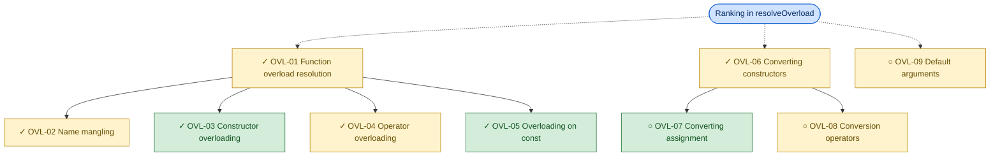

| Connection | Why it exists |
|---|---|
| OVL-01 → OVL-03, OVL-04, OVL-05 | All three end in the same ranking call, with different candidate sets. |
| OVL-06 → OVL-07 | The temporary-building code `converted()` already exists; only the semantic check is missing. |
| OVL-09 | Shares ranking (arity) but its code generation is separate, in `call()`. |

---

### ENM graph: Enumerations

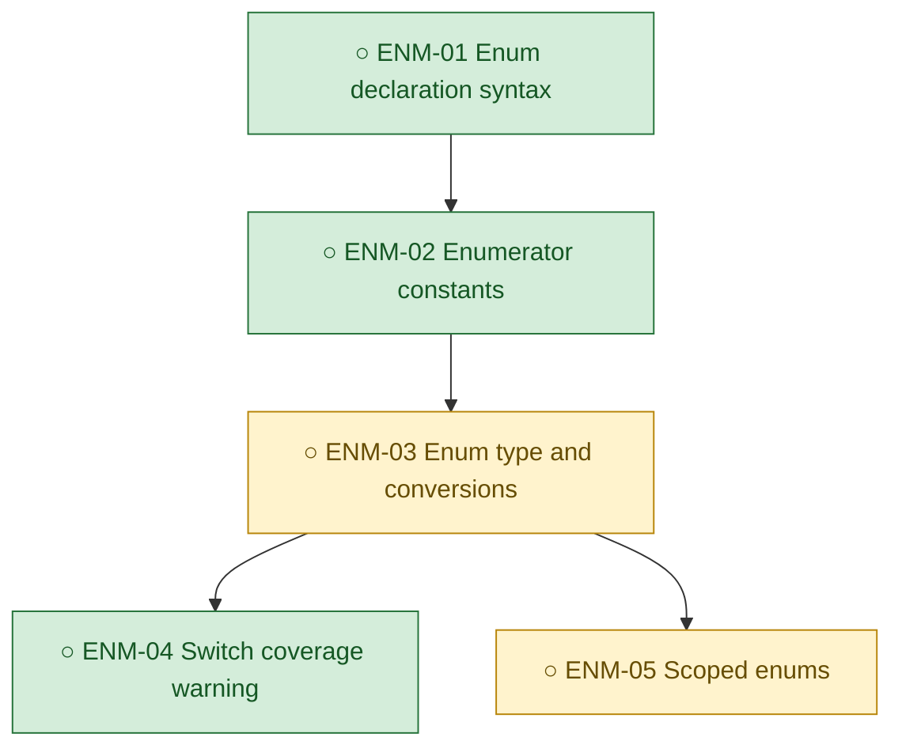

| Connection | Why it exists |
|---|---|
| ENM-01 → ENM-02 → ENM-03 | Each layer only needs the previous one; stopping after ENM-02 is already useful. |

---

### UNI graph: Unions

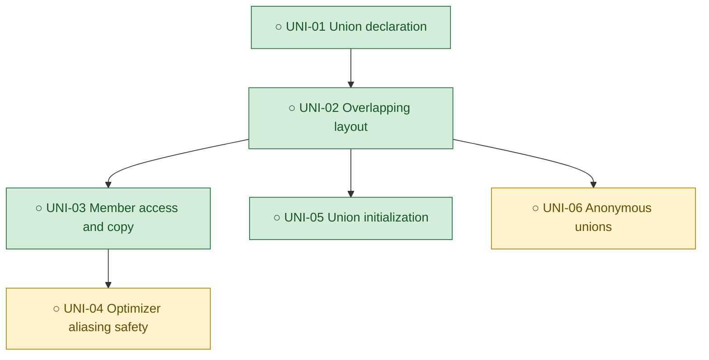

| Connection | Why it exists |
|---|---|
| UNI-03 → UNI-04 | Member access works at once, but it is only correct at `-O1` and above after this step. Treat them as one task. |

---

### FPT graph: Function pointers

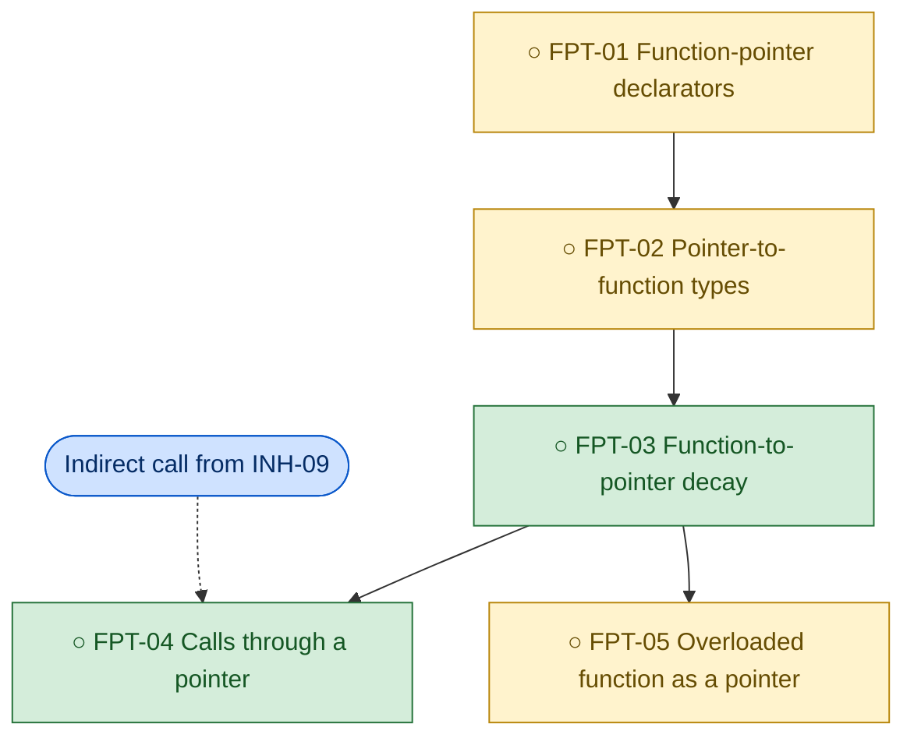

| Connection | Why it exists |
|---|---|
| INH-09 → FPT-04 | The hard part, an indirect call in all three back ends, was already built for virtual calls. |

---

### GEN graph: Generic types (templates)

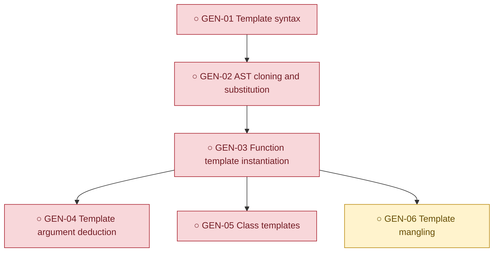

| Connection | Why it exists |
|---|---|
| GEN-02 → GEN-03 | Cloning is the real prerequisite: the semantic pass writes onto nodes, so one tree cannot serve two instantiations. |

---

### TYP graph: Type system

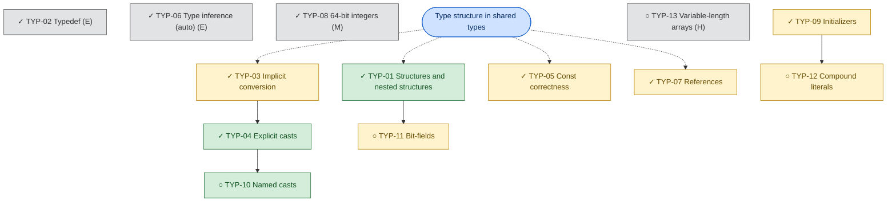

| Connection | Why it exists |
|---|---|
| TYP-03 → TYP-04 → TYP-10 | All go through `convert()`; a named cast differs only in what semantic analysis permits. |
| TYP-09 → TYP-12 | A compound literal is an initializer list for a temporary, so `initAggregate()` carries over. |

---

### MEM graph: Memory management

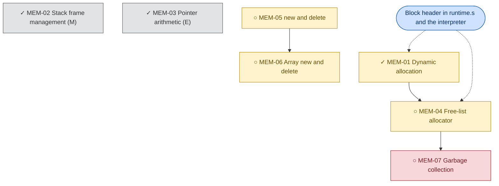

| Connection | Why it exists |
|---|---|
| MEM-01 and MEM-04 | `__malloc` already stores each block's size in a header, which is what a free list needs. |
| MEM-02 and MEM-03 | Isolated: finished, and unrelated to the heap. |

---

### SAF graph: Memory-safety and static checks

```mermaid
flowchart TD
    accTitle: Memory-safety and static checks connectivity
    accDescr: Internal features of Memory-safety and static checks, with solid arrows for implementation dependencies and dotted arrows for shared infrastructure. Colours show difficulty, blue shared infrastructure and grey isolated features.

    saf_01["✓ SAF-01 Constant array-bounds warning (E)"]
    saf_02["✓ SAF-02 Uninitialized-read warning (M)"]
    saf_03["✓ SAF-03 Sequence-point warning (M)"]
    saf_04["✓ SAF-04 Flow checks (M)"]
    saf_05["✓ SAF-05 Printf format checking (M)"]
    saf_06["○ SAF-06 Unused variable and function warnings"]
    saf_07["○ SAF-07 Returning the address of a local (E)"]
    saf_08["○ SAF-08 Assignment used as a condition (E)"]
    saf_09["◐ SAF-09 Null and bad-address diagnostics"]
    saf_10["◐ SAF-10 Division-by-zero at run time"]
    saf_11["○ SAF-11 Interpreter leak detection"]
    saf_12["○ SAF-12 Double-free and use-after-free detection"]
    saf_13["○ SAF-13 Run-time bounds checking"]
    saf_14["◐ SAF-14 Deep-recursion handling (E)"]
    saf_15["○ SAF-15 Pointer alias analysis"]
    saf_16["○ SAF-16 Static leak detection"]
    si_use(["useCount on every symbol"])
    si_blocks(["Live-block table in the interpreter"])

    si_use -.-> saf_06
    si_blocks -.-> saf_11
    si_blocks -.-> saf_12
    si_blocks -.-> saf_13
    saf_11 --> saf_12
    saf_15 --> saf_16
    saf_09 -.-> saf_10

    classDef easy fill:#d4edda,stroke:#26733b,color:#155724
    classDef moderate fill:#fff3cd,stroke:#b8860b,color:#664d03
    classDef hard fill:#f8d7da,stroke:#a71d2a,color:#721c24
    classDef shared fill:#cfe2ff,stroke:#0a58ca,color:#052c65
    classDef isolated fill:#e2e3e5,stroke:#555555,color:#333333
    class saf_06,saf_10,saf_11 easy
    class saf_09,saf_12 moderate
    class saf_13,saf_15,saf_16 hard
    class saf_01,saf_02,saf_03,saf_04,saf_05,saf_07,saf_08,saf_14 isolated
    class si_use,si_blocks shared
```

| Connection | Why it exists |
|---|---|
| SAF-11 → SAF-12 → SAF-13 | All use one table of live heap blocks in the interpreter. |
| SAF-09 and SAF-10 | Both add one run-time error routine to `runtime.s`. |
| SAF-01 to SAF-05, SAF-07, SAF-08 | Isolated: each is a self-contained check in one semantic function. |

---

### CTL graph: Control flow

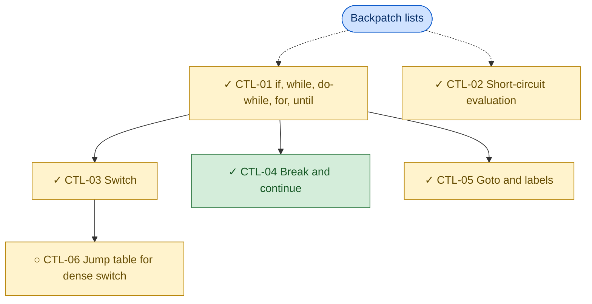

| Connection | Why it exists |
|---|---|
| CTL-01 and CTL-02 | Both are built on `makelist`, `merge` and `backpatch`. |

---

### EXC graph: Exception handling

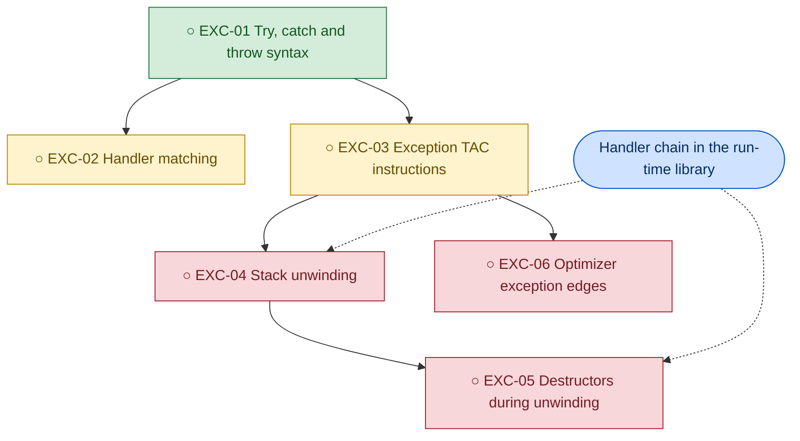

| Connection | Why it exists |
|---|---|
| EXC-04 → EXC-05 | Unwinding without destructors would be wrong for this language, so these cannot be separated. |
| EXC-03 → EXC-06 | Once a call can throw, all optimizer facts across calls are in question. |

---

### OPT graph: TAC optimizations

```mermaid
flowchart TD
    accTitle: TAC optimizations connectivity
    accDescr: Internal features of TAC optimizations, with solid arrows for implementation dependencies and dotted arrows for shared infrastructure. Colours show difficulty, blue shared infrastructure and grey isolated features.

    opt_01["✓ OPT-01 Constant folding"]
    opt_02["✓ OPT-02 Local value numbering and CSE"]
    opt_03["✓ OPT-03 Copy and constant propagation"]
    opt_04["✓ OPT-04 Dead code elimination"]
    opt_05["✓ OPT-05 Global CSE"]
    opt_06["✓ OPT-06 Loop-invariant code motion"]
    opt_07["✓ OPT-07 Function inlining"]
    opt_08["✓ OPT-08 Tail recursion"]
    opt_09["✓ OPT-09 Multiplication by a power of two"]
    opt_10["○ OPT-10 More algebraic rules"]
    opt_11["○ OPT-11 Induction-variable strength reduction"]
    opt_12["○ OPT-12 Loop unrolling"]
    opt_13["○ OPT-13 Loop fusion (H)"]
    opt_14["○ OPT-14 General tail calls"]
    opt_15["○ OPT-15 Dead function elimination"]
    opt_16["◐ OPT-16 Multi-level inlining"]
    si_cfg(["flowGraph and basic blocks"])

    si_cfg -.-> opt_03
    si_cfg -.-> opt_04
    si_cfg -.-> opt_05
    si_cfg -.-> opt_06
    opt_02 -.-> opt_01
    opt_02 -.-> opt_09
    opt_09 --> opt_10
    opt_06 -.-> opt_11
    opt_06 -.-> opt_12
    opt_07 -.-> opt_12
    opt_08 --> opt_14
    opt_07 --> opt_16
    opt_15 -.-> opt_16

    classDef easy fill:#d4edda,stroke:#26733b,color:#155724
    classDef moderate fill:#fff3cd,stroke:#b8860b,color:#664d03
    classDef hard fill:#f8d7da,stroke:#a71d2a,color:#721c24
    classDef shared fill:#cfe2ff,stroke:#0a58ca,color:#052c65
    classDef isolated fill:#e2e3e5,stroke:#555555,color:#333333
    class opt_01,opt_09,opt_10,opt_15 easy
    class opt_02,opt_03,opt_04,opt_05,opt_07,opt_08,opt_12,opt_16 moderate
    class opt_06,opt_11,opt_14 hard
    class opt_13 isolated
    class si_cfg shared
```

| Connection | Why it exists |
|---|---|
| OPT-01, OPT-02, OPT-09 | All run inside `numberBlock()`. |
| OPT-06 and OPT-11, OPT-12 | All use the natural loops from `loops()`. |
| OPT-07 and OPT-12 | Both copy quads with renaming and retargeted jumps. |
| OPT-15 and OPT-16 | Both need the call graph (INF-09). |

---

### BCK graph: MIPS back end

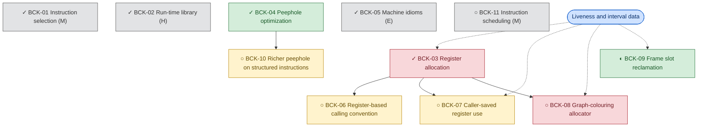

| Connection | Why it exists |
|---|---|
| BCK-03 → BCK-07, BCK-08 | Both replace or extend the assignment loop in `assignRegisters()`. |
| BCK-01, BCK-02 | Separate foundations; everything depends on them, so they are not useful edges here. |

---

### INF graph: Compiler infrastructure

```mermaid
flowchart TD
    accTitle: Compiler infrastructure connectivity
    accDescr: Internal features of Compiler infrastructure, with solid arrows for implementation dependencies and dotted arrows for shared infrastructure. Colours show difficulty, blue shared infrastructure and grey isolated features.

    inf_01["✓ INF-01 Basic block formation"]
    inf_02["✓ INF-02 Control-flow graphs"]
    inf_03["✓ INF-03 Liveness analysis"]
    inf_04["◐ INF-04 Reaching definitions"]
    inf_05["✓ INF-05 Available expressions"]
    inf_06["✓ INF-06 Dominators and natural loops"]
    inf_07["○ INF-07 Generic data-flow framework"]
    inf_08["○ INF-08 SSA form"]
    inf_09["○ INF-09 Call graph"]
    inf_10["○ INF-10 Interprocedural analysis"]
    inf_11["◐ INF-11 Pass manager"]
    inf_12["○ INF-12 Multiple IR levels (H)"]
    inf_13["✓ INF-13 Compiler diagnostics (M)"]
    inf_14["✓ INF-14 TAC interpreter and differential checking (H)"]
    inf_15["◐ INF-15 Source-level debug information (M)"]
    inf_16["○ INF-16 Combined driver (E)"]
    inf_17["○ INF-17 Multiple source files (M)"]
    si_fp(["FunctionPass class in opt.cpp"])

    inf_01 --> inf_02
    si_fp -.-> inf_02
    inf_02 --> inf_03
    inf_02 --> inf_04
    inf_02 --> inf_05
    inf_02 --> inf_06
    inf_03 -.-> inf_07
    inf_05 -.-> inf_07
    inf_04 -.-> inf_07
    inf_06 --> inf_08
    inf_09 --> inf_10
    si_fp -.-> inf_11

    classDef easy fill:#d4edda,stroke:#26733b,color:#155724
    classDef moderate fill:#fff3cd,stroke:#b8860b,color:#664d03
    classDef hard fill:#f8d7da,stroke:#a71d2a,color:#721c24
    classDef shared fill:#cfe2ff,stroke:#0a58ca,color:#052c65
    classDef isolated fill:#e2e3e5,stroke:#555555,color:#333333
    class inf_01,inf_02,inf_09 easy
    class inf_03,inf_04,inf_05,inf_06,inf_07,inf_11 moderate
    class inf_08,inf_10 hard
    class inf_12,inf_13,inf_14,inf_15,inf_16,inf_17 isolated
    class si_fp shared
```

| Connection | Why it exists |
|---|---|
| INF-02 → the analyses | Every analysis walks the same `Block` graph. |
| INF-03, INF-04, INF-05 → INF-07 | Three copies of one iteration pattern are what a framework would merge. |
| INF-13 to INF-17 | Isolated: tooling with no shared code. |

---

## 🏝️ 8. Isolated internal features

These connect to nothing else that is open, and they can be done alone at any time.

| Feature | Why isolated | Stages changed | Needs major new infrastructure? | Independent? | Worth doing? |
|---|---|---|---|---|---|
| [SAF-06](#saf-06) Unused warnings | Reads existing `useCount`; nothing else depends on it. | Semantic | No | Yes | Yes: an hour of work for a visible check. |
| [SAF-07](#saf-07) Address of a local returned | One pattern in one function. | Semantic | No | Yes | Yes. |
| [SAF-08](#saf-08) Assignment as a condition | One pattern in one function. | Semantic | No | Yes | Optional. |
| [CLS-18](#cls-18) Stray semicolon | One grammar alternative. | Parser | No | Yes | Yes: valid programs are rejected without it. |
| [INH-14](#inh-14) Virtual operator dispatch | A one-argument change at one call. | TAC | No | Yes | Yes: it is a wrong-code bug. |
| [SAF-14](#saf-14) Deep-recursion handling | Only touches the interpreter's call path. | Interpreter | No | Yes | Yes: a compiler tool should not crash. |
| [INF-16](#inf-16) Combined driver | Calls existing tools. | None (script) | No | Yes | Yes: small and useful for a demo. |
| [TYP-13](#typ-13) Variable-length arrays | Needs dynamic frames that nothing else uses. | Semantic, TAC, MIPS, interpreter | Yes | Yes | No. |
| [BCK-11](#bck-11) Instruction scheduling | Unmeasurable on SPIM. | MIPS | Moderate | Yes | No. |
| [INF-17](#inf-17) Multiple source files | Touches only the driver and label emission. | Driver, MIPS | Moderate | Yes | Optional. |

---

## 🧱 9. Implementation clusters

Groups based on shared code, not on similar topics.

| Cluster | Included features | Shared infrastructure | Difficulty | Implementation advantage | Prerequisites | Independent parts? |
|---|---|---|---|---|---|---|
| **C1** Class core | CLS-01 to CLS-08, CLS-17 | `RecordInfo`, member scope, `this` as a parameter | Moderate | Done together; they share one record structure. | None | No: each needs CLS-01. |
| **C2** Object lifetime | CLS-09 to CLS-13, CLS-20 | Generator scope and temporary lists, `construct()` | Hard | Construction and destruction must agree on order. | C1 | Partly: CLS-20 alone. |
| **C3** Class qualifiers | CLS-14 to CLS-16, CLS-18, CLS-19 | Grammar flags, semantic filters | Easy | Each is a parser flag plus one semantic check. | C1 | Yes. |
| **C4** Hierarchy | INH-01 to INH-05, INH-15 | `lookupMember()`, `baseOffset()` | Moderate | One lookup routine serves all. | C1 | INH-15 alone. |
| **C5** Dynamic dispatch | INH-06 to INH-12, INH-14, INH-16, INH-17 | Tables, `call *t`, `virtualFunctions()` | Hard (done); open items Easy | The remaining items are small edits to finished code. | C4 | Yes, for the open items. |
| **C6** Overload and conversion | OVL-01 to OVL-09 | `resolveOverload()`, `converted()` | Moderate | Each new conversion plugs into one ranking. | None | Yes. |
| **C7** Heap | MEM-01 to MEM-06, INH-13 | Block header, allocation calls | Moderate | `new` builds on the allocator; virtual destructors need `delete`. | C2 for MEM-05 | MEM-04 alone. |
| **C8** Removed data types | ENM-01 to ENM-03, UNI-01 to UNI-05 | Parser and type kinds | Easy, except UNI-04 | Both reverse D1–D6 with little back-end work. | Your decision to reverse D1–D6 | Yes: enums and unions are independent. |
| **C9** Function pointers | FPT-01 to FPT-04 | `call *t`, `codeAddress` | Moderate | The back-end half exists. | INH-09 (done) | As one unit. |
| **C10** Templates | GEN-01 to GEN-06 | AST cloning | Hard | All or nothing. | AST deep copy | No. |
| **C11** Type foundations | TYP-01 to TYP-09 | `shared/types` | Moderate | Finished base layer. | None | — |
| **C12** Cheap static warnings | SAF-01 to SAF-08 | Semantic walk, `useCount` | Easy | Each adds one check. | None | Yes, one by one. |
| **C13** Run-time checking | SAF-09 to SAF-14 | Interpreter memory, a run-time error routine | Easy to Moderate | The interpreter sees every access. | None | Yes. |
| **C14** Alias-based analysis | SAF-15, SAF-16 | Points-to sets | Hard | Static leak detection needs aliasing first. | INF-03 | SAF-15 alone. |
| **C15** Structured control flow | CTL-01 to CTL-05 | Backpatch lists | Moderate | Finished. | None | — |
| **C16** Exceptions | EXC-01 to EXC-06 | Unwinder, new TAC, CFG edges | Hard | Partial versions are wrong, not smaller. | C2 | No. |
| **C17** Local optimization | OPT-01 to OPT-04, OPT-09, OPT-10 | `numberBlock()`, `simplify()` | Moderate | One block pass does all of these. | INF-01 | OPT-10 alone. |
| **C18** Loop optimization | OPT-05, OPT-06, OPT-11, OPT-12 | `loops()`, available expressions | Hard | New loop passes reuse loop detection. | INF-06 | Yes. |
| **C19** Function-level optimization | OPT-07, OPT-08, OPT-14 to OPT-16 | Quad copying, call graph | Moderate | The call graph unlocks two items. | INF-09 | OPT-15 after INF-09. |
| **C20** Code emission | BCK-01, BCK-02 | `Emitter`, `runtime.s` | Hard | Finished base layer. | None | — |
| **C21** Register and machine tuning | BCK-03 to BCK-10 | Live intervals, `Emitter` | Moderate | All refine one assignment and one output stream. | C20 | BCK-09 alone. |
| **C22** Data-flow analyses | INF-01 to INF-07 | `Block`, `FunctionPass` | Moderate | One graph, one iteration pattern. | None | INF-04 alone. |
| **C23** SSA | INF-08 | Dominance frontiers | Hard | Stands alone but touches everything. | INF-06 | Yes, on a copy of the code. |
| **C24** Interprocedural | INF-09, INF-10 | `Op::Call` scan | Easy, then Hard | The call graph is cheap and useful alone. | None | INF-09 alone. |
| **C25** Tooling | INF-11, INF-13 to INF-16 | Drivers, logs, diagnostics | Easy to Moderate | Improves every later experiment. | None | Yes. |

---

## 🔗 10. Dependency analysis

Dependencies between advanced features. Each graph in section 7 shows the detail inside one feature.

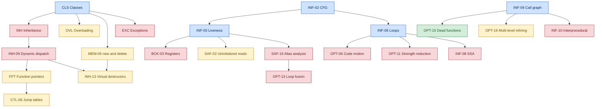

| Kind | Features |
|---|---|
| Must come first | INF-09 before OPT-15 and OPT-16; MEM-05 before INH-13 and MEM-06; SAF-11 before SAF-12; ENM-01 before ENM-02; UNI-03 before UNI-04 |
| Independent | All of [section 8](#-8-isolated-internal-features), plus OPT-10, MEM-04, INF-11 |
| Easier after another | SAF-12 after SAF-11; INF-07 after INF-04; BCK-08 once liveness is shared with `phase4-codegen`; OPT-12 after OPT-11 |
| Shared infrastructure | `numberBlock()` (OPT-01, 02, 09, 10); `loops()` (OPT-06, 11, 12); `resolveOverload()` (OVL); `flowGraph()` (all analyses) |

---

## 🛠️ 11. Compiler pipeline impact

Where the **open** work in each feature falls. ● major change, ○ small change, blank none.

| Feature | Lexer | Parser | AST | Symbols/types | Semantic | TAC | Optimizer | Interpreter | MIPS | Run time |
|---|:-:|:-:|:-:|:-:|:-:|:-:|:-:|:-:|:-:|:-:|
| CLS open items | ○ | ○ | | ○ | ○ | ○ | | | | |
| INH open items | ○ | ○ | | | ○ | ○ | | | | |
| OVL open items | | ● | | | ● | ○ | | | | |
| ENM | ○ | ○ | ○ | ● | ○ | | | | | |
| UNI | ○ | ○ | | ○ | ○ | ○ | ● | | | |
| FPT | | ● | | ● | ● | ○ | ○ | ○ | | |
| GEN | ● | ● | ● | ● | ● | | | | | |
| TYP open items | ○ | ● | | ○ | ● | ● | | ○ | ● | |
| MEM | ○ | ○ | ○ | | ○ | ● | | ● | | ● |
| SAF checks | | | | | ○ | | | ● | ○ | ○ |
| SAF analyses | | | | | | | ● | | | |
| CTL-06 | | | | | | ○ | ○ | ○ | ○ | |
| EXC | ○ | ○ | ○ | | ● | ● | ● | ● | ● | ● |
| OPT | | | | | | | ● | | ○ | |
| BCK | | | | | | ○ | | | ● | ○ |
| INF | | | | | | | ● | | ○ | |

---

## 🧭 12. Overall implementation feasibility

Traced through the whole pipeline, for the open work only.

| Feature | Can be added? | Redesign? | Grammar? | New TAC? | New MIPS mechanism? | Symbol table? | Reuse |
|---|---|---|---|---|---|---|---|
| CLS open items | Yes | No | Small | No | No | Small | High |
| INH bugs, `override` | Yes | No | Small | No | No | No | High |
| Covariant returns | Yes | No | No | No | No | No | High |
| Virtual inheritance | With difficulty | Yes: layout | Yes | No | No | Yes | Low |
| OVL open items | Yes | No | Small | No | No | Small | High |
| Enums | Yes | No | Yes | No | No | Yes | High |
| Unions | Yes, with optimizer tests | No | Yes | No | No | Small | High |
| Function pointers | Yes | No | Yes | No: `call *t` exists | No: `jalr` exists | Yes | High |
| Templates | With difficulty | Yes: reusable AST | Yes | No | No | Yes | Low |
| Bit-fields | Yes | No | Yes | No: shifts exist | No | Yes | Medium |
| Variable-length arrays | With difficulty | Yes: dynamic frames | No | Yes | Yes | Small | Low |
| Free-list allocator | Yes | No | No | No | Run-time only | No | High |
| `new` and `delete` | Yes | No | Yes (restore) | No | No | Small | High: in git history |
| Garbage collection | Not reasonably | Yes | No | Yes | Yes | No | Low |
| Run-time memory checks | Yes, in the interpreter | No | No | No | No | No | High |
| Alias analysis | Yes | No | No | No | No | No | Medium |
| Exceptions | With difficulty | Yes: CFG and calls | Yes | Yes | Yes | Small | Low |
| Induction variables | Yes | No | No | No | No | No | High |
| General tail calls | With difficulty | Partly: D25 | No | A flag | Yes | No | Low |
| SSA | Yes, as a separate form | Partly | No | Yes: phi | No | No | Medium |
| Graph colouring | Yes | No | No | No | No | No | Medium |
| Scheduling | Pointless on SPIM | No | No | No | Yes | No | Low |
| Call graph | Yes | No | No | No | No | No | High |
| Multiple source files | Yes | Partly | No | No | Yes | Small | Medium |

**Overall.** Nearly everything worthwhile fits the current architecture. Only five items need real redesign: templates, exceptions, variable-length arrays, virtual inheritance and garbage collection. All five are marked No in the checklist, because each would need new foundations that nothing else uses. General tail calls, SSA and multiple source files need partial redesign.

---

## 🗺️ 13. Recommended implementation order

Ordered by value for effort. Each stage leaves the compiler working and tested.

```mermaid
flowchart LR
    accTitle: Recommended implementation stages
    accDescr: Five stages in order: bug fixes, cheap checks, run-time safety, optimizer growth, and optional language features that need a decision first.

    stage_1["1 Fix bugs<br/>INH-14 INH-15 SAF-14 SAF-10 CLS-18 OVL-07"]
    stage_2["2 Cheap checks<br/>SAF-06 SAF-07 INH-16 OVL-09"]
    stage_3["3 Run-time safety<br/>MEM-04 SAF-11 SAF-12"]
    stage_4["4 Optimizer<br/>OPT-10 INF-09 OPT-15 INF-04 INF-11 OPT-11 BCK-09"]
    stage_5["5 Your decision<br/>FPT or ENM or UNI or MEM-05"]

    stage_1 --> stage_2 --> stage_3 --> stage_4 --> stage_5

    classDef easy fill:#d4edda,stroke:#26733b,color:#155724
    classDef moderate fill:#fff3cd,stroke:#b8860b,color:#664d03
    classDef hard fill:#f8d7da,stroke:#a71d2a,color:#721c24
    classDef shared fill:#cfe2ff,stroke:#0a58ca,color:#052c65
    class stage_1,stage_2 easy
    class stage_3 moderate
    class stage_4 hard
    class stage_5 shared
```

| Stage | Why here | Items |
|---|---|---|
| 1 Fix bugs | Wrong behaviour and rejected valid programs come first | INH-14, INH-15, SAF-14, SAF-10, CLS-18, OVL-07 |
| 2 Cheap checks | Each is visible in a demo and costs hours | SAF-06, SAF-07, INH-16, OVL-09 |
| 3 Run-time safety | Gives the interpreter a strong story: leaks and use-after-free | MEM-04, SAF-11, SAF-12 |
| 4 Optimizer | New measurable gains; induction variables are the showpiece | OPT-10, INF-09, OPT-15, INF-04, INF-11, OPT-11, BCK-09 |
| 5 Your decision | Reverses D1–D6 or D31 | FPT cluster, ENM, UNI with UNI-04, MEM-05 with INH-13 |

Each new feature should follow the project's existing rule: a test program whose expected output comes from g++ or gcc, passing in the interpreter and in SPIM at all four levels, with the decision logged in `DESIGN_LOG.md`.

---

## ✅ 14. Final feature selection checklist

`Recommended?`: **Done** already works; **Yes** recommended; **Optional** your choice; **No** advised against. Mark your picks in the first column.

| Pick | Advanced feature | Internal feature | Implemented status | Difficulty | Dependencies | Connectivity cluster | Recommended? |
|---|---|---|---|---|---|---|---|
| ✔ | Classes and objects | [CLS-01](#cls-01) Class declaration and record type | ✓ Implemented | Moderate | — | C1 | Done |
| ✔ | Classes and objects | [CLS-02](#cls-02) Object memory layout | ✓ Implemented | Moderate | CLS-01 | C1 | Done |
| ✔ | Classes and objects | [CLS-03](#cls-03) Data member access | ✓ Implemented | Easy | CLS-02 | C1 | Done |
| ✔ | Classes and objects | [CLS-04](#cls-04) Member function declaration and definition | ✓ Implemented | Moderate | CLS-01 | C1 | Done |
| ✔ | Classes and objects | [CLS-05](#cls-05) Method invocation and this pointer | ✓ Implemented | Moderate | CLS-04 | C1 | Done |
| ✔ | Classes and objects | [CLS-06](#cls-06) Access modifiers | ✓ Implemented | Easy | CLS-01 | C1 | Done |
| ✔ | Classes and objects | [CLS-07](#cls-07) Static data members | ✓ Implemented | Moderate | CLS-01 | C1 | Done |
| ✔ | Classes and objects | [CLS-08](#cls-08) Static member functions | ✓ Implemented | Easy | CLS-04 | C1 | Done |
| ✔ | Classes and objects | [CLS-09](#cls-09) Constructors (default, parameterized) | ✓ Implemented | Moderate | CLS-05 | C2 | Done |
| ✔ | Classes and objects | [CLS-10](#cls-10) Member initializer lists | ✓ Implemented | Moderate | CLS-09 | C2 | Done |
| ✔ | Classes and objects | [CLS-11](#cls-11) Copy construction | ✓ Implemented | Moderate | CLS-09 | C2 | Done |
| ✔ | Classes and objects | [CLS-12](#cls-12) Destructors at scope exit | ✓ Implemented | Hard | CLS-09 | C2 | Done |
| ✔ | Classes and objects | [CLS-13](#cls-13) Temporary object lifetime | ✓ Implemented | Hard | CLS-12 | C2 | Done |
| ✔ | Classes and objects | [CLS-14](#cls-14) Const member functions | ✓ Implemented | Moderate | CLS-04 | C3 | Done |
| ✔ | Classes and objects | [CLS-15](#cls-15) Friend functions and classes | ✓ Implemented | Easy | CLS-06 | C3 | Done |
| ✔ | Classes and objects | [CLS-16](#cls-16) Explicit constructors | ✓ Implemented | Easy | CLS-09 | C3 | Done |
| ✔ | Classes and objects | [CLS-17](#cls-17) Nested and local classes | ✓ Implemented | Moderate | CLS-01 | C1 | Done |
| ☐ | Classes and objects | [CLS-18](#cls-18) Stray semicolon after a member body | ○ Not | Easy | CLS-04 | C3 | Yes |
| ☐ | Classes and objects | [CLS-19](#cls-19) Mutable data members | ○ Not | Easy | CLS-14 | C3 | Optional |
| ☐ | Classes and objects | [CLS-20](#cls-20) Lazy construction of static local objects | ◐ Partial | Moderate | CLS-09 | C2 | Optional |
| ☐ | Classes and objects | [CLS-21](#cls-21) Pointers to members | ○ Not | Hard | CLS-05, FPT-04 | — | No |
| ✔ | Inheritance and polymorphism | [INH-01](#inh-01) Single and multilevel inheritance | ✓ Implemented | Moderate | CLS-02 | C4 | Done |
| ✔ | Inheritance and polymorphism | [INH-02](#inh-02) Multiple inheritance | ✓ Implemented | Moderate | INH-01 | C4 | Done |
| ✔ | Inheritance and polymorphism | [INH-03](#inh-03) Base member lookup and access capping | ✓ Implemented | Moderate | INH-01 | C4 | Done |
| ✔ | Inheritance and polymorphism | [INH-04](#inh-04) Qualified member access | ✓ Implemented | Easy | INH-03 | C4 | Done |
| ✔ | Inheritance and polymorphism | [INH-05](#inh-05) Object slicing | ✓ Implemented | Moderate | INH-02 | C4 | Done |
| ✔ | Inheritance and polymorphism | [INH-06](#inh-06) Override detection | ✓ Implemented | Moderate | CLS-04 | C5 | Done |
| ✔ | Inheritance and polymorphism | [INH-07](#inh-07) Vtable layout and generation | ✓ Implemented | Hard | INH-06, CLS-02 | C5 | Done |
| ✔ | Inheritance and polymorphism | [INH-08](#inh-08) Vptr installation | ✓ Implemented | Hard | INH-07 | C5 | Done |
| ✔ | Inheritance and polymorphism | [INH-09](#inh-09) Dynamic dispatch | ✓ Implemented | Hard | INH-08 | C5 | Done |
| ✔ | Inheritance and polymorphism | [INH-10](#inh-10) This-adjustment for later bases | ✓ Implemented | Hard | INH-09, INH-02 | C5 | Done |
| ✔ | Inheritance and polymorphism | [INH-11](#inh-11) Abstract classes and pure virtual functions | ✓ Implemented | Moderate | INH-06 | C5 | Done |
| ☐ | Inheritance and polymorphism | [INH-12](#inh-12) Interfaces | ◐ Partial | Easy | INH-11 | C5 | Optional |
| ☐ | Inheritance and polymorphism | [INH-13](#inh-13) Virtual destructor dispatch | ◐ Partial | Moderate | MEM-05, INH-09 | C7 | Only with MEM-05 |
| ☐ | Inheritance and polymorphism | [INH-14](#inh-14) Virtual operator dispatch | ◐ Partial | Easy | INH-09 | C5 | Yes (bug) |
| ☐ | Inheritance and polymorphism | [INH-15](#inh-15) Diamond ambiguity diagnostic | ◐ Partial | Easy | INH-03 | C4 | Yes (bug) |
| ☐ | Inheritance and polymorphism | [INH-16](#inh-16) override and final | ○ Not | Easy | INH-06 | C5 | Yes |
| ☐ | Inheritance and polymorphism | [INH-17](#inh-17) Covariant return types | ○ Not | Moderate | INH-09 | C5 | Optional |
| ☐ | Inheritance and polymorphism | [INH-18](#inh-18) Run-time type information | ○ Not | Hard | INH-07 | — | No |
| ☐ | Inheritance and polymorphism | [INH-19](#inh-19) Virtual inheritance | ○ Not | Hard | INH-02, INH-08 | — | No |
| ✔ | Overloading and user conversions | [OVL-01](#ovl-01) Function overload resolution | ✓ Implemented | Moderate | — | C6 | Done |
| ✔ | Overloading and user conversions | [OVL-02](#ovl-02) Name mangling | ✓ Implemented | Moderate | OVL-01 | C6 | Done |
| ✔ | Overloading and user conversions | [OVL-03](#ovl-03) Constructor overloading | ✓ Implemented | Easy | OVL-01, CLS-09 | C6 | Done |
| ✔ | Overloading and user conversions | [OVL-04](#ovl-04) Operator overloading | ✓ Implemented | Moderate | OVL-01 | C6 | Done |
| ✔ | Overloading and user conversions | [OVL-05](#ovl-05) Overloading on const | ✓ Implemented | Easy | OVL-01, CLS-14 | C6 | Done |
| ✔ | Overloading and user conversions | [OVL-06](#ovl-06) Converting constructors | ✓ Implemented | Moderate | OVL-01 | C6 | Done |
| ☐ | Overloading and user conversions | [OVL-07](#ovl-07) Converting assignment | ○ Not | Easy | OVL-06 | C6 | Yes |
| ☐ | Overloading and user conversions | [OVL-08](#ovl-08) Conversion operators | ○ Not | Moderate | OVL-06 | C6 | Optional |
| ☐ | Overloading and user conversions | [OVL-09](#ovl-09) Default arguments | ○ Not | Moderate | OVL-01 | C6 | Yes |
| ☐ | Enumerations | [ENM-01](#enm-01) Enum declaration syntax | ○ Not | Easy | — | C8 | Optional |
| ☐ | Enumerations | [ENM-02](#enm-02) Enumerator constants | ○ Not | Easy | ENM-01 | C8 | Optional |
| ☐ | Enumerations | [ENM-03](#enm-03) Enum type and conversions | ○ Not | Moderate | ENM-02 | C8 | Optional |
| ☐ | Enumerations | [ENM-04](#enm-04) Switch coverage warning | ○ Not | Easy | ENM-03 | — | Optional |
| ☐ | Enumerations | [ENM-05](#enm-05) Scoped enums | ○ Not | Moderate | ENM-03 | — | No |
| ☐ | Unions | [UNI-01](#uni-01) Union declaration | ○ Not | Easy | CLS-01 | C8 | Optional |
| ☐ | Unions | [UNI-02](#uni-02) Overlapping layout | ○ Not | Easy | UNI-01 | C8 | Optional |
| ☐ | Unions | [UNI-03](#uni-03) Member access and copy | ○ Not | Easy | UNI-02 | C8 | Optional |
| ☐ | Unions | [UNI-04](#uni-04) Optimizer aliasing safety | ○ Not | Moderate | UNI-03 | C8 | Required with UNI-01 |
| ☐ | Unions | [UNI-05](#uni-05) Union initialization | ○ Not | Easy | UNI-02 | C8 | Optional |
| ☐ | Unions | [UNI-06](#uni-06) Anonymous unions | ○ Not | Moderate | UNI-02 | — | No |
| ☐ | Function pointers | [FPT-01](#fpt-01) Function-pointer declarators | ○ Not | Moderate | — | C9 | Optional |
| ☐ | Function pointers | [FPT-02](#fpt-02) Pointer-to-function types | ○ Not | Moderate | FPT-01 | C9 | Optional |
| ☐ | Function pointers | [FPT-03](#fpt-03) Function-to-pointer decay | ○ Not | Easy | FPT-02 | C9 | Optional |
| ☐ | Function pointers | [FPT-04](#fpt-04) Calls through a pointer | ○ Not | Easy | FPT-03 | C9 | Optional |
| ☐ | Function pointers | [FPT-05](#fpt-05) Overloaded function as a pointer | ○ Not | Moderate | FPT-03, OVL-01 | — | No |
| ☐ | Generic types (templates) | [GEN-01](#gen-01) Template syntax | ○ Not | Hard | — | C10 | No |
| ☐ | Generic types (templates) | [GEN-02](#gen-02) AST cloning and substitution | ○ Not | Hard | GEN-01 | C10 | No |
| ☐ | Generic types (templates) | [GEN-03](#gen-03) Function template instantiation | ○ Not | Hard | GEN-02 | C10 | No |
| ☐ | Generic types (templates) | [GEN-04](#gen-04) Template argument deduction | ○ Not | Hard | GEN-03, OVL-01 | C10 | No |
| ☐ | Generic types (templates) | [GEN-05](#gen-05) Class templates | ○ Not | Hard | GEN-03 | C10 | No |
| ☐ | Generic types (templates) | [GEN-06](#gen-06) Template mangling | ○ Not | Moderate | GEN-03 | C10 | No |
| ✔ | Type system | [TYP-01](#typ-01) Structures and nested structures | ✓ Implemented | Easy | — | C11 | Done |
| ✔ | Type system | [TYP-02](#typ-02) Typedef | ✓ Implemented | Easy | — | C11 | Done |
| ✔ | Type system | [TYP-03](#typ-03) Implicit conversion | ✓ Implemented | Moderate | — | C11 | Done |
| ✔ | Type system | [TYP-04](#typ-04) Explicit casts | ✓ Implemented | Easy | TYP-03 | C11 | Done |
| ✔ | Type system | [TYP-05](#typ-05) Const correctness | ✓ Implemented | Moderate | — | C11 | Done |
| ✔ | Type system | [TYP-06](#typ-06) Type inference (auto) | ✓ Implemented | Easy | — | C11 | Done |
| ✔ | Type system | [TYP-07](#typ-07) References | ✓ Implemented | Moderate | — | C11 | Done |
| ✔ | Type system | [TYP-08](#typ-08) 64-bit integers | ✓ Implemented | Moderate | — | C11 | Done |
| ✔ | Type system | [TYP-09](#typ-09) Initializers | ✓ Implemented | Moderate | — | C11 | Done |
| ☐ | Type system | [TYP-10](#typ-10) Named casts | ○ Not | Easy | TYP-04 | — | Optional |
| ☐ | Type system | [TYP-11](#typ-11) Bit-fields | ○ Not | Moderate | TYP-01 | — | Optional |
| ☐ | Type system | [TYP-12](#typ-12) Compound literals | ○ Not | Moderate | TYP-09 | — | Optional |
| ☐ | Type system | [TYP-13](#typ-13) Variable-length arrays | ○ Not | Hard | — | — | No |
| ✔ | Memory management | [MEM-01](#mem-01) Dynamic allocation | ✓ Implemented | Moderate | — | C7 | Done |
| ✔ | Memory management | [MEM-02](#mem-02) Stack frame management | ✓ Implemented | Moderate | — | C7 | Done |
| ✔ | Memory management | [MEM-03](#mem-03) Pointer arithmetic | ✓ Implemented | Easy | — | C7 | Done |
| ☐ | Memory management | [MEM-04](#mem-04) Free-list allocator | ○ Not | Moderate | MEM-01 | C7 | Yes |
| ☐ | Memory management | [MEM-05](#mem-05) new and delete | ○ Not | Moderate | CLS-09 | C7 | Optional |
| ☐ | Memory management | [MEM-06](#mem-06) Array new and delete | ○ Not | Moderate | MEM-05 | C7 | Optional |
| ☐ | Memory management | [MEM-07](#mem-07) Garbage collection | ○ Not | Hard | MEM-04 | — | No |
| ✔ | Memory-safety and static checks | [SAF-01](#saf-01) Constant array-bounds warning | ✓ Implemented | Easy | — | C12 | Done |
| ✔ | Memory-safety and static checks | [SAF-02](#saf-02) Uninitialized-read warning | ✓ Implemented | Moderate | INF-03 | C12 | Done |
| ✔ | Memory-safety and static checks | [SAF-03](#saf-03) Sequence-point warning | ✓ Implemented | Moderate | — | C12 | Done |
| ✔ | Memory-safety and static checks | [SAF-04](#saf-04) Flow checks | ✓ Implemented | Moderate | — | C12 | Done |
| ✔ | Memory-safety and static checks | [SAF-05](#saf-05) Printf format checking | ✓ Implemented | Moderate | — | C12 | Done |
| ☐ | Memory-safety and static checks | [SAF-06](#saf-06) Unused variable and function warnings | ○ Not | Easy | — | C12 | Yes |
| ☐ | Memory-safety and static checks | [SAF-07](#saf-07) Returning the address of a local | ○ Not | Easy | — | C12 | Yes |
| ☐ | Memory-safety and static checks | [SAF-08](#saf-08) Assignment used as a condition | ○ Not | Easy | — | C12 | Optional |
| ☐ | Memory-safety and static checks | [SAF-09](#saf-09) Null and bad-address diagnostics | ◐ Partial | Moderate | — | C13 | Optional |
| ☐ | Memory-safety and static checks | [SAF-10](#saf-10) Division-by-zero at run time | ◐ Partial | Easy | — | C13 | Yes |
| ☐ | Memory-safety and static checks | [SAF-11](#saf-11) Interpreter leak detection | ○ Not | Easy | — | C13 | Yes |
| ☐ | Memory-safety and static checks | [SAF-12](#saf-12) Double-free and use-after-free detection | ○ Not | Moderate | SAF-11 | C13 | Yes |
| ☐ | Memory-safety and static checks | [SAF-13](#saf-13) Run-time bounds checking | ○ Not | Hard | SAF-11 | C13 | Optional |
| ☐ | Memory-safety and static checks | [SAF-14](#saf-14) Deep-recursion handling | ◐ Partial | Easy | — | C13 | Yes (bug) |
| ☐ | Memory-safety and static checks | [SAF-15](#saf-15) Pointer alias analysis | ○ Not | Hard | INF-03 | C14 | Optional |
| ☐ | Memory-safety and static checks | [SAF-16](#saf-16) Static leak detection | ○ Not | Hard | SAF-15, INF-09 | C14 | No |
| ✔ | Control flow | [CTL-01](#ctl-01) if, while, do-while, for, until | ✓ Implemented | Moderate | — | C15 | Done |
| ✔ | Control flow | [CTL-02](#ctl-02) Short-circuit evaluation | ✓ Implemented | Moderate | — | C15 | Done |
| ✔ | Control flow | [CTL-03](#ctl-03) Switch | ✓ Implemented | Moderate | CTL-01 | C15 | Done |
| ✔ | Control flow | [CTL-04](#ctl-04) Break and continue | ✓ Implemented | Easy | CTL-01 | C15 | Done |
| ✔ | Control flow | [CTL-05](#ctl-05) Goto and labels | ✓ Implemented | Moderate | CTL-01 | C15 | Done |
| ☐ | Control flow | [CTL-06](#ctl-06) Jump table for dense switch | ○ Not | Moderate | CTL-03, FPT-04 | — | Optional |
| ☐ | Exception handling | [EXC-01](#exc-01) Try, catch and throw syntax | ○ Not | Easy | — | C16 | No |
| ☐ | Exception handling | [EXC-02](#exc-02) Handler matching | ○ Not | Moderate | EXC-01 | C16 | No |
| ☐ | Exception handling | [EXC-03](#exc-03) Exception TAC instructions | ○ Not | Moderate | EXC-01 | C16 | No |
| ☐ | Exception handling | [EXC-04](#exc-04) Stack unwinding | ○ Not | Hard | EXC-03 | C16 | No |
| ☐ | Exception handling | [EXC-05](#exc-05) Destructors during unwinding | ○ Not | Hard | EXC-04, CLS-12 | C16 | No |
| ☐ | Exception handling | [EXC-06](#exc-06) Optimizer exception edges | ○ Not | Hard | EXC-03, INF-02 | C16 | No |
| ✔ | TAC optimizations | [OPT-01](#opt-01) Constant folding | ✓ Implemented | Easy | INF-01 | C17 | Done |
| ✔ | TAC optimizations | [OPT-02](#opt-02) Local value numbering and CSE | ✓ Implemented | Moderate | INF-01 | C17 | Done |
| ✔ | TAC optimizations | [OPT-03](#opt-03) Copy and constant propagation | ✓ Implemented | Moderate | INF-02 | C17 | Done |
| ✔ | TAC optimizations | [OPT-04](#opt-04) Dead code elimination | ✓ Implemented | Moderate | INF-03 | C17 | Done |
| ✔ | TAC optimizations | [OPT-05](#opt-05) Global CSE | ✓ Implemented | Moderate | INF-05 | C18 | Done |
| ✔ | TAC optimizations | [OPT-06](#opt-06) Loop-invariant code motion | ✓ Implemented | Hard | INF-06 | C18 | Done |
| ✔ | TAC optimizations | [OPT-07](#opt-07) Function inlining | ✓ Implemented | Moderate | — | C19 | Done |
| ✔ | TAC optimizations | [OPT-08](#opt-08) Tail recursion | ✓ Implemented | Moderate | INF-02 | C19 | Done |
| ✔ | TAC optimizations | [OPT-09](#opt-09) Multiplication by a power of two | ✓ Implemented | Easy | OPT-02 | C17 | Done |
| ☐ | TAC optimizations | [OPT-10](#opt-10) More algebraic rules | ○ Not | Easy | OPT-09 | C17 | Yes |
| ☐ | TAC optimizations | [OPT-11](#opt-11) Induction-variable strength reduction | ○ Not | Hard | INF-06, INF-04 | C18 | Yes |
| ☐ | TAC optimizations | [OPT-12](#opt-12) Loop unrolling | ○ Not | Moderate | INF-06 | C18 | Optional |
| ☐ | TAC optimizations | [OPT-13](#opt-13) Loop fusion | ○ Not | Hard | SAF-15 | — | No |
| ☐ | TAC optimizations | [OPT-14](#opt-14) General tail calls | ○ Not | Hard | OPT-08 | C19 | Optional |
| ☐ | TAC optimizations | [OPT-15](#opt-15) Dead function elimination | ○ Not | Easy | INF-09 | C19 | Yes |
| ☐ | TAC optimizations | [OPT-16](#opt-16) Multi-level inlining | ◐ Partial | Moderate | OPT-07, INF-09 | C19 | Optional |
| ✔ | MIPS back end | [BCK-01](#bck-01) Instruction selection | ✓ Implemented | Moderate | — | C20 | Done |
| ✔ | MIPS back end | [BCK-02](#bck-02) Run-time library | ✓ Implemented | Hard | — | C20 | Done |
| ✔ | MIPS back end | [BCK-03](#bck-03) Register allocation | ✓ Implemented | Hard | INF-03 | C21 | Done |
| ✔ | MIPS back end | [BCK-04](#bck-04) Peephole optimization | ✓ Implemented | Easy | — | C21 | Done |
| ✔ | MIPS back end | [BCK-05](#bck-05) Machine idioms | ✓ Implemented | Easy | — | C21 | Done |
| ☐ | MIPS back end | [BCK-06](#bck-06) Register-based calling convention | ○ Not | Moderate | BCK-03 | C21 | Optional |
| ☐ | MIPS back end | [BCK-07](#bck-07) Caller-saved register use | ○ Not | Moderate | BCK-03 | C21 | Optional |
| ☐ | MIPS back end | [BCK-08](#bck-08) Graph-colouring allocator | ○ Not | Hard | BCK-03, INF-03 | C21 | Optional |
| ☐ | MIPS back end | [BCK-09](#bck-09) Frame slot reclamation | ◐ Partial | Easy | INF-03 | C21 | Yes |
| ☐ | MIPS back end | [BCK-10](#bck-10) Richer peephole on structured instructions | ○ Not | Moderate | BCK-04 | C21 | Optional |
| ☐ | MIPS back end | [BCK-11](#bck-11) Instruction scheduling | ○ Not | Moderate | — | — | No |
| ✔ | Compiler infrastructure | [INF-01](#inf-01) Basic block formation | ✓ Implemented | Easy | — | C22 | Done |
| ✔ | Compiler infrastructure | [INF-02](#inf-02) Control-flow graphs | ✓ Implemented | Easy | INF-01 | C22 | Done |
| ✔ | Compiler infrastructure | [INF-03](#inf-03) Liveness analysis | ✓ Implemented | Moderate | INF-02 | C22 | Done |
| ☐ | Compiler infrastructure | [INF-04](#inf-04) Reaching definitions | ◐ Partial | Moderate | INF-02 | C22 | Yes |
| ✔ | Compiler infrastructure | [INF-05](#inf-05) Available expressions | ✓ Implemented | Moderate | INF-02 | C22 | Done |
| ✔ | Compiler infrastructure | [INF-06](#inf-06) Dominators and natural loops | ✓ Implemented | Moderate | INF-02 | C22 | Done |
| ☐ | Compiler infrastructure | [INF-07](#inf-07) Generic data-flow framework | ○ Not | Moderate | INF-03, INF-05 | C22 | Optional |
| ☐ | Compiler infrastructure | [INF-08](#inf-08) SSA form | ○ Not | Hard | INF-06 | C23 | Optional |
| ☐ | Compiler infrastructure | [INF-09](#inf-09) Call graph | ○ Not | Easy | — | C24 | Yes |
| ☐ | Compiler infrastructure | [INF-10](#inf-10) Interprocedural analysis | ○ Not | Hard | INF-09 | C24 | Optional |
| ☐ | Compiler infrastructure | [INF-11](#inf-11) Pass manager | ◐ Partial | Moderate | — | C25 | Yes |
| ☐ | Compiler infrastructure | [INF-12](#inf-12) Multiple IR levels | ○ Not | Hard | — | — | No |
| ✔ | Compiler infrastructure | [INF-13](#inf-13) Compiler diagnostics | ✓ Implemented | Moderate | — | C25 | Done |
| ✔ | Compiler infrastructure | [INF-14](#inf-14) TAC interpreter and differential checking | ✓ Implemented | Hard | — | C25 | Done |
| ☐ | Compiler infrastructure | [INF-15](#inf-15) Source-level debug information | ◐ Partial | Moderate | — | C25 | Optional |
| ☐ | Compiler infrastructure | [INF-16](#inf-16) Combined driver | ○ Not | Easy | — | C25 | Yes |
| ☐ | Compiler infrastructure | [INF-17](#inf-17) Multiple source files | ○ Not | Moderate | — | — | Optional |

---

## 🔬 Appendix A: probe evidence

Each probe was a small program run through `semantic_analyzer`, then `tac_generator -O2 --run` and `mips_generator -O2` with SPIM. Results marked g++ were also compared with g++ 13.

| Probe | Program | Result |
|---|---|---|
| `tmpl` | `template<class T> T id(T x)` | Rejected: syntax error |
| `enumx`, `unionx` | `enum`, `union` definitions | Rejected: syntax error (D1–D6) |
| `fptr` | `int (*p)(int) = f;` | Rejected: deliberate parser error |
| `exc` | `try { throw 1; } catch (int e)` | Rejected: syntax error |
| `defarg` | `int f(int a, int b = 2)` | Rejected: syntax error |
| `ns`, `inl` | `namespace`, `inline` | Rejected: syntax error |
| `ovr`, `fin` | `override`, `final` | Rejected: syntax error |
| `cov` | Covariant return | Rejected: return type differs |
| `vinh` | `class B : virtual public A` | Rejected: syntax error |
| `dia` | Diamond, `d.x` | **Accepted; g++ rejects it as ambiguous** |
| `mi` | Multiple inheritance with constructors | Correct: `1 2` |
| `vop` | Virtual `operator+` through a reference | **Prints 1; g++ prints 2** |
| `vfromctor` | Virtual call from a constructor | Correct: `A` |
| `ifaceonly` | Pure abstract class used through a reference | Correct: `3` |
| `dtorv` | Virtual destructors on a local object | Correct order: `b a` |
| `oper`, `staticm`, `nestc`, `localc`, `structfn`, `arrobj` | Operators, static members, nested and local classes, methods in structs, object arrays | Correct |
| `refret`, `fparr`, `ovl`, `autox`, `structret`, `mutual` | Reference return, 2-D array parameter, overloads, `auto`, struct return, mutual recursion | Correct |
| `opconv` | `D e = d + 4;` through a converting constructor | Accepted |
| `asgconv` | `d = 4;` through a converting constructor | Rejected, though valid C++ |
| `convop`, `scast` | `operator int()`, `static_cast` | Rejected: syntax error |
| `ptrmem`, `rref`, `mutb` | Pointer to member, `&&` reference, `mutable` | Rejected: syntax error |
| `bitf`, `complit`, `nestfn`, `lamb` | Bit-field, compound literal, nested function, lambda | Rejected: syntax error |
| `vla` | `int a[n];` | Rejected: semantic error |
| `semiend` | `void f() {};` in a class | Rejected, though valid C++ |
| `oob` | `a[5]` on `int a[3]` | Warning `array-bounds` |
| `selfinit` | `int a = a;` | Warning from `tac_generator` |
| `fmt` | `printf("%d", 1.5)` | Warning `format` |
| `divz` | `a / 0` | Warning; interpreter reports division by zero |
| `divr` | `a / b` with `b == 0` at run time | Interpreter reports the error; SPIM run printed no diagnostic |
| `nullp` | `*p` with a null `p` | Interpreter reports it; SPIM shows a raw exception |
| `unused`, `unusedf` | Unused variable and static function | No warning |
| `retlocal` | Returns `&a` of a local | No warning |
| `cmpchk` | `if (a = 2)` | No warning |
| `leak`, `dfree`, `uaf` | Leak, double free, use after free | Not detected |
| `dctor` | `malloc` of a class with a constructor | Constructor does not run (expected without `new`) |
| `gotoctor` | `goto` past a constructor | Rejected: jump crosses initialization |
| `tailm` | 1,000,000 mutual tail calls | **Interpreter segfault (exit 139), also at `-O3`;** SPIM stack exhausted |
| `sr` | `i * 8` in a loop, `s * 16`, `x / 4`, `x % 8` | Multiplications become shifts; division stays; no induction-variable change |

---

## 🧾 Appendix B: README feature coverage

Every row of the main README feature table, with the sections that decompose it here and the committed tests that exercise it. Rows marked *Baseline* have no internal-feature section because this document breaks down advanced features only: they already work and nothing remains to choose. `extern` and unnamed structs were also confirmed with a direct `-O2 --run` probe; that probe is single-file, because separate compilation is INF-17 (not implemented).

| README row | Covered in this document | Test evidence |
|---|---|---|
| Arithmetic, logical, relational, bitwise, assignment, unary operators | *Baseline* (short-circuit: CTL-02) | `t01_expressions`, `t03_booleans`, `t20_bits` |
| if-else, for, while, do-while, `until` | CTL-01 | `t02_control_flow`, `t25_control` |
| switch/case/default | CTL-03 (jump table open: CTL-06) | `t02_control_flow`, `t25_control` |
| goto, labels, break, continue | CTL-04, CTL-05 | `t02_control_flow`, `t25_control` |
| int, char, void, short, long, float, double, bool, unsigned | TYP-03, TYP-08 for conversions and 64-bit; the rest *Baseline* | `t01_expressions`, `t03_booleans`, `t21_numeric` |
| Arrays, multi-dimensional arrays | *Baseline* (bounds: SAF-01, SAF-13; VLAs: TYP-13) | `t04_arrays` |
| Pointers, multi-level pointers, pointer arithmetic | MEM-03; multi-level is *Baseline* (function pointers: FPT) | `t05_pointers` |
| Structures, unnamed structs, anonymous struct members, brace elision | TYP-01, TYP-09 | `t06_structs`, `t33_brace_elision`, `v22_unnamed_aggregates` |
| Functions, recursion, prototypes, forward calls | *Baseline* (frames: MEM-02; deep recursion: SAF-14) | `t07_functions` |
| printf / scanf | SAF-05 for format checks; the runtime is *Baseline* | `t10_io`, `t34_float_formats` |
| static, extern, const | TYP-05, CLS-07, CLS-08; `extern` and `static` locals are *Baseline* | `t19_scopes`, `v24_thesis_rules`, `test28_storage_classes` |
| Variable arguments (`...`, `va_*`) | *Baseline* | `t07_functions`, `t16_runtime` |
| Dynamic memory (`malloc` ... `free`) | MEM-01 (free-list allocator open: MEM-04) | `t09_memory` |
| Command-line input (`argc`, `argv`) | *Baseline* | `t11_main_args` |
| typedef, references | TYP-02, TYP-07 | `t24_references`, `t26_declarations` |
| Classes, inheritance, access modifiers, `const` methods, `friend` | CLS-01 to CLS-06, CLS-14, CLS-15, INH-01 to INH-05 | `t08_classes`, `t23_objects`, `t32_class_features` |
| Constructors/destructors, member initializer lists, `explicit`, operator overloading | CLS-09 to CLS-13, CLS-16, OVL-03, OVL-04 | `t27_object_semantics`, `t30_temporaries`, `t32_class_features` |
| Virtual functions, abstract classes | INH-06 to INH-13 (open bug: INH-14) | `t31_virtual` |
| Function overloading, converting constructors | OVL-01, OVL-02, OVL-06 (open bug: OVL-07) | `t23_objects`, `t32_class_features` |
| Preprocessor (`#define`, `#include`, `#if`) | *Baseline* | `t02_control_flow`, `t25_control`, `t26_declarations` |
