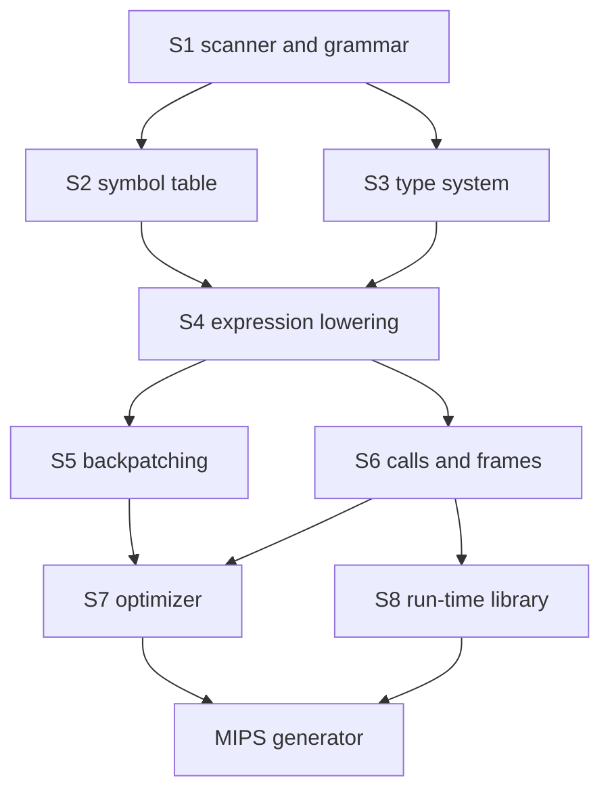
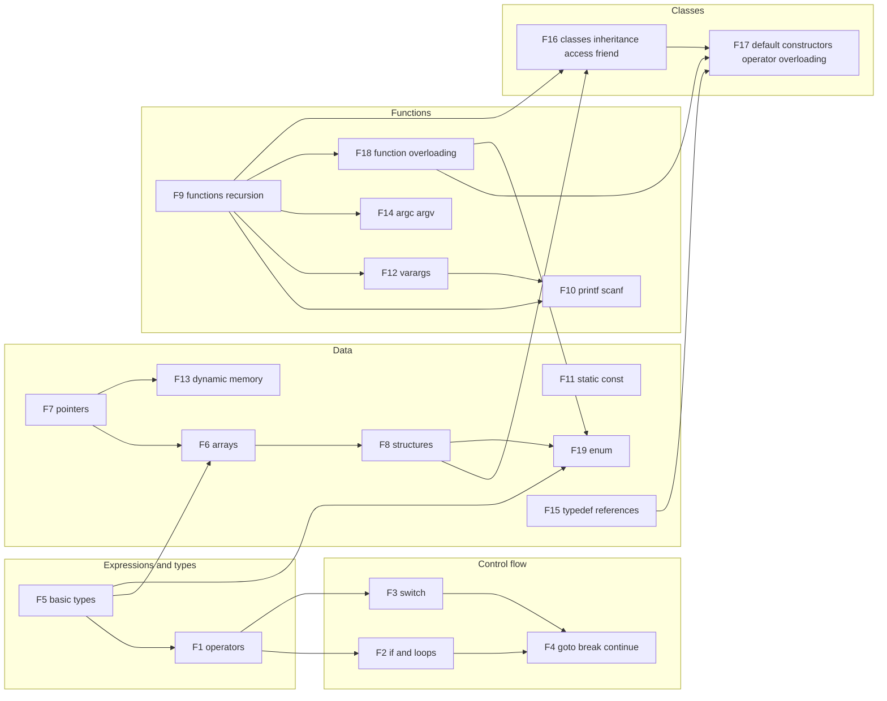
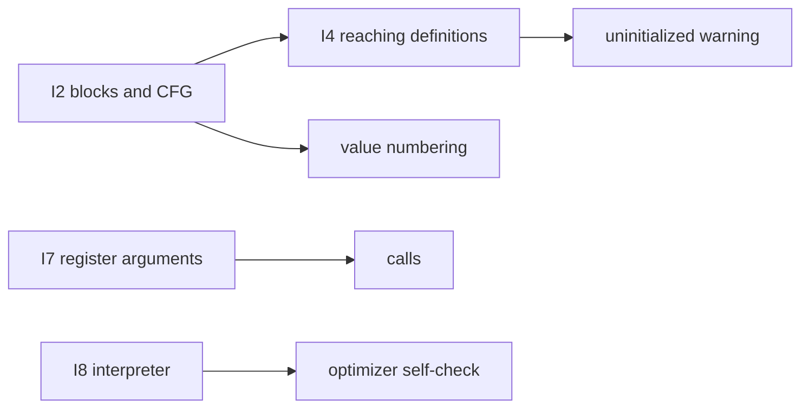

# Feature Connectivity

How every feature in the [README feature table](../README.md) is built inside the compiler, which shared parts it relies on, and what else has to change if you change or remove it. Written after the reductions and additions of D34–D41 (2026-11-22), updated for D42 (enum and union back) and D43 (`extern` removed); every location below is in the current source.

Use it to plan a change: find the feature, read **Relies on** (what must keep working for it), **Used by** (what breaks if you remove it), and the [impact table](#5-change-impact).

---

## 1. The shared parts everything connects through

Most features never talk to each other directly. They connect through eight shared parts:

| ID | Shared part | Where | What it gives the features |
|---|---|---|---|
| **S1** | Scanner and grammar | `phase2-parser/src/scanner.l`, `parser.y` | Tokens, the lexer hack (`TYPE_NAME`), AST nodes |
| **S2** | Symbol table | `shared/symbol_table` (`sem::SymbolTable`, `lookup`, `declare`) | Scopes, storage class, overload sets, unique names, mangling |
| **S3** | Type system | `shared/types` (`Type`, `RecordInfo`, `usualArithmetic`, `sizeOf`, `layoutRecord`) | Types, conversions, sizes and offsets |
| **S4** | Expression and lvalue lowering | `phase3-ir/src/gen_expr.cpp` (`rvalue`, `lvalue`, `load`, `store`, `convert`) | Turns any expression into TAC |
| **S5** | Backpatching | `irgen.h` (`makelist`, `merge`, `backpatch`), `cond()`, `stmt()` | Jumps for every condition and statement |
| **S6** | Calls and frames | `Generator::call`, `buildFrame`; MIPS `Emitter::call`, `Emitter::function` | Argument passing, activation records |
| **S7** | Optimizer and its analyses | `phase3-ir/src/opt.cpp` | Basic blocks, CFG, liveness, reaching definitions, value numbering |
| **S8** | Run-time library | `phase4-codegen/runtime/runtime.s` | `printf`, `scanf`, heap, 64-bit helpers, run-time errors |

---

## 2. All features and their connections

An arrow `A --> B` means **B is built on A**: removing A breaks B. There are no cycles, so features can be removed from the right-hand side without touching the left.

---

## 3. Feature by feature

Each feature lists its internal pieces (with code), what it relies on, and what relies on it. Phases: **L** lexer, **P** parser, **S** semantic, **T** TAC, **O** optimizer, **M** MIPS.

### F1 Operators (arithmetic, logical, relational, bitwise, assignment, unary)

| Internal piece | Phase | Code |
|---|---|---|
| Precedence and associativity | P | `parser.y` lines 106–133 (`%left`, `%right`, `binary_expr`, `unary_expr`) |
| Result type, usual arithmetic conversions | S | `SemanticAnalyzer::binary`, `unary`, `usualArithmetic()` |
| Constant folding at compile time | S | `foldBinary` |
| Unsequenced-modification warning | S | `sequencing.cpp` (`checkSequencing`) |
| Assignment used as a condition warning | S | `condition()` in `statements.cpp` (D37) |
| Arithmetic quads, typed operators | T | `Generator::binary`, `unary`, `incDec`, `assignment` |
| `&&`, `||`, `!`, relations as jumps | T | `cond`, `relJump`, `boolValue` |
| Folding, simplification, shifts | O | `numberBlock`, `simplify` (D38 rules) |
| Instruction selection, `slt` idiom | M | `Emitter::binary`, `unary`, `setCondition` |
| Division-by-zero check | M | `binary()` and `__div_by_zero`, `__udivmodll` (D37) |

- **Relies on:** S1, S3 (types), F5.
- **Used by:** every other feature that has an expression: F2, F3, F6, F7, F17 (operator overloading reuses the same nodes).

### F2 if-else, for, while, do-while, `until`

| Internal piece | Phase | Code |
|---|---|---|
| Grammar, dangling else | P | `selection_stmt` with `%prec IFX`; `UNTIL` token |
| Scalar condition check | S | `condition()` |
| Missing return, unreachable code | S | `flowChecks`, `completes` |
| Jumping code with backpatching | T | `stmt()` cases `IfStmt`, `WhileStmt`, `UntilStmt` (lists swapped), `DoWhileStmt`, `ForStmt` |
| Jump clean-up, unrolling by two | O | `cleanJumps`, `unrollLoops` (D38), `loops()` |
| Branch instructions | M | `Emitter::branch` |

- **Relies on:** F1 (conditions), S5.
- **Used by:** F4 (`break`/`continue` live inside loops), the loop optimizations in S7.

### F3 switch/case/default

| Internal piece | Phase | Code |
|---|---|---|
| Duplicate case, integer subject | S | `SwitchCtx` in `statements.cpp` |
| Tests placed after the body | T | `stmt()` case `SwitchStmt`; `Breakable::cases`, `defaultPos` |
| Jump over an initialization into a case | S | `jumpScopes` |

- **Relies on:** F1, S5, F4 (`break` leaves the switch).
- **Used by:** nothing else.

### F4 goto, labels, break, continue

| Internal piece | Phase | Code |
|---|---|---|
| Labels have function scope | S | `collectLabels`; labels as hidden symbols (`declareHidden`) |
| Jump over an initialization is an error | S | `jumpScopes` |
| `break`/`continue` lists per loop | T | `Breakable` stack in `irgen.h` |
| Forward `goto` patched at the label | T | `labels`, `pendingGotos` |

- **Relies on:** F2, F3, S5.
- **Used by:** nothing else. (Before D35 it also had to destroy objects when leaving blocks; that link is gone.)

### F5 int, char, void, short, long, float, double, bool, unsigned (and `long long`)

| Internal piece | Phase | Code |
|---|---|---|
| Type keywords | L/P | `type_specifier` rules |
| Structural types, sizes (ILP32) | S | `sem::Type`, `sizeOf`, `alignOf` |
| Conversions | S/T | `convertible`, `checkConstantConversion`; `Generator::convert` (`Conv` quads) |
| Machine classes | T | `Cls`, `classOf()` in `tac.cpp` |
| Float / double / 64-bit instructions | M | `.s`/`.d` forms; register pairs and `__divll`… for `long long` |

- **Relies on:** S1, S3.
- **Used by:** everything that has a value.

### F6 Arrays, multi-dimensional arrays

| Internal piece | Phase | Code |
|---|---|---|
| Array types, decay to pointer | S | `arrayOf`, `decay` |
| Constant out-of-bounds warning | S | `index()` (`array-bounds`) |
| Row-major address `((i1 × n2) + i2) × w` | T | `indexLValue`, `scaled` |
| Brace initializers | S/T | `checkInitializer`; `initItems`, `initAggregate` |
| Indexed load/store | M | `element()` |

- **Relies on:** F5, F7 (indexing through a pointer is `*(p + i × w)`).
- **Used by:** F8 (arrays of structs, arrays in structs), F14 (`argv`).

### F7 Pointers, multi-level pointers, pointer arithmetic

| Internal piece | Phase | Code |
|---|---|---|
| Structural pointer types, const per level | S | `pointerTo`; `const` on each level |
| Null pointer constant, comparisons | S | `isNullPointerConstant` |
| Scaled `p + i`, `p - q` | T | `Generator::binary` (`pointerAdd`, `scaled`) |
| `&x`, `*p` | T | `AddrOf`, `Load`, `Store` |
| Address-taken variables stay in memory | O | `inMemory`, `addressTaken` (blocks CSE and register homes) |

- **Relies on:** F5.
- **Used by:** F6, F13, F15 (references are addresses), F16 (`this`, base pointers).

### F8 Structures, unnamed structs, anonymous struct members, brace elision

| Internal piece | Phase | Code |
|---|---|---|
| Records, member offsets | S | `recordDefinition`, `layoutRecord` |
| Unnamed structs and promoted members | S | `nameAnonymousTag`, `anonymousMember`, `RecordInfo::promoted` |
| Brace elision, designators | S | `elideBraces`, `takeElided`, `designatorIndex` |
| Member access as offsets | T | `member()`, `lvalue()` |
| Block copies, by-value passing and return | T/M | `Op::Store` with `Cls::Block`; `copyBytes`, `__memcpy` |

- **Relies on:** F5, F6, S3.
- **Used by:** F16 (a class is a record with methods).

### F9 Functions, recursion, prototypes, forward calls

| Internal piece | Phase | Code |
|---|---|---|
| Forward calls (use before declaration) | P/S | `queuePendingReference`; `prescan`, `hoistFunction` |
| Signatures, argument checks | S | `functionSignature`, `checkCallArgs` |
| `param` / `call` quads | T | `Generator::call`, `callExpr` |
| Frame table | T | `buildFrame` |
| Inlining, tail recursion, dead functions | O | `inlineCalls`, `tailRecursion`, dead-function removal in `optimize()` (D38) |
| Activation record, register arguments | M | `Emitter::function` (prologue/epilogue), `Emitter::call` (`$a0`–`$a3` at `-O1`+, D39) |
| Stack-overflow check | M | prologue check against `__stack_limit` (D37) |

- **Relies on:** S2, S6.
- **Used by:** F10, F12, F14, F16 (methods), F17, F18.

### F10 printf / scanf

| Internal piece | Phase | Code |
|---|---|---|
| Reserved words, built-in calls | L/S | `PRINTF`, `SCANF` tokens; `builtinCall` |
| Format checking | S | `checkFormat` |
| Built-in call quads, variadic promotion | T | `builtin()`, `promoteVariadic` |
| Interpreter | T | host `printf`/`scanf` in `interp.cpp` |
| Hand-written MIPS routines | M | `__printf`, `__scanf` in `runtime.s` (always all arguments on the stack) |

- **Relies on:** F9, F12 (variadic arguments), S8.
- **Used by:** nearly every test program, so it is the riskiest to change.

### F11 static, const

(`extern` was removed by D43: every object declaration is a definition.)

| Internal piece | Phase | Code |
|---|---|---|
| Storage classes | S | `Storage::Global`, `Static`; `storageClasses` (more than one is an error) |
| Static data, initial values | T | `globals()`, `globalInit`, `GlobalInit` |
| Const correctness | S | `checkModifiable`, `convertible` (const per level) |
| Static local with a constructor is an error | S | `hasConstructor` check in `variable()` (D35) |
| `.data` emission | M | `Emitter::globals` |

- **Relies on:** S2, S3.
- **Used by:** F16 (static members are static data).

### F12 Variable arguments (`...`, `va_*`)

| Internal piece | Phase | Code |
|---|---|---|
| `...` parameters, `va_*` built-ins | P/S | `ELLIPSIS`, `VA_*` tokens; `varargBuiltin` |
| Default promotions | T | `promoteVariadic` |
| `VaStart`, `VaArg`, `VaEnd` quads | T | `builtin()` |
| Walk the argument area | M | `varargStart`; a variadic callee spills all of `$a0`–`$a3` to its home area (D39) |

- **Relies on:** F9, S6 (arguments must be in memory for the walk).
- **Used by:** F10.

### F13 Dynamic memory (`malloc` … `free`)

| Internal piece | Phase | Code |
|---|---|---|
| Reserved built-ins | L/S | `MALLOC`, `FREE`, … ; `builtinCall` |
| Interpreter heap | T | `heapAlloc` in `interp.cpp` |
| Free-list allocator over `sbrk` (D45) | M/I | `__malloc`, `__calloc`, `__realloc`, `__free`, `__heap_free`; interpreter `mallocBlock`, `freeBlock` |

- **Relies on:** F7, S8.
- **Used by:** nothing in the compiler (programs only).

### F14 Command-line input (`argc`, `argv`)

| Internal piece | Phase | Code |
|---|---|---|
| `main` signature check | S | `checkMainSignature` |
| Interpreter arguments | T | `run(program, args, input)` |
| Start-up code | M | `main:` stores `$a0`/`$a1`, calls `main_` (`Emitter::run`) |

- **Relies on:** F9, F6, F7.
- **Used by:** nothing else.

### F15 typedef, references

| Internal piece | Phase | Code |
|---|---|---|
| Lexer hack for type names | L/P | `addTypeName`, `isTypeName`, `TYPE_NAME` |
| Typedef symbols | S | `typedefDecl` |
| References as addresses | T | `referenceTo`, `throughReference`; reference parameters pass an address |
| Const reference to a temporary | T | `referenceTo` makes a converted temporary |

- **Relies on:** S1 (typedef needs the scanner), F7 (references are addresses).
- **Used by:** F16 and F17 (reference parameters, `operator+=` returning `T &`).

### F16 Classes, single inheritance, access modifiers, `friend`

| Internal piece | Phase | Code |
|---|---|---|
| Class records, member scope | S | `recordDefinition`, `ScopeKind::Record` |
| Methods, `this` | S/T | `functionSignature` (`ownerRecord`); `Generator::function` creates `this` |
| Static members | S/T | `Storage::Static`; `globals()` |
| Single inheritance only | S | one base in `recordDefinition` (D35); base at offset 0 |
| Base member lookup, access capping | S | `lookupMember`, `checkAccess` |
| Friends | S | `friendFunction`, `friendFunctions`, `friendClasses` |
| No slicing, no nested or local classes | S | `convertible`, `argumentConversion`; `isCxxClass` (D35) |
| Method calls | T | `callExpr` (`this` is the object's address) |

- **Relies on:** F8, F9, F7, F11, S2.
- **Used by:** F17.

### F17 Default constructors, operator overloading

| Internal piece | Phase | Code |
|---|---|---|
| One constructor `T()`, no parameters | S | `recordDefinition` (constructor case), `construct()`, `outOfClassSpecial` (D35) |
| Base, then members, then body | T | `constructSubobjects`, `defaultConstruct` |
| Global objects built before `main` | T | `dynamicGlobals` in `Generator::function` |
| `T x(other)`: a block copy | T | `constructInto` |
| Operator overloading | S/T | `overloadedOperator`, `checkOperatorDeclaration`; `overloaded()` |

- **Relies on:** F16, F18 (operators are resolved like overloads), F15.
- **Used by:** nothing else.

### F18 Function overloading

| Internal piece | Phase | Code |
|---|---|---|
| Overload sets | S | `Scope::names` holds a vector per name |
| Ranking, ambiguity | S | `resolveOverload`, `argumentConversion`, `ConvRank` (Exact, Promotion, Conversion, Ellipsis) |
| Itanium link names | S | `mangle()` |
| A distinct function per overload | T/M | the callee `Symbol*`; MIPS labels are the mangled names |

- **Relies on:** F9, S2, S3.
- **Used by:** F17.

### F19 enum (D42)

| Internal piece | Phase | Code |
|---|---|---|
| Keyword and enum rules | L/P | `ENUM` token; `struct_or_class_specifier` (`EnumDecl`), `enumerator_list`, `enumerator`; `ENUM_TAG`, `ENUM_CONST` in the parse-time table; `union` is reserved and rejected by the scanner (D50) |
| Enum type | S | an Int `Type` with `enumInfo` (`enumType`, `isEnum`, `EnumInfo`); C++ conversions in `implicitConversion`; promotion in `integerPromotion`; `?:` in `ternary()`; no `++`/`--` |
| Enumerators | S | `enumDefinition()`: `SymbolKind::EnumConstant`, value folded onto each use by `identifier()` |
| Enum link names | S | `Mangler::canonical` (an enum by its name) |
| Lowering | T | an enumerator is `icon()` in `rvalue()`; an enum is a plain int |
| Back end | O/M | nothing new: an enum is an int |

- **Relies on:** F5 (an enum is an int), F18 (overloading on enums), S2, S3.
- **Used by:** nothing.

---

## 4. Infrastructure features (not rows in the table, but connected to many)

| ID | Feature | Code | Connected to |
|---|---|---|---|
| I1 | Diagnostics, error recovery | `shared/diagnostics`; `error ';'`, `error '}'` rules; Error type | every phase |
| I2 | Basic blocks, CFG | `blockLeaders`, `basicBlocks`, `flowGraph` | F2, F3, F4 and all of S7 |
| I4 | Reaching definitions | `ReachingDefinitions` (D38) | uninitialized-variable warning |
| I7 | Register arguments | `loadArgumentRegisters`, `saveArgumentRegisters` | F9 (calls) |
| I8 | TAC interpreter | `interp.cpp` | optimizer self-check, `--run`, depth limit (D37) |
| I9 | Combined driver | `mips_generator` with `--tokens`, `--ast`, `--symbols`, `--tac`, `--run` (D40) | all phases |

---

## 5. Change impact

What you must touch if you **remove** or **change** each feature. "Tests" names the suites that cover it.

| Feature | To remove it, change | Breaks if removed | Tests |
|---|---|---|---|
| F1 operators | (not removable) | everything | all suites |
| F2 if / loops | `parser.y`, `stmt()`, `flowChecks`, `unrollLoops` | F4, loop optimizations | `t02`, `t25`, `t35` |
| F3 switch | `parser.y` switch rules, `SwitchCtx`, `stmt()` | nothing | `t02`, `t25` |
| F4 goto / break / continue | `labels`, `pendingGotos`, `Breakable`, `jumpScopes` | nothing | `t02`, `t25`, `e23` |
| F5 types | (not removable); dropping one type: scanner, `TypeKind`, `classOf`, MIPS selection | depends on the type | `t21`, `t34` |
| F6 arrays | `indexLValue`, `initItems`, `arrayOf` | F8 arrays, F14 `argv` | `t04` |
| F7 pointers | `pointerAdd`, `AddrOf`/`Load`/`Store` | F6, F13, F15, F16 | `t05` |
| F8 structs | `recordDefinition`, `layoutRecord`, block copies | F16 | `t06`, `t33` |
| F9 functions | (not removable) | most features | all |
| F10 printf / scanf | `builtin()`, `checkFormat`, `__printf`, `__scanf` | every test's output | all |
| F11 static / const | `Storage`, `globals()`, `checkModifiable` | static members (F16) | `t19`, `t26` |
| F12 varargs | `varargBuiltin`, `VaStart`…, `varargStart`, variadic spill in prologue | F10 if written in C; the runtime does not need it | `t07`, `t16` |
| F13 malloc | built-ins, `__malloc` | nothing in the compiler | `t09` |
| F14 argc / argv | start-up code, `checkMainSignature` | nothing | `t11` |
| F15 typedef / references | lexer hack, `typedefDecl`, `referenceTo` | reference parameters in F16 and F17 | `t24`, `t26` |
| F16 classes | `recordDefinition` class parts, `this`, `checkAccess`, friends | F17 | `t08`, `t23`, `t27`, `v10`, `v27`, `e09`, `e23` |
| F17 constructors / operators | `construct`, `constructSubobjects`, `overloadedOperator` | nothing | `t08`, `t27`, `v17` |
| F18 overloading | `resolveOverload`, `mangle` | F17 operators, F19 enum overloads | `v21`, `e15` |
| F19 enum | the token and rules, `enumDefinition`, `enumInfo` checks, `icon()` for enumerators | nothing | `v28`, `e25`, `t36` |

### Changes that are cheap because nothing depends on them

F3, F4, F13, F14, F17, F19 and every infrastructure analysis except I2 are leaves: removing or rewriting one touches only its own code and tests.

### Changes that ripple

- **F7 pointers** feeds arrays, the heap, references and classes.
- **F9 functions / S6 calls** is shared by every call; the D39 register convention lives here, so any change to argument passing must be mirrored in `Emitter::call` (caller), the prologue in `Emitter::function` (callee), and `varargStart` (variadic walk).
- **F10 printf** is in every test program; a change there must keep all 45 TAC and 45 SPIM outputs identical.

---

## 6. What changed since the previous analysis

The earlier [advanced feature analysis](ADVANCED_COMPILER_FEATURE_ANALYSIS.md) was written before D34–D41. Its status column differs from today's code as follows:

| Earlier item | Now |
|---|---|
| Preprocessor | Removed (D34): any `#` line is a lexical error |
| CLS-09–13, 14, 16, 17, 20 (constructors with parameters, initializer lists, copy constructors, destructors, temporaries, const methods, explicit, nested/local classes, static objects) | Removed (D35); only `T()` remains |
| INH-02, 05–15 (multiple inheritance, slicing, virtual functions and everything serving them) | Removed (D35); single inheritance only |
| OVL-06 converting constructors | Removed (D35) |
| OPT-06 loop-invariant code motion | Removed (D36) |
| SAF-08 assignment as a condition | Implemented (D37) |
| SAF-10 division by zero, SAF-14 deep recursion | Implemented in both back ends (D37) |
| OPT-10 more algebraic rules, OPT-12 loop unrolling, OPT-15 dead functions | Implemented (D38) |
| INF-04 reaching definitions | Implemented (D38), drives the uninitialized warning |
| BCK-06 register calling convention, BCK-09 frame slot reclamation | Implemented (D39) |
| INF-16 combined driver | Implemented (D40) |
| enum, union (dropped by D1) | enum back (D42) with C++ rules; union back with D42, removed again (D50) |
| `extern` | Removed (D43) |
