# How the compiler translates a program

This document explains, with diagrams, how a source program becomes Three
Address Code (TAC): what the passes are, how the syntax-directed
translation (SDT) of Lectures 25–27 is implemented, and, construct by
construct, which rule produces which code. Every TAC listing below is real
output of `phase3-ir/tac_generator` (unoptimized), not a hand-written
example.

**Contents**

1. [A multi-pass compiler](#1-a-multi-pass-compiler)
2. [From the slides' SDT to our code](#2-from-the-slides-sdt-to-our-code)
3. [One expression, end to end](#3-one-expression-end-to-end)
4. [Markers M and N](#4-markers-m-and-n)
5. [Boolean expressions](#5-boolean-expressions): relational, `&&`, `||`, `!`, as a value
6. [Statements](#6-statements): `if`, `if-else`, `while`, `until`, `do-while`, `for`, `switch`, `break` / `continue`, `goto`, `return`
7. [Expressions with their own rules](#7-expressions-with-their-own-rules): assignment, arrays, `?:`, calls
8. [Where to find each rule](#8-where-to-find-each-rule)

How to read the diagrams: boxes are blocks of generated code, arrows are
the jumps between them, and the **orange** box is the point that
backpatching fills in, the instruction number a marker `M` records.

How to read the code: every section shows the function that implements
the rule, shortened to its translation logic (type checks, destructors and
other bookkeeping left out), with each line's comment naming the part of
the slide rule it is.

---

## 1. A multi-pass compiler

A *pass* is one complete trip over the program. The compiler makes one
pass per phase, each over the result of the one before:

```mermaid
flowchart LR
    SRC(["source.c"]) --> PP["1 · Preprocessor<br/>define, include, if"]
    PP --> PARSE["2 · Lexer + parser<br/>builds the syntax tree"]
    PARSE --> SEM["3 · Semantic analysis<br/>types, symbols, offsets"]
    SEM --> TAC["4 · TAC generation<br/>the SDT rules"]
    TAC --> OPT["5 · Optimizer<br/>-O1 / -O2 / -O3"]
    OPT --> MIPS["6 · MIPS generation"]
    MIPS --> OUT(["file.s → SPIM"])

    classDef pass fill:#ffffff,stroke:#2d3142,color:#2d3142
    classDef focal fill:#fdf0ea,stroke:#eb6c36,color:#2d3142,stroke-width:2px
    classDef io fill:#f5f5f5,stroke:#8a8f9e,color:#2d3142
    class PP,PARSE,SEM,OPT,MIPS pass
    class TAC focal
    class SRC,OUT io
```

| Pass | Reads | Writes | Folder |
|---|---|---|---|
| 1 | source text | text with macros and `#include` expanded | `shared/preprocessor` |
| 2 | that text | the syntax tree (AST) | `phase2-parser` |
| 3 | the whole tree | the same tree, with each expression's type, the symbol each name means, struct offsets | `phase2b-semantic` |
| 4 | the annotated tree | TAC quadruples, one array per function | `phase3-ir` |
| 5 | the TAC | shorter TAC that behaves the same | `phase3-ir/src/opt.cpp` |
| 6 | the TAC | MIPS assembly | `phase4-codegen` |

**Why not a single pass.** The slides generate TAC inside the parser,
while each rule is reduced. That needs every fact the rule uses to be known
at that moment. Ours are not:

- a function may be called before it is declared, so its parameter types
  and the overload a call picks are only known after the whole file;
- a method may use class members declared below it;
- the TAC needs each expression's type (`int+` or `double+`, which
  conversions to insert) and every struct field's offset, and those are
  what pass 3 computes.

So the parser only builds the tree, pass 3 annotates it, and pass 4 runs
the SDT rules over the finished tree (decision D10 in
[`DESIGN_LOG.md`](DESIGN_LOG.md)). Inside pass 4 the TAC of a function is
still produced in **one walk**: backpatching fills in every jump target as
it goes, so no extra pass over the code is needed.

---

## 2. From the slides' SDT to our code

The rules are the slides' rules. What changes is *when* they run.

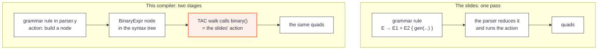

Every name in the slides has a counterpart in
[`phase3-ir/include/irgen.h`](../phase3-ir/include/irgen.h):

| Slides | Here |
|---|---|
| `E.place` | the value an expression function **returns** (a temporary, a variable or a constant) |
| `E.code` | the instructions it `emit()`s, in order |
| `newtemp()` / `gen(...)` | `newTemp()` / `emit()` |
| `makelist`, `merge`, `backpatch` | `makelist()`, `merge()`, `backpatch()` |
| `nextquad` | `nextQuad()` |
| `B.truelist`, `B.falselist` | two lists `cond()` fills |
| `S.nextlist` | the list `stmt()` returns |
| a production, e.g. `E → E1 op E2` | a kind of tree node, e.g. `BinaryExpr`, and the function for it, `binary()` |

The parser's own actions are an SDT too, but theirs produce the tree, not
TAC: `expr : expr '+' expr { $$.node = mkNode(BinaryExpr, "+", {$1, $3}); }`.

---

## 3. One expression, end to end

`x = a + b * c;`

**Pass 2** builds this tree (one node per reduced rule):

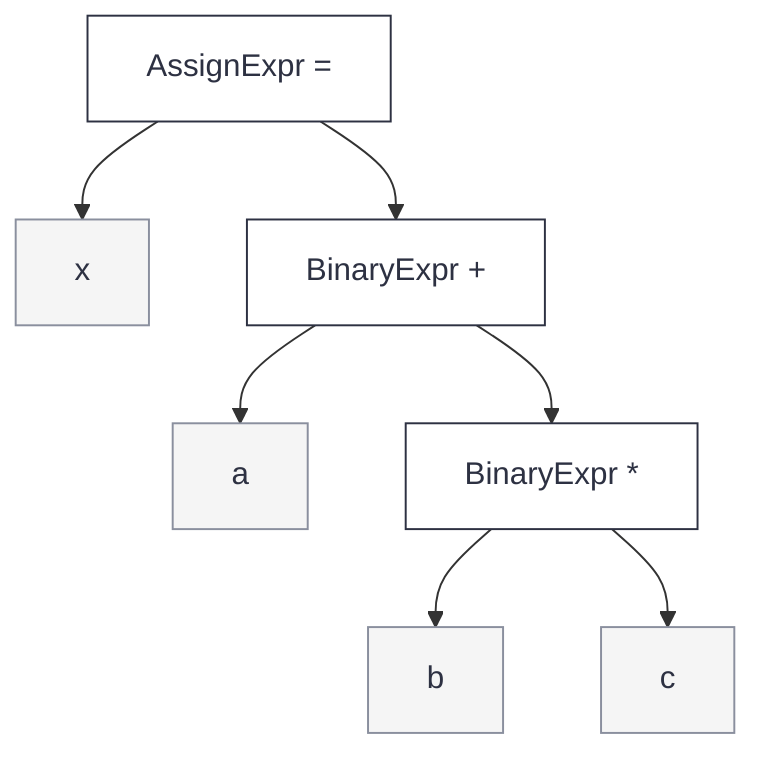

**Pass 4** walks it. Each function first asks its children for their
`place`, then applies the rule, so the code comes out bottom-up, exactly
in the order the slides' parser would reduce:

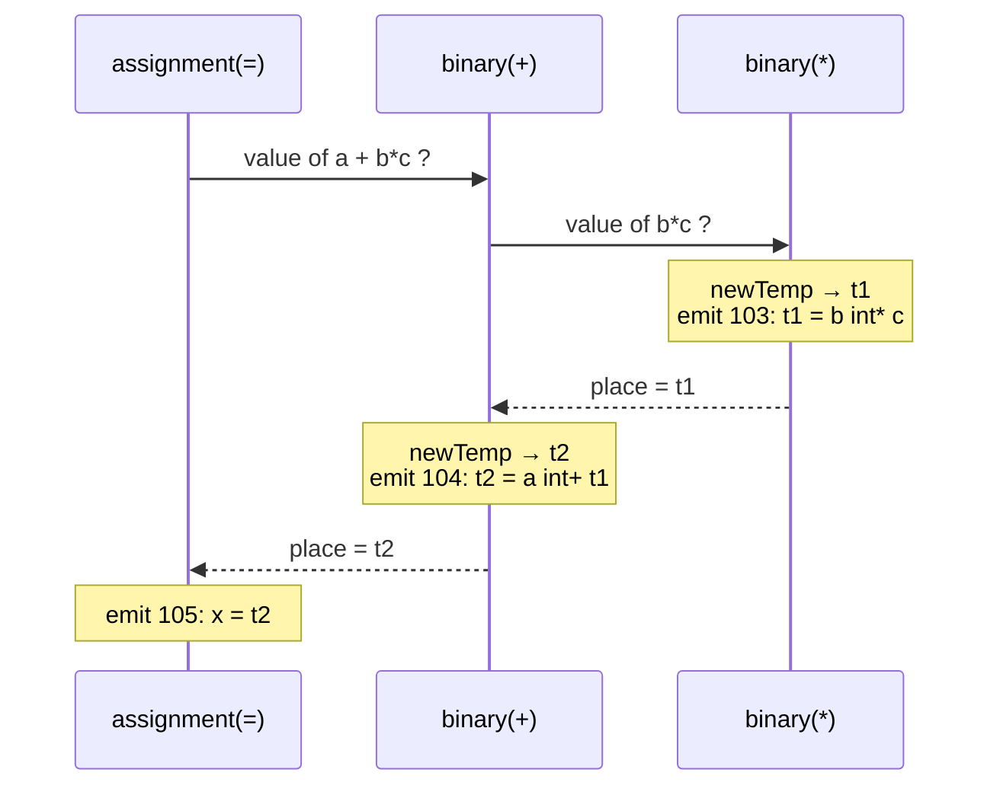

The function for `E → E1 op E2`, simplified from
[`gen_expr.cpp`](../phase3-ir/src/gen_expr.cpp):

```cpp
// E -> E1 op E2  { E.place = newtemp(); gen(E.place '=' E1.place op E2.place) }
Operand Generator::binary(node n) {
    Operand a = rvalue(n->children[0]);   // E1.place
    Operand b = rvalue(n->children[1]);   // E2.place
    return emitBinary(op, a, b, type);    // newTemp() + emit(t = a op b), returns E.place
}
```

```
103     t1 = b int* c
104     t2 = a int+ t1
105     x = t2
```

---

## 4. Markers M and N

The slides put empty rules into the grammar,

```
M → ε   { M.quad = nextquad }
N → ε   { N.nextlist = makelist(nextquad); gen('goto _') }
```

because a parser can only run code at the end of a rule, and backpatching
needs to record "where the next part starts" *in the middle* of one.

Our parser emits no code, so its grammar has **no markers** and the tree
has no marker nodes. The TAC function for a rule handles the rule's parts
one after another, so the middle of the rule is simply a line between two
calls:

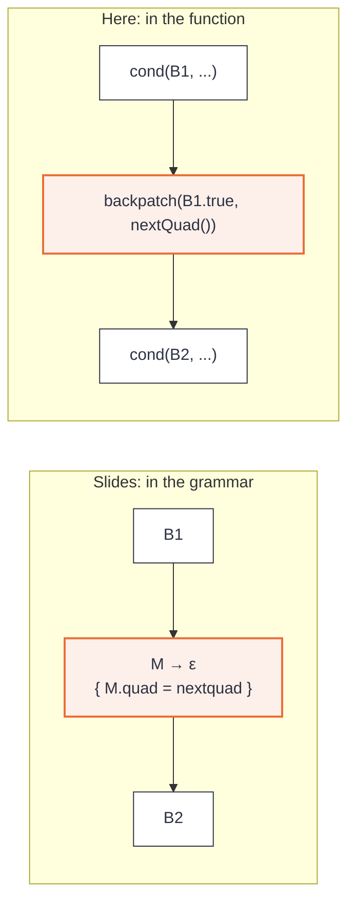

| Marker | Here |
|---|---|
| `M` | `nextQuad()`, called where `M` would be reduced |
| `N` | `emitGoto()`, which emits `goto _` and returns its index for a list |

---

## 5. Boolean expressions

A condition is translated into **jumping code** (Lecture 27): it leaves
behind two backpatch lists, `B.truelist` (jumps to take when it is true)
and `B.falselist`. The statement using it decides where they go. All of
this is `cond()` and `relJump()` in
[`gen_expr.cpp`](../phase3-ir/src/gen_expr.cpp).

### 5.1 Relational: `B → E1 relop E2`

```
B.truelist  = makelist(nextquad)
B.falselist = makelist(nextquad + 1)
gen('if' E1.place relop E2.place 'goto _')
gen('goto _')
```

```cpp
// cond(), relational case
trueList.push_back(relJump(n));            // B.truelist  = makelist(nextquad); gen('if' E1 relop E2 'goto _')
falseList.push_back(emitGoto());           // B.falselist = makelist(nextquad+1); gen('goto _')

// relJump(): both sides converted to their common type, then one IfRel quad
q.op = Op::IfRel;  q.a = E1.place;  q.b = E2.place;  q.relop = "<";
return emit(q);                            // its index, kept in B.truelist
```

Two jumps, both still open; for `if (a < b) x = 1;`:

```
103       if a int< b goto L1      ← B.truelist
104       goto L2                  ← B.falselist
105  L1:  x = 1
106  L2:  return x
```

### 5.2 `B → B1 && M B2`

```
backpatch(B1.truelist, M.quad)
B.truelist  = B2.truelist
B.falselist = merge(B1.falselist, B2.falselist)
```

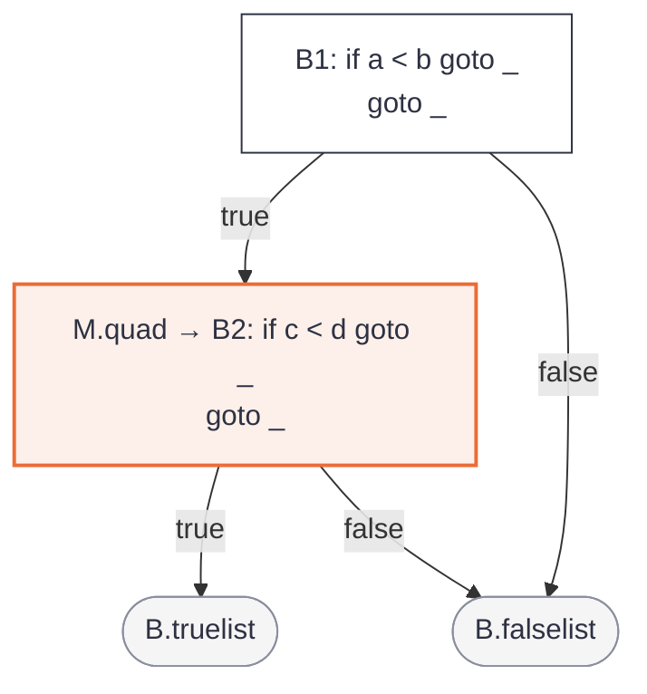

```cpp
// cond(), case &&
List leftTrue;
cond(B1, leftTrue, falseList);             // B1; its false jumps go straight into B.falselist
backpatch(leftTrue, nextQuad());           // M: backpatch(B1.truelist, M.quad)
cond(B2, trueList, falseList);             // B2: B.truelist = B2.truelist, B2's false jumps join B.falselist
```

`if (a < b && c < d) x = 1;`

```
105       if a int< b goto L1      B1 true → M.quad (107)
106       goto L3                  B1 false ┐
107  L1:  if c int< d goto L2      B2       │ merged: B.falselist
108       goto L3                           ┘
109  L2:  x = 1                    B.truelist
110  L3:  return x
```

### 5.3 `B → B1 || M B2`

```
backpatch(B1.falselist, M.quad)
B.truelist  = merge(B1.truelist, B2.truelist)
B.falselist = B2.falselist
```

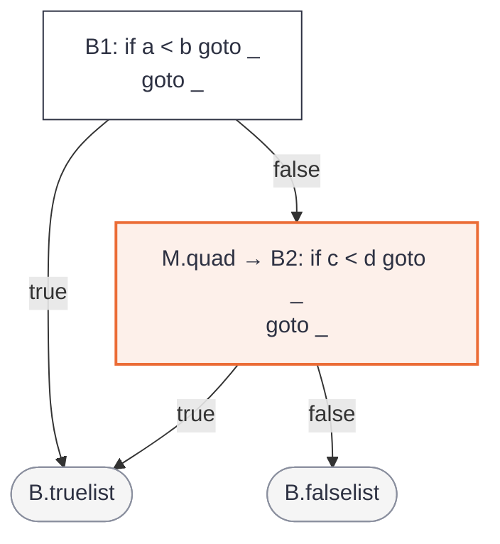

```cpp
// cond(), case ||
List leftFalse;
cond(B1, trueList, leftFalse);             // B1; its true jumps go straight into B.truelist
backpatch(leftFalse, nextQuad());          // M: backpatch(B1.falselist, M.quad)
cond(B2, trueList, falseList);             // B2: B2's true jumps join B.truelist, B.falselist = B2.falselist
```

`if (a < b || c < d) x = 1;`

```
105       if a int< b goto L2      B1 true ┐ merged: B.truelist
106       goto L1                  B1 false → M.quad (107)
107  L1:  if c int< d goto L2      B2 true ┘
108       goto L3                  B.falselist
109  L2:  x = 1
110  L3:  return x
```

### 5.4 `B → ! B1`

No code at all: the two lists swap.

```
B.truelist = B1.falselist      B.falselist = B1.truelist
```

```cpp
// cond(), case !
cond(B1, falseList, trueList);             // the two lists passed the other way round: no code
```

`if (!(a < b)) x = 1;` — the `if` now goes to `x = 1` on the *false* jump:

```
103       if a int< b goto L2      (true of a<b = false of !)
104       goto L1                  (false of a<b = true of !)
105  L1:  x = 1
106  L2:  return x
```

### 5.5 A boolean used as a value

When a condition's result is stored (`x = a < b;`), the slides'
four-instruction pattern turns the two exits into 1 and 0 (`boolValue()`):

```
E.place = newtemp()
gen('if' E1.place relop E2.place 'goto' nextquad+3)
gen(E.place '= 0');  gen('goto' nextquad+2);  gen(E.place '= 1')
```

```cpp
// boolValue()
Operand t = newTemp(intType());            // E.place = newtemp()
trueList.push_back(relJump(n));            // if E1 relop E2 goto _   (patched below)
backpatch(falseList, nextQuad());
emitAssign(t, icon(0));                    // t = 0
int skip = emitGoto();                     // goto _   (over the next line)
backpatch(trueList, nextQuad());           // the true jump lands here
emitAssign(t, icon(1));                    // t = 1
backpatch(makelist(skip), nextQuad());
return t;
```

```
102       if a int< b goto L1
103       t1 = 0
104       goto L2
105  L1:  t1 = 1
106  L2:  x = t1
```

`&&`, `||` and `!` used as values go through `cond()` first and land on the
same two assignments.

---

## 6. Statements

Every statement function returns **`S.nextlist`**: the jumps that must go
to whatever follows the statement. The enclosing block patches them
(`L → L1 M S { backpatch(L1.nextlist, M.quad) }` in `block()`). All of
this is `stmt()` in [`gen_stmt.cpp`](../phase3-ir/src/gen_stmt.cpp).

### 6.1 `S → if ( B ) M S1`

```
backpatch(B.truelist, M.quad)
S.nextlist = merge(B.falselist, S1.nextlist)
```

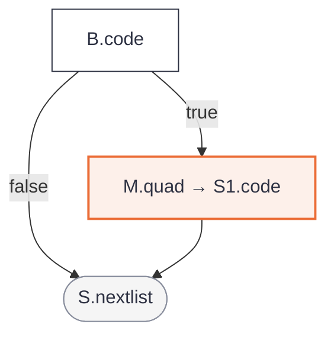

```cpp
cond(B, trueList, falseList);
backpatch(trueList, nextQuad());           // M
List next = stmt(S1);
return merge(next, falseList);             // S.nextlist
```

Output: see 5.1.

### 6.2 `S → if ( B ) M1 S1 N else M2 S2`

```
backpatch(B.truelist, M1.quad)
backpatch(B.falselist, M2.quad)
S.nextlist = merge(S1.nextlist, N.nextlist, S2.nextlist)
```

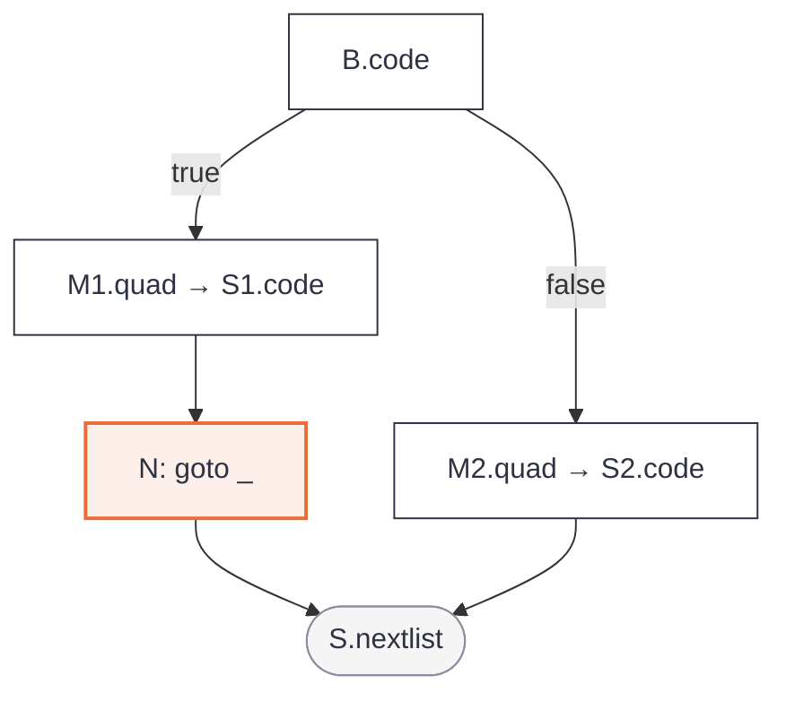

```cpp
cond(B, trueList, falseList);
backpatch(trueList, nextQuad());           // M1
List next = stmt(S1);
next.push_back(emitGoto());                // N
backpatch(falseList, nextQuad());          // M2
return merge(next, stmt(S2));
```

`if (a < b) x = 1; else x = 2;`

```
102       if a int< b goto L1
103       goto L2
104  L1:  x = 1                    M1.quad
105       goto L3                  N
106  L2:  x = 2                    M2.quad
107  L3:  return x                 (S.nextlist patched by the block)
```

### 6.3 `S → while M1 ( B ) M2 S1`

```
backpatch(S1.nextlist, M1.quad)
backpatch(B.truelist, M2.quad)
S.nextlist = B.falselist
gen('goto' M1.quad)
```

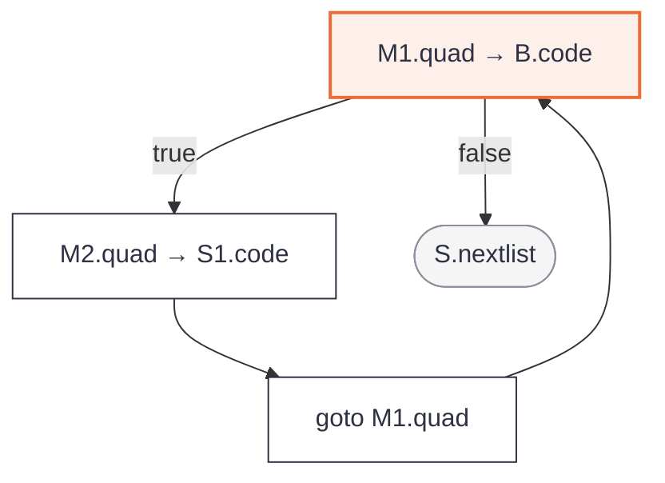

```cpp
int begin = nextQuad();                    // M1
cond(B, trueList, falseList);
backpatch(trueList, nextQuad());           // M2
List bodyNext = stmt(S1);
backpatch(merge(bodyNext, continues), begin);
emitGoto(begin);                           // gen('goto' M1.quad)
return merge(falseList, breaks);           // S.nextlist
```

`while (i < 10) { s = s + i; i = i + 1; }`

```
102  L1:  if i int< 10 goto L2     M1.quad
103       goto L3                  B.falselist = S.nextlist
104  L2:  t1 = s int+ i            M2.quad
105       s = t1
106       t2 = i int+ 1
107       i = t2
108       goto L1                  back to M1
109  L3:  return s
```

### 6.4 `S → until M1 ( B ) M2 S1`

This language's `until` loop (a `while` that runs *until* the condition
becomes true): the same rule as `while` with the two lists of `B` swapped.

```cpp
// stmt(), case UntilStmt: the while code, with cond()'s two lists passed swapped
int begin = nextQuad();                    // M1
cond(B, falseList, trueList);              // until: B true = leave, B false = run the body
backpatch(trueList, nextQuad());           // M2
List bodyNext = stmt(S1);
backpatch(merge(bodyNext, continues), begin);
emitGoto(begin);                           // gen('goto' M1.quad)
return merge(falseList, breaks);           // S.nextlist
```

`until (i >= 10) i = i + 1;`

```
101  L1:  if i int>= 10 goto L3    true → leave
102       goto L2                  false → body
103  L2:  t1 = i int+ 1
104       i = t1
105       goto L1
106  L3:  return i
```

### 6.5 `S → do M1 S1 while M2 ( B )`

```
backpatch(B.truelist, M1.quad)
backpatch(S1.nextlist, M2.quad)
S.nextlist = B.falselist
```

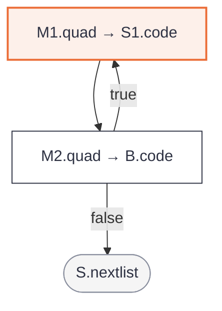

The body comes first, so it always runs once; there is no `goto` back,
the condition's true jump is the loop.

```cpp
// stmt(), case DoWhileStmt
int begin = nextQuad();                    // M1: the body starts here
List bodyNext = stmt(S1);                  // S1
backpatch(merge(bodyNext, continues), nextQuad());  // M2: backpatch(S1.nextlist, M2.quad); continue → the test
cond(B, trueList, falseList);              // B
backpatch(trueList, begin);                // backpatch(B.truelist, M1.quad): true jumps back to the body
return merge(falseList, breaks);           // S.nextlist = B.falselist (+ the breaks)
```

`do { i = i + 1; } while (i < 10);`

```
101  L1:  t1 = i int+ 1            M1.quad
102       i = t1
103       if i int< 10 goto L1     B true → M1
104       goto L2                  B.falselist
105  L2:  return i
```

### 6.6 `S → for ( S0 ; M1 B ; M2 E N ) M3 S1`

The `while` rule with the initialization in front and the step `E`
between the body and the jump back. `continue` goes to the step.

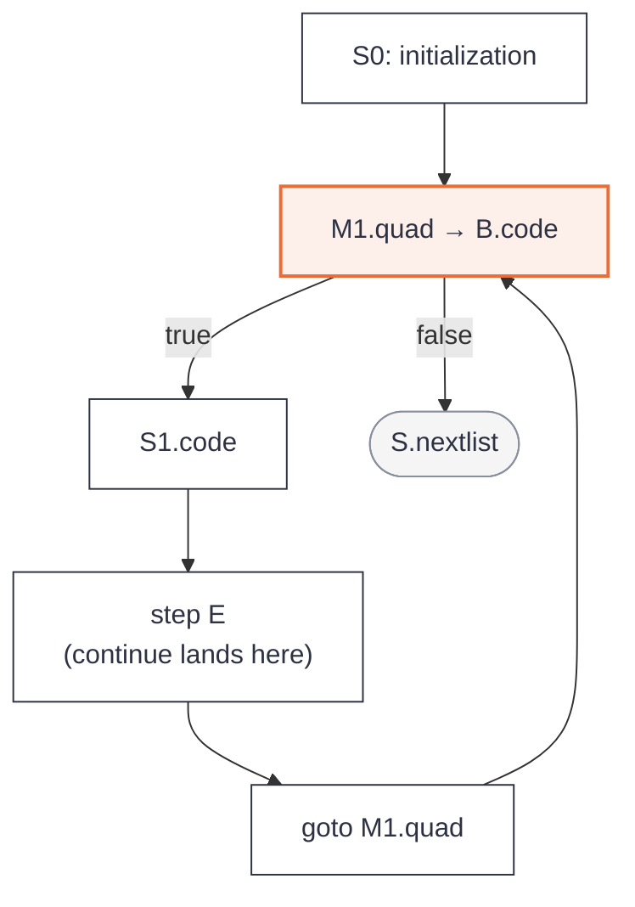

```cpp
// stmt(), case ForStmt
backpatch(stmt(S0), nextQuad());           // S0: the initialization
int begin = nextQuad();                    // M1: the test starts here
cond(B, trueList, falseList);              // B
backpatch(trueList, nextQuad());           // M3: true → the body
List bodyNext = stmt(S1);                  // S1
backpatch(merge(bodyNext, continues), nextQuad());  // M2: body end and continue → the step
rvalue(E, true);                           // E: the step
emitGoto(begin);                           // N: goto M1.quad
return merge(falseList, breaks);           // S.nextlist = B.falselist (+ the breaks)
```

`for (int i = 0; i < 10; i = i + 1) s = s + i;`

```
101       i = 0                    S0
102  L1:  if i int< 10 goto L2     M1.quad
103       goto L3                  B.falselist
104  L2:  t1 = s int+ i            body
105       s = t1
106       t2 = i int+ 1            step
107       i = t2
108       goto L1
109  L3:  return s
```

A variable declared in the initialization (`int i`) lives in a scope of
its own that covers the whole loop.

### 6.7 `S → switch ( E ) S1`

Lecture 27's layout: evaluate `E` once into a temporary, jump over the
body to the tests, and put the tests after the body, where all the case
positions are known.

```
t = E.place;  goto test
S1.code                 (case labels only record their position)
goto next
test: if t == v1 goto L1 ... if t == vn goto Ln
      goto Ldefault
```

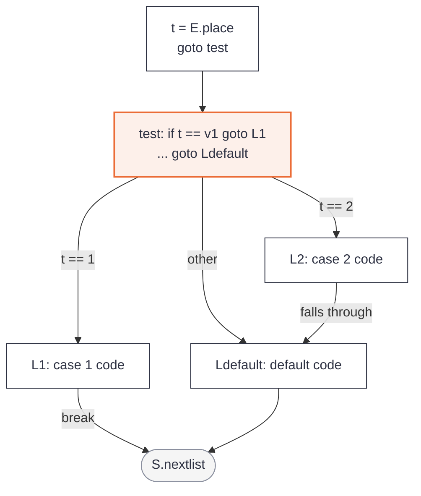

```cpp
// stmt(), case SwitchStmt
Operand t = newTemp(T);
emitAssign(t, E.place);                    // t = E.place
int toTests = emitGoto();                  // goto test
List bodyNext = stmt(S1);                  // S1: each case / default records nextQuad() as its position
bodyNext.push_back(emitGoto());            // goto next (the end of the last case)
backpatch(makelist(toTests), nextQuad());  // test:
for (auto &c : cases)                      //   if t == v_i goto L_i
    emit(IfRel(t, "==", c.value, /*target*/ c.position));
if (defaultPos >= 0) emitGoto(defaultPos); //   goto Ldefault
return merge(bodyNext, breaks);            // S.nextlist

// stmt(), case CaseStmt: no code, only the position
cases.push_back({value, nextQuad()});
return stmt(child);
```

`switch (k) { case 1: x = 10; break; case 2: x = 20; case 3: x = x + 1; break; default: x = -1; }`

```
102       t1 = k
103       goto L5                  to the tests
104  L1:  x = 10                   case 1
105       goto L6                  break
106  L2:  x = 20                   case 2 (falls through)
107  L3:  t2 = x int+ 1            case 3
108       x = t2
109       goto L6                  break
110  L4:  t3 = int- 1              default
111       x = t3
112       goto L6
113  L5:  if t1 int== 1 goto L1    the tests
114       if t1 int== 2 goto L2
115       if t1 int== 3 goto L3
116       goto L4                  default
117  L6:  return x
```

### 6.8 `break` and `continue`

```
S → break      { S.nextlist = makelist(nextquad); gen('goto _') }   → the loop's or switch's exit
S → continue   { gen('goto _') }, patched to the loop's next test   → the condition (for: the step)
```

Each loop and `switch` keeps a record of its open `break` and `continue`
jumps; when the loop is finished, `break`s join `S.nextlist` and
`continue`s are patched to the condition (`while`, `do-while`) or the step
(`for`). Objects with destructors in the blocks being left are destroyed
before the jump.

```cpp
// stmt(), case BreakStmt
destroyScopes(loop.scopeDepth);            // objects of the blocks being left
loop.breaks.push_back(emitGoto());         // S.nextlist = makelist(nextquad); gen('goto _')

// stmt(), case ContinueStmt
destroyScopes(loop.scopeDepth);
loop.continues.push_back(emitGoto());      // gen('goto _'), patched by the loop to its test or step

// and in the loop (while / for / do-while), when its body is done:
backpatch(merge(bodyNext, loop.continues), testOrStep);
return merge(falseList, loop.breaks);      // breaks leave with the loop's S.nextlist
```

`while (i < 100) { i = i + 1; if (i == 5) continue; if (i > 8) break; s = s + i; }`

```
102  L1:  if i int< 100 goto L2
103       goto L7
104  L2:  t1 = i int+ 1
105       i = t1
106       if i int== 5 goto L3
107       goto L4
108  L3:  goto L1                  continue → the condition
109  L4:  if i int> 8 goto L5
110       goto L6
111  L5:  goto L7                  break → after the loop
112  L6:  t2 = s int+ i
113       s = t2
114       goto L1
115  L7:  return s
```

### 6.9 `goto` and labels

A label records its instruction number when it is reached; a `goto`
emits `goto _` with that number, or, for a label further down, is kept in
a pending list and patched when the label is reached.

```cpp
// stmt(), case LabeledStmt
labels[label] = nextQuad();                // the label's instruction number
for (auto &g : pendingGotos)               // gotos written before the label:
    if (g.label == label) quads[g.jump].target = nextQuad();   // backpatch them now
return stmt(child);

// stmt(), case GotoStmt
destroyScopes(blocksLeft);                 // objects of the blocks the jump leaves
int j = emitGoto(known ? labels[label] : -1);   // goto L (or goto _ if L is further down)
if (!known) pendingGotos.push_back({label, j});
```

`again: i = i + 1; if (i < 3) goto again;`

```
101  L1:  t1 = i int+ 1            label again
102       i = t1
103       if i int< 3 goto L2
104       goto L3
105  L2:  goto L1                  goto again
106  L3:  return i
```

### 6.10 `return`

`S → return E { gen('return' E.place) }`. The value is computed first,
then the destructors of the objects still alive run, then the `return`.
Falling off the end of `main` adds `return 0`.

```cpp
// stmt(), case ReturnStmt
q.op = Op::Return;
q.a = convert(rvalue(E), returnType);      // E.place, in the function's return type
destroyTemporaries();                      // objects made while computing E
destroyScopes(0);                          // every local object still alive
emit(q);                                   // gen('return' E.place)
```

`int f(int k) { return k * 2; }`

```
100       t1 = k int* 2
101       return t1
```

---

## 7. Expressions with their own rules

### 7.1 Assignment: `S → id = E`

`gen(id.place '=' E.place)`, after converting `E` to the variable's type
(`assignment()`). `a op= b` is `a = a op b` with `a` evaluated once.

```cpp
// assignment(), case =
LValue lv = lvalue(L);                     // id, a[off], or *p
Operand v = convert(rvalue(E), lv.type);   // E.place, in the variable's type
store(lv, v);                              // gen(id '=' E.place) / a[off] = v / *p = v
return v;

// assignment(), case op=
Operand cur = load(lv);                    // a, read once
Operand r = emitBinary(op, cur, rvalue(E), type);   // t = a op E.place
store(lv, convert(r, lv.type));            // a = t
```

`x = a + b * c;`: see [section 3](#3-one-expression-end-to-end).

### 7.2 Arrays: `L → id [ E ]`, `L → L1 [ E ]`

The slides' row-major formula, `((i1 * n2) + i2) * w`, then an indexed
copy `a[off] = x` or `x = a[off]` (`indexLValue()`):

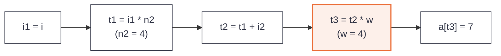

```cpp
// indexLValue(): A[i1][i2]...[ik]
Operand acc = rvalue(i1);                              // i1
for (k = 2; k <= dims; ++k) {
    acc = emitBinary(Mul, acc, icon(n_k), int);        // t = acc * n_k        "(n2 = 4)"
    acc = emitBinary(Add, acc, rvalue(i_k), int);      // t = t + i_k
}
Operand off = scaled(acc, w);                          // t = acc * w          "(w = 4)"
return addOffset(base, off, elemType);                 // L.array = a, L.offset = off
// then load(): x = a[off]   or   store(): a[off] = x
```

`int a[3][4]; a[i][j] = 7; x = a[i][j];`

```
102     t1 = i int* 4                       (n2 = 4)
103     t2 = t1 int+ j
104     t3 = t2 int* 4                      (w = 4)
105     a[t3] = 7
106     t4 = i int* 4                       (n2 = 4)
107     t5 = t4 int+ j
108     t6 = t5 int* 4                      (w = 4)
109     t7 = a[t6]
110     x = t7
```

### 7.3 `E → B ? E1 : E2`

`B` as jumping code, each branch stores into one temporary, an `N` jump
skips the second branch (`ternary()`).

```cpp
// ternary()
Operand t = newTemp(T);                    // E.place = newtemp()
cond(B, trueList, falseList);              // B
backpatch(trueList, nextQuad());           // M1
emitAssign(t, rvalue(E1));                 // t = E1.place
int skip = emitGoto();                     // N: goto _ over E2
backpatch(falseList, nextQuad());          // M2
emitAssign(t, rvalue(E2));                 // t = E2.place
backpatch(makelist(skip), nextQuad());     // N lands after E2
return t;
```

`m = a > b ? a : b;`

```
102       if a int> b goto L1
103       goto L2
104  L1:  t1 = a
105       goto L3                  N
106  L2:  t1 = b
107  L3:  m = t1
```

### 7.4 Calls: `S → call id ( Elist )`

```
Elist → Elist , E    { append E.place to queue }
S → call id ( Elist ) { for each p on queue: gen('param' p);  gen('call' id.place ',' n) }
```

All arguments are evaluated before the first `param` (an argument may
itself contain a call); a method gets the object's address, `this`, as its
first parameter (`call()`).

```cpp
// call()
std::vector<Operand> queue;
for (auto &arg : args)                     // Elist → Elist , E { append E.place to queue }
    queue.push_back(argumentFor(paramType, arg));      // evaluated and converted, all first
if (method) emit(Param(thisPointer));      // param this
for (auto &v : queue) emit(Param(v));      // for each p on queue: gen('param' p)
Quad q;  q.op = Op::Call;  q.callee = f;  q.nargs = n;
q.r = newTemp(returnType);                 // the result's place
emit(q);                                   // gen('call' id.place ',' n)
return q.r;
```

`x = add(2, 3);`

```
102     param 2
103     param 3
104     t1 = call add(int, int), 2
105     x = t1
```

---

## 8. Where to find each rule

| Production | Function | File |
|---|---|---|
| `E → E1 op E2` | `binary()` | [`phase3-ir/src/gen_expr.cpp`](../phase3-ir/src/gen_expr.cpp) |
| `E → - E1`, `& E1`, `* E1` | `unary()` | same |
| `S → id = E`, `S → L = E` | `assignment()` | same |
| `L → id [ E ]`, `L → L1 [ E ]` | `indexLValue()` | same |
| `B → E1 relop E2` | `relJump()` | same |
| `B → B1 && M B2`, `B1 \|\| M B2`, `! B1`, `true`, `false` | `cond()` | same |
| boolean as a value | `boolValue()` | same |
| `E → B ? E1 : E2` | `ternary()` | same |
| `S → call id ( Elist )` | `call()` | same |
| `S → { L }`, `L → L1 M S` | `block()` | [`phase3-ir/src/gen_stmt.cpp`](../phase3-ir/src/gen_stmt.cpp) |
| `if`, `if-else`, `while`, `until`, `do-while`, `for`, `switch`, `break`, `continue`, `goto`, `return` | the cases of `stmt()` | same |

The slide rule each function implements is written in the comment above
it. The phase's own documentation, with the full translation table and the
optimizer, is [`phase3-ir/README.md`](../phase3-ir/README.md); every design
decision and its reason is in [`DESIGN_LOG.md`](DESIGN_LOG.md).
